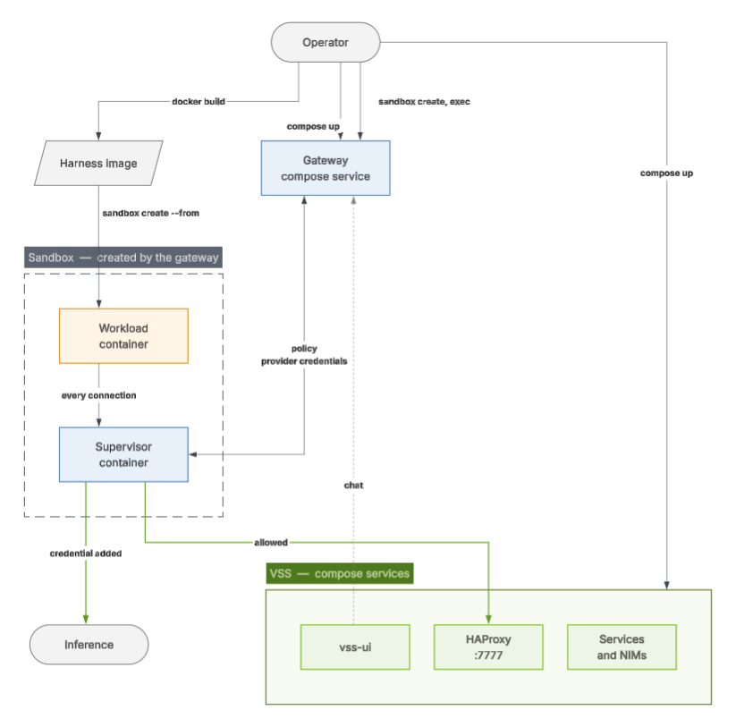
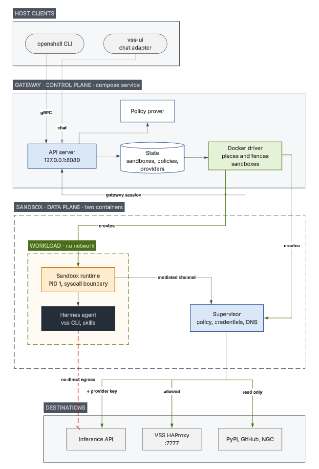
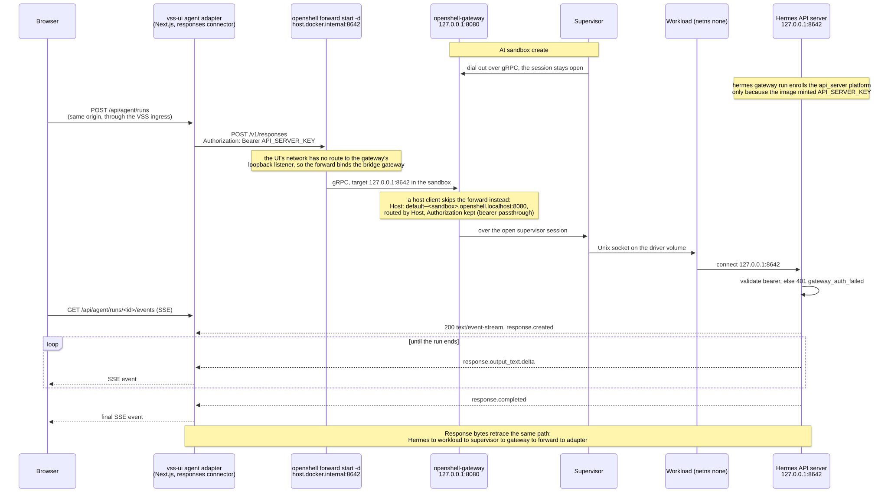
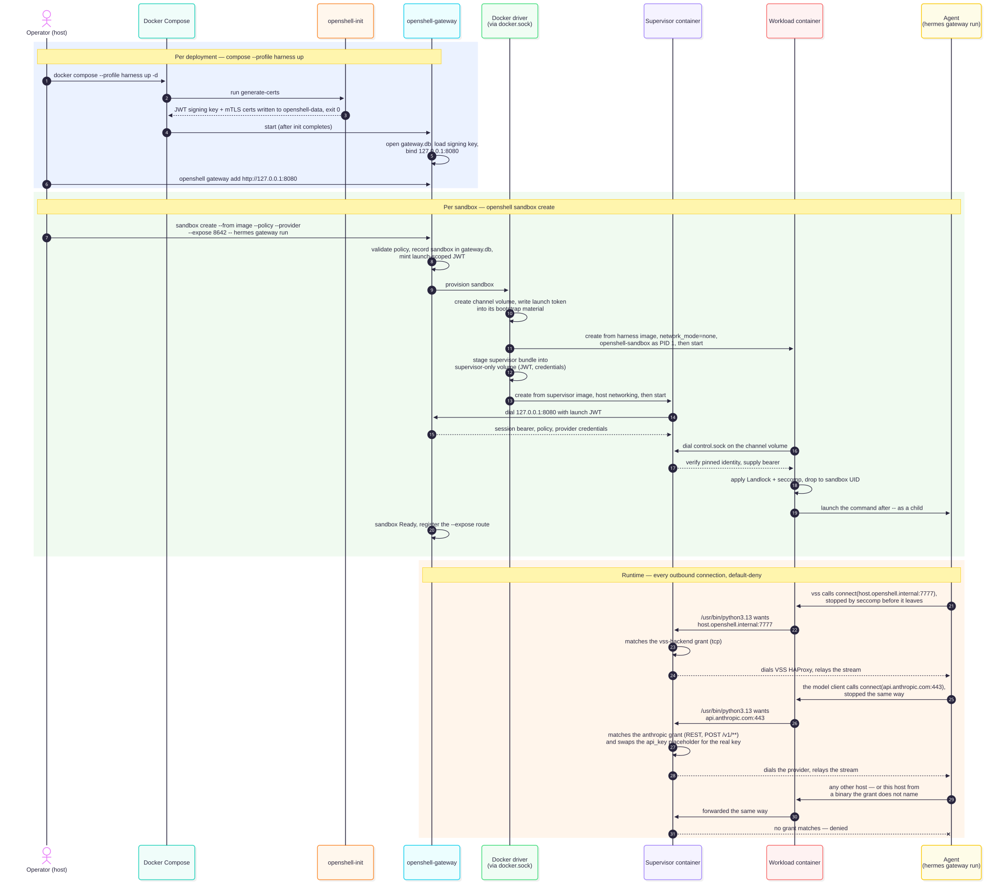

# Agent Harness on OpenShell

Runs an agent harness inside an
[OpenShell](https://docs.nvidia.com/openshell/latest/) 0.1.6 sandbox, with the
gateway declared as a Compose service. Brought up with the `openshell` CLI
from this checkout; no skill deploys it.

Sections 2 to 5 build a plain Hermes harness that reaches its own model and
the package hosts. [Adding VSS capabilities](#optional--add-vss-capabilities)
is optional, and for an operator who has a deployment to drive: a second image
layer and policy pair giving the agent the `vss` CLI, the operation skills and
a grant to reach VSS.

> **Note:** For why VSS drives OpenShell directly rather than through NemoClaw
> V1, see
> [`docs/nemoclaw-v1-vs-openshell.md`](docs/nemoclaw-v1-vs-openshell.md).

| File | Role |
|---|---|
| [`.env`](.env), [`gateway/docker-compose.yml`](gateway/docker-compose.yml), [`gateway/gateway.toml`](gateway/gateway.toml) | Step 1 — the `openshell-init` and `openshell-gateway` services and their version-2 gateway config |
| [`hermes/policy.yaml`](hermes/policy.yaml), [`hermes/boundary.yaml`](hermes/boundary.yaml) | Step 2 — the sandbox policy and the boundary ceiling `openshell-prover check` verifies it against |
| [`hermes/Dockerfile`](hermes/Dockerfile) | Step 3 — the harness image with the policy baked in, built from upstream Hermes source on a standard Ubuntu base |
| [`providers/`](providers/) — `agent-inference-profile.yaml`, `agent-inference-build-profile.yaml`, `agent-inference-local-profile.yaml` | Step 4 — provider profiles for the agent's own model: an OpenAI-compatible endpoint, `build.nvidia.com`, or a host-local model server |
| [`vss/`](vss/) — `Dockerfile`, `policy.yaml`, `boundary.yaml` | Optional — the VSS layer over the step 3 image, and the policy pair adding the `vss-backend` and `ngc` grants |

---

## 1. Architecture

Drawn for OpenShell 0.1.6, the release everything below was tested on. Both
diagrams show a sandbox with the optional VSS layer added, since that is the
arrangement with the most moving parts; the default sandbox is the same
picture with the VSS column and the `:7777` arrow removed.



- **Gateway** is the control plane, a Compose service behind the `harness`
  profile. It owns sandbox lifecycle and state,
  signs the only credentials in the system, delivers policy and provider
  credentials, and runs the policy prover. Its **compute driver** provisions
  each sandbox as two containers and builds the isolation boundary.
- **Workload** runs the harness image (Hermes and the baked policy, plus the
  skills and `vss` CLI when the VSS layer is built in)
  with networking turned off. Its only path out is the
  supervisor; if the supervisor exits, the agent is stopped rather than running
  unchecked.
- **Supervisor** is the trusted half and the only decision point. It checks every
  connection against the policy, then opens it: to the inference endpoint with
  the real credential added at egress, and — only where the VSS policy pair is
  in force — to HAProxy `:7777`. The agent never holds a key.
- **Gateway link** delivers policy and credentials to the supervisor and
  carries logs, exec sessions and the exposed harness API, whose `:8642` is the
  loopback target inside the sandbox; the URL itself is served on the gateway's
  own port under a per-sandbox hostname.

### Inside the boundary

The same deployment, one level down. The destinations are the only hosts the
sandbox can reach: the policy pair it was created with allows them, and the
provider profile supplies the key added to inference calls. VSS HAProxy is
among them only under `vss/policy.yaml`.



Splitting the sandbox into a workload and a supervisor container is what makes
the agent's own compromise survivable: the workload shares the boundary with
the agent, so it holds nothing worth stealing — no signing key, no gateway
JWT, no provider credential — and decides nothing. It reports what the agent
attempted; the supervisor decides. When the agent opens a connection, the
kernel stops the call and the runtime forwards it to the supervisor as
"`/usr/bin/python3.13` wants `host.openshell.internal:7777`". The supervisor
checks it against the `vss-backend` grant — present only in `vss/policy.yaml`,
so the default sandbox is refused here — and, if allowed, opens the connection
itself on the agent's behalf. An inference call takes the same path
and additionally gets the provider key added at egress, which is why VSS ships
the model's `api_key` as a placeholder. The runtime band of the [deploy
sequence](#what-openshell-deploys) draws both.

Each connection is a separate stream on one mutually authenticated HTTP/2
channel, so a slow download cannot block exec or process control, and the
workload freezes if that channel drops. The two JWTs are issued per sandbox and
per *generation*: restarting a sandbox mints fresh tokens and certificates and
invalidates the old ones.

### A chat turn end to end

The gateway hops were measured on 0.1.5 with a probe server; the Hermes end was
measured against the harness image.



**Deployed from the host.** This path assumes a VSS deployment, so the sandbox
is the one on the [VSS layer](#optional--add-vss-capabilities). Both are
deployed from the host and in that order: VSS by
[`vss-build-vision-ai`](../skills/vss-build-vision-ai/SKILL.md) or Compose,
then the harness against the running build with the `openshell` CLI. The agent
inside the sandbox drives VSS but never deploys or tears it down.

Drawn for the Compose deployment, where the gateway, the sandbox and the VSS
services share one Docker host. On Kubernetes the shape is the same with the
Kubernetes compute driver: the supervisor runs in its own pod, reaches the
workload over mutual TLS on a private Service, and a NetworkPolicy replaces
Docker's networking-off as the outer fence.


---

## 2. Quickstart

Brings up a Hermes sandbox against its own model; no VSS deployment needed.
Every file in the table above is pre-created: the Compose services and the
`OPENSHELL_TAG` they read, the version-2 gateway config, the policy and the
boundary it is proven against, the harness Dockerfile, and the provider
profiles. Section 4 is the same ground with the reasoning; §5 is how to check
the result.

First set the agent's own model in [`.env`](.env). The commands source it, so
its values replace any of the same name exported in the shell:

| Variable | Set it to |
|---|---|
| `HARNESS_BASE_URL` | The endpoint's OpenAI-compatible base URL. The default is the host `providers/agent-inference-profile.yaml` authorizes |
| `HARNESS_MODEL` | A model id that endpoint serves |
| `HARNESS_API_KEY` | The endpoint's key, unquoted. Never commit it |

A base URL on another host needs that host's profile; the recreate steps after
the Quickstart cover build.nvidia.com and a server on this host.

Then run from the repository root.

```bash
# 0. Install the openshell CLI and openshell-prover 0.1.6, the gateway's
#    release, into ~/.local/bin from the checksum-verified release tarballs.
mkdir -p ~/.local/bin && export PATH="$HOME/.local/bin:$PATH"
( cd "$(mktemp -d)" && V=0.1.6 A=$(uname -m) &&
  for p in openshell openshell-prover; do
    curl -fsSLO "https://github.com/NVIDIA/OpenShell/releases/download/v$V/$p-$A-unknown-linux-musl.tar.gz"
    curl -fsSLO "https://github.com/NVIDIA/OpenShell/releases/download/v$V/$p-checksums-sha256.txt"
    grep " $p-$A-unknown-linux-musl.tar.gz\$" "$p-checksums-sha256.txt" | sha256sum -c - &&
    tar -xzf "$p-$A-unknown-linux-musl.tar.gz" -C ~/.local/bin
  done )
openshell --version && openshell-prover --version     # both 0.1.6

cd .openshell
set -a; . ./.env; set +a          # OPENSHELL_TAG, HERMES_REF, HARNESS_*
case "$HARNESS_API_KEY" in ''|\"*|\'*) echo "HARNESS_API_KEY must be set, without quotes" >&2; false;; esac

# 1. Gateway. Idempotent: re-running it leaves a live gateway alone.
docker compose --env-file .env -f gateway/docker-compose.yml --profile harness up -d
openshell gateway add http://127.0.0.1:8080 --local --name openshell-gateway

# 2. Harness image: upstream Hermes and the baked policy.
docker build -t "openshell-hermes:$HERMES_REF" hermes

# 3. Inference provider. The profile authorizes the host; the provider seals the
#    key, which the proxy injects at egress so the agent never holds it.
openshell profile import -f providers/agent-inference-profile.yaml
openshell provider create --name agent-inference --type agent-inference \
  --credential HARNESS_API_KEY

# 4. Sandbox. The trailing command is the harness itself.
openshell sandbox create \
  --name hermes \
  --from "openshell-hermes:$HERMES_REF" \
  --policy hermes/policy.yaml \
  --provider agent-inference \
  --env HARNESS_BASE_URL="$HARNESS_BASE_URL" \
  --env HARNESS_MODEL="$HARNESS_MODEL" \
  --restart-policy on-failure \
  --expose 8642 --expose-authorization-mode bearer-passthrough --detach \
  -- sh -c 'chmod 770 /sandbox;
            trust-supervisor-ca
            C=/sandbox/.hermes/config.yaml
            sed -i -e "s#\${env:HARNESS_BASE_URL}#$HARNESS_BASE_URL#g" \
                   -e "s#\${env:HARNESS_MODEL}#$HARNESS_MODEL#g" "$C"
            E=/sandbox/.hermes/.env
            grep -q "^API_SERVER_KEY=" "$E" 2>/dev/null || {
              K=$(head -c 32 /dev/urandom | od -An -tx1 | tr -d " \n")
              printf "API_SERVER_KEY=%s\n" "$K" >> "$E"; }
            chmod 640 "$E"
            exec hermes gateway run'
```

From here the agent is reachable two ways:

```bash
# A shell turn
openshell sandbox exec -n hermes -- \
  hermes chat -Q -q 'Reply with the single word: pong'

# The API server, with the sandbox's API_SERVER_KEY as the bearer
KEY=$(openshell sandbox exec -n hermes --no-tty -- \
  sh -c '. /sandbox/.hermes/.env; printf %s "$API_SERVER_KEY"')
curl -s -H "Authorization: Bearer $KEY" -H 'Content-Type: application/json' \
  http://default--hermes.openshell.localhost:8080/v1/chat/completions \
  -d '{"model":"hermes-agent","messages":[{"role":"user","content":"What model are you running"}]}'
```

[Section 5](#5-verification) checks both, plus the policy proof.

To change the model, the endpoint or the key, or to start over, make the change
and then recreate the sandbox. The model and endpoint are fixed at create, and a
running API server never sees a new credential. The gateway, image and provider
all survive the recreate:

```bash
PROVIDER=agent-inference          # the Quickstart's provider

# 1. Make one change in .env. Skip this step to just start over.
#  a) A different model on the same endpoint: HARNESS_MODEL.
#  b) A different endpoint family, here build.nvidia.com: HARNESS_BASE_URL to
#     https://integrate.api.nvidia.com/v1, HARNESS_MODEL to a model id it
#     serves, HARNESS_API_KEY to its nvapi- key. The provider authorizes only
#     its profile's host, so the sandbox refuses any other base URL.
#  c) A new key for the current provider: HARNESS_API_KEY.

# 2. Re-read .env, then register the change with the gateway.
set -a; . ./.env; set +a
#  b) A provider for the new family. For a server on this host, use
#     agent-inference-local-profile.yaml instead; its key is optional.
openshell profile import -f providers/agent-inference-build-profile.yaml
openshell provider create --name agent-inference-build \
  --type agent-inference-build --credential HARNESS_API_KEY
PROVIDER=agent-inference-build
#  c) The new key on the current provider.
openshell provider update "$PROVIDER" --credential HARNESS_API_KEY

# 3. Delete the sandbox and create it again: the Quickstart's step 4 with
#    $PROVIDER.
openshell sandbox delete hermes
openshell sandbox create \
  --name hermes \
  --from "openshell-hermes:$HERMES_REF" \
  --policy hermes/policy.yaml \
  --provider "$PROVIDER" \
  --env HARNESS_BASE_URL="$HARNESS_BASE_URL" \
  --env HARNESS_MODEL="$HARNESS_MODEL" \
  --restart-policy on-failure \
  --expose 8642 --expose-authorization-mode bearer-passthrough --detach \
  -- sh -c 'chmod 770 /sandbox;
            trust-supervisor-ca
            C=/sandbox/.hermes/config.yaml
            sed -i -e "s#\${env:HARNESS_BASE_URL}#$HARNESS_BASE_URL#g" \
                   -e "s#\${env:HARNESS_MODEL}#$HARNESS_MODEL#g" "$C"
            E=/sandbox/.hermes/.env
            grep -q "^API_SERVER_KEY=" "$E" 2>/dev/null || {
              K=$(head -c 32 /dev/urandom | od -An -tx1 | tr -d " \n")
              printf "API_SERVER_KEY=%s\n" "$K" >> "$E"; }
            chmod 640 "$E"
            exec hermes gateway run'

# 4. Test it. The new sandbox minted a new API_SERVER_KEY, so fetch it again.
KEY=$(openshell sandbox exec -n hermes --no-tty -- \
  sh -c '. /sandbox/.hermes/.env; printf %s "$API_SERVER_KEY"')
curl -s -H "Authorization: Bearer $KEY" -H 'Content-Type: application/json' \
  http://default--hermes.openshell.localhost:8080/v1/chat/completions \
  -d '{"model":"hermes-agent","messages":[{"role":"user","content":"Which model are you?"}]}'
```

### Optional — add VSS capabilities

Gives the agent the `vss` CLI, the operation skills and the `vss_cli` tool
plugin, and the one grant that lets it reach a VSS deployment. Take it only
against a deployment that is already up.

First set the VSS layer's two values in [`.env`](.env), which likewise
replaces any shell export of them:

| Variable | Set it to |
|---|---|
| `VSS_REF` | A ref on `VSS_REPO` that the skills and the `vss` CLI are built from, at one reproducible version. The build fetches it rather than reading the working tree, so a local commit reaches the image only once it is pushed |
| `VSS_PUBLIC_URL` | The deployment's origin as the sandbox reaches it. The default, `http://host.openshell.internal:7777`, is a deployment on this host |

Both halves are needed. The image alone leaves a `vss` CLI the policy refuses
to let out; the policy alone grants reach to a sandbox with no CLI to use it.
Neither the image nor the policy can be swapped on a running sandbox, so this
replaces the sandbox from the Quickstart's step 4 rather than modifying it.

```bash
cd .openshell
set -a; . ./.env; set +a
TAG="${VSS_REF//\//-}-from-source"  # VSS_REF may be a branch; a Docker tag cannot hold "/"

# a. The VSS layer, built on the harness image from the Quickstart's step 2
#    (openshell-hermes:$HERMES_REF).
docker build --build-arg HARNESS_IMAGE="openshell-hermes:$HERMES_REF" \
  --build-arg VSS_REF="$VSS_REF" -t "openshell-hermes-vss:$TAG" vss

# b. Replace the sandbox with one on the VSS image and the VSS policy. Same
#    create command as the Quickstart's step 4 otherwise, plus VSS_PUBLIC_URL.
openshell sandbox delete hermes
openshell sandbox create \
  --name hermes \
  --from "openshell-hermes-vss:$TAG" \
  --policy vss/policy.yaml \
  --provider agent-inference \
  --env VSS_PUBLIC_URL="$VSS_PUBLIC_URL" \
  --env HARNESS_BASE_URL="$HARNESS_BASE_URL" \
  --env HARNESS_MODEL="$HARNESS_MODEL" \
  --restart-policy on-failure \
  --expose 8642 --expose-authorization-mode bearer-passthrough --detach \
  -- sh -c 'chmod 770 /sandbox;
            trust-supervisor-ca
            C=/sandbox/.hermes/config.yaml
            sed -i -e "s#\${env:HARNESS_BASE_URL}#$HARNESS_BASE_URL#g" \
                   -e "s#\${env:HARNESS_MODEL}#$HARNESS_MODEL#g" "$C"
            E=/sandbox/.hermes/.env
            grep -q "^API_SERVER_KEY=" "$E" 2>/dev/null || {
              K=$(head -c 32 /dev/urandom | od -An -tx1 | tr -d " \n")
              printf "API_SERVER_KEY=%s\n" "$K" >> "$E"; }
            chmod 640 "$E"
            exec hermes gateway run'

# c. Point the CLI at VSS, then re-select the skills those services can serve.
openshell sandbox exec -n hermes -- vss configure --base-url "$VSS_PUBLIC_URL"
openshell sandbox exec -n hermes -- vss-hermes-sync
```

Step c prints which command groups the deployment can serve and which skills
went active; a partial deployment is normal, and the inactive skills name the
service they wanted. [Section 5](#5-verification) has the two extra checks
this layer adds.

### Optional — answer from the VSS UI

Builds on the VSS layer above, so take that one first: this points a VSS
deployment's own UI at the sandbox, and a deployment is what supplies the UI.
Skip it to reach the agent through `hermes chat` or the API server instead.
Deploying VSS itself is
[`vss-build-vision-ai`](../skills/vss-build-vision-ai/SKILL.md)'s job;
`<build>` below is the `_builds/<name>` it wrote.

Nothing moves on the browser's side: it still enters through the deployment's
ingress, and `vss-ui` stays on its Compose network, which HAProxy resolves it
by. Only the UI's own outbound hop is new, and it cannot be the gateway-managed
URL — step 1 binds the gateway to the host's loopback, which a bridged
container has no route to. Publish the sandbox's API server on the address
`host.docker.internal` already resolves to inside the UI container instead:

```bash
HG=$(docker network inspect bridge -f '{{(index .IPAM.Config 0).Gateway}}')
openshell forward start -d "$HG:8642" hermes   # do not pipe: -d holds the pipe open
```

`-d` reparents the forward to init, so it outlives the terminal;
`openshell forward list` names it and `openshell forward stop 8642 hermes` ends
it. Only the agent's port crosses; the gateway's own listener, whose user API
is unauthenticated, stays on loopback. Nothing
restarts it after a reboot, and a recreated sandbox invalidates both the
forward and the key below, so redo this step and the next one together.

Then give the adapter the endpoint and the key. `AGENT_BACKEND_PATH` keeps its
`/v1/responses` default:

```bash
openshell sandbox exec -n hermes --no-tty -- \
  sh -c '. /sandbox/.hermes/.env; printf %s "$API_SERVER_KEY"'   # the token below
```

A build that is already up carries its resolved values in `resolved.yml`, so
recreate the one service against an overlay rather than editing what the
resolver wrote:

```yaml
# _builds/<build>/ui-hermes.override.yml
services:
  vss-ui:
    environment:
      AGENT_ADAPTER_ENABLED: "true"
      AGENT_BACKEND_PROTOCOL: responses
      AGENT_BACKEND_URL: http://host.docker.internal:8642
      AGENT_BACKEND_MODEL: hermes-agent
      AGENT_BACKEND_TOKEN: "<API_SERVER_KEY>"
      NEXT_PUBLIC_AGENT_ADAPTER_ENABLED: "true"
      NEXT_PUBLIC_FORCE_HTTP_CHAT_TRANSPORT: "true"
      NEXT_PUBLIC_ENABLE_CHAT_SIDEBAR: "true"
      NEXT_PUBLIC_ENABLE_CHAT_TAB: "true"
```

```bash
cd _builds/<build>
docker compose -p "$(docker inspect vss-agent-ui \
  --format '{{index .Config.Labels "com.docker.compose.project"}}')" \
  -f resolved.yml -f ui-hermes.override.yml up -d --no-deps vss-ui
```

A build that is not up yet takes the same settings in
`_builds/<build>/override.env`: the adapter keys under a `VSS_` prefix
(`VSS_AGENT_ADAPTER_ENABLED` and so on), from which the resolver derives the
two `NEXT_PUBLIC_` adapter flags, plus `NEXT_PUBLIC_ENABLE_CHAT_SIDEBAR` and
`NEXT_PUBLIC_ENABLE_CHAT_TAB`, which a harness build leaves `false` for lack
of an in-stack agent.

Verify through the ingress, not the container, so the check covers the path the
browser takes — `<origin>` is the deployment's own origin:

```bash
curl -s <origin>/api/agent/connection          # -> {"state":"connected"}
curl -s -X POST <origin>/api/agent/runs -H 'Content-Type: application/json' \
  -d '{"thread_id":"t1","input":[{"role":"user","content":"List the VIOS sensors."}]}'
curl -s <origin>/api/agent/runs/<run_id>/events
```

The reply streams back as `message.delta` events, with each `vss` call shown as
a tool event before them. This connects the two chat surfaces only: the Search
tab and the ingress `/api`, `/chat` and `/websocket` routes address the
in-stack `vss-agent`, which a harness build does not run.

---

## 3. How OpenShell works

### What the gateway is

OpenShell's control plane. One long-lived container per deployment, the only
component that touches the container backend, with a single listener that
serves both the CLI/SDK and the supervisors dialing in. Per the
[architecture page](https://docs.nvidia.com/openshell/about/architecture), it
creates each sandbox as two parts — a trusted **supervisor** and an isolated
**workload** — keeps their state in SQLite or Postgres, issues the JWTs that
bind them, and delivers policy and provider credentials to the supervisor.

Enforcement is not its job — that belongs to the supervisor, below. Logs,
Prometheus metrics and OCSF audit records flow back through the gateway.

One sandbox is therefore two containers, and the trust split lands on that
boundary. The supervisor is the fragile half: on 0.1.6, if it exits, the driver
marks the sandbox `ControlSupervisorExited` and stops the workload — the
failure mode [#11997](https://github.com/NVIDIA/NemoClaw/issues/11997) reports.
A restart brings up a fresh supervisor and keeps the workload's files, not its
process.

### What the supervisor is

The trusted half of a sandbox, one per sandbox, and the only component that
decides anything at runtime. The gateway creates it and hands it the policy and
the provider credentials; from there every connection the agent attempts is
matched against that policy, credentialed, resolved and dialed by the
supervisor on the agent's behalf. The workload has no network of its own, so
there is no second path out. *What OpenShell enforces* below covers the rules it
applies; what matters here is where it comes from and what that costs.

**It ships with the gateway, not with the harness image.** On 0.1.x both halves
come from images the gateway is configured with — `openshell-sandbox` copied
into the workload as PID 1, `openshell-supervisor` run as a companion container
— so the supervisor's version tracks the gateway, not `.openclaw/Dockerfile`.
Moving to 0.1.x is therefore a gateway upgrade, not an image rebuild.

That also means a containerised gateway no longer needs its data directory at
the same absolute path on host and container. The upstream Compose recipe still
says it does, but at v0.1.5 the driver's `build_binds` returns nothing and its
README states "No workload launch depends on a host bind mount".

### What OpenShell deploys

The first three rows are declared once per deployment in VSS's Compose file
(§4 step 1). The rest are made by the gateway's compute driver — Docker here,
selected by `compute_driver = "docker"` — through the host's Docker socket on
each `sandbox create`. The driver builds the boundary but never makes a policy
decision.

| Resource | Process | Contents and networking |
|---|---|---|
| **Per deployment** — Compose, `harness` profile | | |
| `openshell-init` container | `generate-certs`, then exits | One-shot: writes the JWT signing keys and mTLS certificates into the data volume |
| `openshell-gateway` container | `openshell-gateway` | Host networking, one listener on `127.0.0.1:8080` for the CLI, SDK and supervisors, health on `:8081`; mounts the Docker socket |
| `openshell-data` volume | — | `gateway.db` (SQLite record of every sandbox), the JWT signing key, and the key-encryption key that seals provider credentials |
| **Per sandbox** — the Docker driver | | |
| Workload container | `openshell-sandbox` as PID 1, the harness (`hermes gateway run`) as its child | The harness image, `network_mode=none`, one non-root UID, all capabilities dropped |
| Supervisor container | `openshell-supervisor` | From the supervisor image, host networking; dials the gateway and makes every outbound connection |
| Channel volumes | — | Sandbox bootstrap keys, and the Unix socket the two containers speak over — never the network |
| Supervisor-only volume | — | The supervisor's JWT and gateway credentials; never mounted into the workload |



0.1.6 reversed which end of that socket dials the other, which imposes a
version rule: a new sandbox needs matching supervisor and sandbox-runtime
binaries, so step 1 pins both images with the gateway.

The per-sandbox rows are siblings of the gateway container, not part of any
Compose project: `compose down` leaves them running, and `openshell sandbox
delete` removes both containers and their volumes.

### What OpenShell enforces

The security boundary is OpenShell's, and it sits outside the agent's trust
domain, so a compromised agent cannot switch it off:

- **Filesystem and syscalls** — Landlock confinement and seccomp filtering, in
  the kernel.
- **Network** — default-deny; a connection is allowed only when its
  destination *and* calling binary match the same policy block. On 0.1.x the
  workload has no network at all and reaches out only through the supervisor.
- **Credentials** — the agent sees an `openshell:resolve:env:<KEY>`
  placeholder; the real secret is added at egress for approved endpoints only.
- **Process** — non-root identity (root is rejected), and the image's
  `ENTRYPOINT` is replaced by the supervisor.
- **Policy changes** — the prover checks each change before approval and flags
  new credentialed reach, new HTTP methods and cloud-metadata access.


---

## 4. Steps

**1 — Gateway becomes a Compose service.** Decided: the gateway is a container
VSS declares. OpenShell publishes a reference
[`deploy/docker/docker-compose.yml`](https://docs.nvidia.com/openshell/latest/how-it-works/gateways/container-deployment)
to start from:

```yaml
services:
  openshell-init:                # one-shot: writes the sandbox JWT signing
    image: ghcr.io/nvidia/openshell/gateway:${OPENSHELL_TAG}  # keys the Docker
    profiles: [harness]                                       # driver requires
    command: [generate-certs, --output-dir, /var/lib/openshell/tls]
    user: "0"                    # seeds a root-owned fresh named volume
    environment: { HOME: /var/lib/openshell }
    volumes: [openshell-data:/var/lib/openshell]
  openshell-gateway:
    image: ghcr.io/nvidia/openshell/gateway:${OPENSHELL_TAG}
    profiles: [harness]          # never materialises for a no-harness build
    depends_on: { openshell-init: { condition: service_completed_successfully } }
    restart: unless-stopped
    network_mode: host           # the supervisor dials the host's own loopback
    command: ["--bind-address", "127.0.0.1", "--port", "8080"]
    user: "0"                    # as upstream: uid 1000 can't read the keys or socket
    environment:
      OPENSHELL_GATEWAY_CONFIG: /etc/openshell/gateway.toml
      OPENSHELL_DB_URL: "sqlite:/var/lib/openshell/gateway.db?mode=rwc"  # barred from the TOML
      XDG_DATA_HOME: /var/lib/openshell
      HOME: /var/lib/openshell
    volumes:
      - /var/run/docker.sock:/var/run/docker.sock
      - openshell-data:/var/lib/openshell
      - ./gateway.toml:/etc/openshell/gateway.toml:ro
volumes:
  openshell-data: {}
```

`gateway.toml` is upstream's
[`deploy/docker/gateway.toml`](https://github.com/NVIDIA/OpenShell/blob/v0.1.6/deploy/docker/gateway.toml),
with `health_bind_address` on loopback and the
JWT key paths `init` writes. Three edits VSS has to make to it:

- **Pin `sandbox_runtime_image` and `supervisor_image` to the gateway's
  release.** Upstream ships both as `latest`. Since 0.1.6 a new sandbox
  requires matching supervisor and sandbox-runtime binaries, so a drifting tag
  is a sandbox that refuses to start, not a version-hygiene nicety.
- **Write the version 2 schema.** 0.1.5 rejects a `version = 1` file:
  `this build requires version 2; migrate legacy fields`. The renames that
  bite, each a separate startup failure: `compute_drivers = ["docker"]` becomes
  `compute_driver = "docker"`, `[openshell.drivers.docker].sandbox_namespace`
  is gone, and `gateway_jwt.ttl_secs = 0` is refused as "expected a nonzero
  u64".
- **Decide the authentication posture, and configure the sandbox JWT
  regardless.** 0.1.6 refuses to start unless some user authentication is
  configured; upstream's recipe takes the opt-out,
  `allow_unauthenticated_users = true`, which is defensible only because the
  listener is on loopback — it means any process on the host can drive the
  control plane, so a shared host needs the mTLS certificates `init` already
  writes. The opt-out does not cover the Docker driver's separate requirement:
  without a `[openshell.gateway.gateway_jwt]` block the gateway starts and
  serves happily, then fails every `sandbox create` with `docker sandboxes
  require launch-scoped gateway authentication`. That is what `openshell-init`
  above is for.

```bash
docker compose --env-file .env -f gateway/docker-compose.yml --profile harness up -d
openshell gateway add http://127.0.0.1:8080 --local --name openshell
```

Three constraints the service has to respect:

- **Host networking, loopback bind.** `supervisor_network_mode` defaults to
  `host`, so the supervisor shares the host's network namespace and dials
  `127.0.0.1:<gateway port>` when no `grpc_endpoint` is set. Putting the
  gateway on host networking too means there is no published port to get wrong
  and no bridge peers that can reach it; a LAN machine dialling `127.0.0.1`
  only ever reaches itself. Do not switch the supervisor to `bridge`: it would
  then have its own loopback, and the driver rejects a loopback-only gateway
  for it. Binding the listener anywhere a container can reach — a dedicated
  Compose network joined by `vss-ui`, say — trades a boundary Docker enforces
  for one a network declaration enforces, and whoever reaches the listener can
  create sandboxes and read credentials while `allow_unauthenticated_users` is
  `true`. The UI needs no such widening: a forward publishes the one port it
  calls.
- **Pass the bind flags explicitly.** The image's `CMD` is `--bind-address
  0.0.0.0 --port 8080` and flags beat the TOML, so the TOML's `bind_address` is
  ignored unless the command is replaced. Name the flags rather than clearing
  the command with `command: []`, which Compose treats as unset.
- **Docker socket, not privilege.** This is Docker-outside-of-Docker: the
  gateway creates sibling containers on the host. It needs read/write on the
  socket, which upstream's recipe gets with `user: "0"` — never
  `--privileged`. A `group_add` of the docker GID is not enough on its own:
  the image's declared UID 1000 has no `/etc/passwd` entry and no writable
  state directory, so it cannot read the keys `init` wrote either. Root in the
  gateway container is why the listener stays on loopback.

The data directory is a named volume, and needs backups rather than being
treated as cache: it holds the SQLite record of every sandbox, the JWT signing
key, and the key-encryption key that provider credentials are sealed with.
Keeping it across `compose down` is what keeps sandboxes' gateway records.

**One project, one profile.** The gateway sits in the VSS project behind the
`harness` profile, so a deployment stays one `compose up` and one `compose
down`, and a no-harness build — the correct outcome for one that only ingests,
indexes or serves an API — never materialises a Docker-socket mount it would
not use. Ordering is not a reason to split the projects: the harness is
installed against a build that is already running. The sandbox still never
becomes a service; Compose owns the gateway, and the gateway owns the sandboxes
it creates as siblings.

**Why not the installer.** No CLI verb provisions a gateway, so the only
alternative is OpenShell's installer, which runs the same binary under a
systemd user unit. Declaring the Compose service instead keeps the image tag,
port and mounts under review with the rest of the stack rather than as host
state. The cost is the socket mount above.

**2 — Convert the policy and prove it.** Translate the preset to OpenShell policy
YAML, then verify the result rather than eyeballing it.

There are two candidate/ceiling pairs, because a sandbox takes a single
`--policy` file and the VSS grant cannot be an overlay on one.
`hermes/policy.yaml` is the default: the agent's own model endpoint and the
package hosts. `vss/policy.yaml` is that file plus `vss-backend` and `ngc`,
and is what the [VSS layer](#optional--add-vss-capabilities) creates against.
Everything before `network_policies` is identical in the two, by requirement
rather than convention — the prover compares those sections verbatim.

Each is per-harness because OpenShell matches a connection on its destination
*and* its calling binary, so the `binaries` lists below are what make these
Hermes's rather than OpenClaw's:

```yaml
version: 1
filesystem_policy:
  read_only:  [/usr, /bin, /sbin, /lib, /lib64, /etc, /opt, /proc]
  read_write: [/sandbox, /tmp, /dev/null, /dev/urandom]
landlock: { compatibility: best_effort }
process:  { run_as_user: "998", run_as_group: "999" }   # `sandbox` in the image
network_policies:
  anthropic:                     # hermes/policy.yaml and vss/policy.yaml
    name: anthropic
    endpoints:
      - host: api.anthropic.com
        port: 443
        protocol: rest
        enforcement: enforce     # audit-mode REST is `unsupported`, not a pass
        rules:
          - allow: { method: POST, path: "/v1/**" }
    binaries: [{ path: /usr/bin/python3.13 }]
  vss-backend:                   # vss/policy.yaml only
    name: vss-backend-readwrite
    endpoints:
      - { host: host.openshell.internal, port: 7777, protocol: tcp }
    binaries: [{ path: /usr/bin/python3.13 }]
  # ... pypi and github in both, ngc in vss/policy.yaml
```

**`binaries` must name the interpreter, not the launcher.** OpenShell matches a
process by the real path the kernel reports, and every `hermes` entry point in
the image is a Python script, so no process ever carries one of those paths —
the connection is opened by `/usr/bin/python3.13`. OpenShell's documentation
makes the same point with `pip`. Inspecting the image also gives `sandbox` as
`998:999`, where the OpenClaw base has `998:998`, so one boundary file cannot
cover both harnesses: the prover compares process identity and exact
binary paths, and the two images agree on neither.

**A plain TCP grant is `protocol: tcp`, not the preset's `access: full`, and an
L4 grant cannot share a named policy with REST rules.** That is why the VSS
port and the harness's REST hosts are separate named entries above.

The `allowed_ips` the preset carries from 0.0.116 are dropped above: with the
default host-mode supervisor the driver publishes host loopback as the backend
address for `host.openshell.internal`, so the `172.17.0.0/16`-style grants
match nothing.

Each candidate has its own ceiling, written once by hand. Same paths and same
binaries, deliberately wider where it matters — every method on Anthropic
rather than `POST /v1/**`:

```yaml
version: 1
filesystem_policy:
  read_only:  [/usr, /bin, /sbin, /lib, /lib64, /etc, /opt, /proc]
  read_write: [/sandbox, /tmp, /dev/null, /dev/urandom]
landlock: { compatibility: best_effort }
process:  { run_as_user: "998", run_as_group: "999" }
network_policies:
  harness-rest-max:              # hermes/boundary.yaml and vss/boundary.yaml
    name: harness-rest-max
    endpoints:
      - host: api.anthropic.com
        port: 443
        protocol: rest
        enforcement: enforce
        rules:
          - allow: { method: GET,  path: "/**" }
          - allow: { method: POST, path: "/**" }
    binaries: [{ path: /usr/bin/python3.13 }]
  vss-backend-max:               # vss/boundary.yaml only. L4 only; mixing
    name: vss-backend-max        # REST in here is `unsupported`
    endpoints:
      - { host: host.openshell.internal, port: 7777, protocol: tcp }
    binaries: [{ path: /usr/bin/python3.13 }]
```

```bash
openshell-prover check hermes/policy.yaml --boundary hermes/boundary.yaml
openshell-prover check vss/policy.yaml    --boundary vss/boundary.yaml
# result: within_boundary
# coverage: domains=filesystem,network_l4,network_rest,process,landlock
```

Both files must name the **same** filesystem paths and the same exact binary
paths: a candidate `/tmp/cache` under a boundary `/tmp`, or `/usr/bin/curl` under
a boundary glob `/usr/bin/*`, returns `unsupported` rather than passing, because
an image symlink could redirect either. The prover also refuses policies using
GraphQL or MCP rules rather than ignoring them, so the result is honest about
what it covered.

**3 — Build the image and bake the policy in**, so one artifact carries the
harness and the access boundary it is proven against.
[`hermes/Dockerfile`](hermes/Dockerfile) builds it in one pass from upstream
Hermes on `nvcr.io/nvidia/base/ubuntu:24.04`, with no NemoClaw image
underneath; why that rather than deriving from `hermes-sandbox` is in
[`docs/nemoclaw-v1-vs-openshell.md`](docs/nemoclaw-v1-vs-openshell.md#removing-the-last-nemoclaw-dependency-the-base-image).

```bash
docker build -t "openshell-hermes:$HERMES_REF" .openshell/hermes
```

The image is tagged by `HERMES_REF` rather than a VSS ref because nothing in
it comes from VSS: a Hermes bump produces a new tag instead of overwriting the
old one, and a VSS commit does not invalidate it at all.

[`vss/Dockerfile`](vss/Dockerfile) is the optional second build. It takes this
image as its base and adds the `vss` CLI, the operation skills, the workspace
docs and the `vss_cli` plugin at one `VSS_REF`, then replaces the baked policy
with `vss/policy.yaml`. Layering rather than branching one Dockerfile on a
build arg is what keeps the default image provably free of VSS — there is no
flag to get wrong, because the content is not in the file.

Two things the images leave to the start command in step 5, both because of
what 0.1.6 changed:

- **CA bundle.** certifi's `cacert.pem` is a real file and the supervisor's CA
  is mounted only once the sandbox exists, so the image ships
  `trust-supervisor-ca` to append
  `/run/openshell-supervisor-ca/material/ca-bundle.crt` to it.
- **Inference target.** 0.1.6 replaced managed inference routes with
  sandbox-scoped provider attachments, which makes the base URL and the model
  the workload's to set, so `config.yaml` carries them as
  `${env:HARNESS_BASE_URL}` and `${env:HARNESS_MODEL}`.

The model `api_key` is `${env:HARNESS_API_KEY}`, the name every provider
profile declares, so whichever provider is attached fills it with the proxy's
placeholder, which the proxy swaps for the real key at egress.

The NGC CLI is in neither image, so under the VSS layer an operation skill
that resolves a sample video by name fails and the `ngc` entry in
`vss/policy.yaml` never matches.

Precedence is `--policy` > `OPENSHELL_SANDBOX_POLICY` > image policy > built-in
default. Keep the runtime-discovered parts — `allowed_ips` from
`orchestrator_mcp_helper.sandbox_host_cidrs`, the `.invalid` Kubernetes ingress
placeholder — on `--policy` at create, or accept the documented fallback CIDRs
for Compose.

**4 — Register the inference provider:**

```yaml
# .openshell/providers/agent-inference-profile.yaml
id: agent-inference
display_name: Agent inference
category: inference
inference_capable: true
credentials:
  - name: api_key
    env_vars: [HARNESS_API_KEY]
    required: true
    auth_style: bearer
    header_name: authorization
endpoints:
  - host: inference-api.nvidia.com
    port: 443
    protocol: rest
    enforcement: enforce
    rules:
      - allow: { method: POST, path: "/v1/**" }
binaries:
  - { path: /usr/bin/python3.13 }     # /usr/local/bin/node, for OpenClaw
```

```bash
openshell profile lint   -f .openshell/providers/agent-inference-profile.yaml
openshell profile import -f .openshell/providers/agent-inference-profile.yaml
HARNESS_API_KEY=... openshell provider create \
  --name agent-inference --type agent-inference --credential HARNESS_API_KEY
```

`--credential KEY` reads the value from the environment, which is the form a
custom profile needs: `--from-existing` has no stored credentials to read. The
CLI has to be the gateway's own release, since the two speak Protobuf.

The profile is per endpoint family, because it is what authorizes the host.
One file each covers the three endpoint choices, and step 5 names the one it
imported:

| Endpoint | Profile | `HARNESS_API_KEY` |
|---|---|---|
| (a) OpenAI-compatible endpoint | `providers/agent-inference-profile.yaml` | the endpoint's key |
| (b) model served on this host | `providers/agent-inference-local-profile.yaml` | optional |
| (c) build.nvidia.com | `providers/agent-inference-build-profile.yaml` | an `nvapi-` key |

A server on a port (b) does not declare is unreachable until the profile
declares it. Within a family the model id is free, and step 5 sets it.

**5 — Create the sandbox and expose the harness API:**

```bash
openshell sandbox create \
  --name hermes \
  --from openshell-hermes:$HERMES_REF \
  --policy hermes/policy.yaml \
  --provider agent-inference \
  --env HARNESS_BASE_URL=https://inference-api.nvidia.com/v1 \
  --env HARNESS_MODEL=aws/anthropic/bedrock-claude-opus-5 \
  --restart-policy on-failure \
  --expose 8642 --expose-authorization-mode bearer-passthrough --detach \
  -- sh -c 'chmod 770 /sandbox;
            trust-supervisor-ca
            C=/sandbox/.hermes/config.yaml
            sed -i -e "s#\${env:HARNESS_BASE_URL}#$HARNESS_BASE_URL#g" \
                   -e "s#\${env:HARNESS_MODEL}#$HARNESS_MODEL#g" "$C"
            E=/sandbox/.hermes/.env
            grep -q "^API_SERVER_KEY=" "$E" 2>/dev/null || {
              K=$(head -c 32 /dev/urandom | od -An -tx1 | tr -d " \n")
              printf "API_SERVER_KEY=%s\n" "$K" >> "$E"; }
            chmod 640 "$E"
            exec hermes gateway run'

openshell policy get hermes --full         # verify effective policy
```

The [VSS layer](#optional--add-vss-capabilities) recreates this sandbox with
`--from openshell-hermes-vss:$TAG`, `--policy vss/policy.yaml` and one more
`--env VSS_PUBLIC_URL`; nothing else about the command changes. Neither the
image nor the policy can be swapped on a live sandbox, which is why it is a
delete and a create rather than an update.

To verify, run the CLI agent, then the API server the UI uses:

```bash
openshell sandbox exec -n hermes -- \
  hermes chat -Q -q 'Reply with the single word: pong'

KEY=$(openshell sandbox exec -n hermes --no-tty -- \
  sh -c '. /sandbox/.hermes/.env; printf %s "$API_SERVER_KEY"')
curl -s -H "Authorization: Bearer $KEY" -H 'Content-Type: application/json' \
  http://default--hermes.openshell.localhost:8080/v1/chat/completions \
  -d '{"model":"hermes-agent","messages":[{"role":"user","content":"Reply with: pong"}]}'
```

`sandbox connect` attaches to the main process's output, not a shell — detach
with Ctrl-P Ctrl-Q, since Ctrl-C reaches `hermes gateway run`. For a shell, use
`openshell sandbox exec -n hermes --tty -- bash`. A `Connection error` from the
agent means the proxy denied the call; the supervisor container's log names the
host and reason.

**The two `--env` values are the model choice, and the `sed` is what makes
them stick.** They replace `NEMOCLAW_ENDPOINT_URL`/`NEMOCLAW_MODEL`, so a
redeploy against a different model is a flag rather than a rebuild. Rendering
them into the file is not redundant: `hermes chat` expands a `${env:}` ref, but
the API server the UI talks to reads the file as written and sends the
placeholder as the model id, which the endpoint rejects with `HTTP 403`. The
model `api_key` ref needs no rendering — the proxy replaces the bearer either
way.

**The trailing command is the harness itself, not a start script.** OpenShell
treats it as the sandbox's canonical main process: it streams the output and
returns the exit status, so a dead agent surfaces as `Error` with
`MainProcessFailed` instead of a healthy-looking container. The image's own
`CMD ["sleep", "infinity"]` only keeps an exec-driven sandbox alive and
watches nothing.

**The rest of the command is three preconditions, none of which a launcher
baked into the image could meet.** Hermes's secret-boundary guard requires
`/sandbox` to be group-readable, which OpenShell does not leave it, and
`API_SERVER_KEY` in `/sandbox/.hermes/.env` at mode 640 rather than in the
environment — a file the image deliberately ships without, so the key is minted
per sandbox. `trust-supervisor-ca` is third, and has to run here because
the CA it appends is mounted only once the sandbox exists. A script in the
image could do none of it: a root PID 1 is what the gateway's policy validation
refuses.

`--expose` publishes one of the sandbox's loopback ports at a URL the gateway
manages, so the path becomes client → gateway listener → supervisor → sandbox
with no host-side forward process in it. The URL is
`http://<workspace>--<sandbox>.openshell.localhost:<gateway port>/` — the
gateway's **own** listener, routed by `Host`, so the exposed port is a target
rather than an address and `--expose 8642` publishes nothing on 8642.
`openshell.localhost` is the built-in default domain, so reaching it needs no
certificate, SAN or DNS work; `--server-san` is what admits a different domain,
and is the knob the Brev check below turns. Measured against gateway 0.1.5,
and `bearer-passthrough` re-confirmed on 0.1.6: WebSocket upgrades and plain
HTTP both survive the route, and `bearer-passthrough` delivers the application
`Authorization` header intact where the default `strip` removes it — a bearer
`GET /v1/models` through the route returns Hermes's own `hermes-agent` model. Who can *reach* the route is set by the
bind in step 1, not by the route — the loopback bind is what refuses a
bridge-networked client, so putting the gateway on a network the UI can reach
is a decision about who may create sandboxes, not a data-path constraint.

**Expose `:8642`, the API server, not `:18789`, the dashboard.** The API server
is what the UI adapter talks to and where Hermes serves `/health`. It binds the
sandbox's own loopback at its documented default, because the image ships no
`API_SERVER_PORT`; note that `gateway.api_server.port` in `config.yaml` does
not move it, so overriding the port means `/sandbox/.hermes/.env`. OpenShell exposes a
loopback port from the inside, so `--expose 8642` reaches the API server
directly, with no forwarder in between.

The dashboard does not survive the route as shipped: Hermes refuses a WebSocket
upgrade whose `Host` or `Origin` does not match the address it bound, and the
gateway rewrites `Host` while preserving `Origin`, so the page loads and its
sockets close. Setting Hermes' `dashboard.public_url` to the routed origin
clears that, so routing the dashboard is a config decision rather than a dead
end; until then operators reach it with `openshell forward start 18789`, where
the browser origin is loopback.

Two forwards survive of three host-side processes: that one, and the UI's, from
the Quickstart's UI option. `dashboard-relay.py` exists only to reach a forward
pinned to loopback and `dashboard-forward-watchdog.py` only to repair one that
holds its port while carrying no HTTP — neither has a job once
`openshell forward start` binds the off-loopback address itself and nothing
retires the forward behind its back.

`--restart-policy` defaults to `no`, which leaves an exited Hermes dead and the
route silently unanswered; `on-failure` has the driver replace the runtime after
a nonzero main-process exit.

**Compose cannot declare the sandbox, so this step needs a script on both
sides.** `gateway.toml` has no sandbox section, and the containers the driver
creates are siblings Compose never sees — `compose down` leaves them running.
Wrap the commands above in one rerunnable script that skips only the `create`
when the sandbox already exists, so an interrupted first run is finished by the
next one, and pair it with a second that calls `openshell sandbox delete`
alongside `compose down`.

Still to confirm: exposed services use the gateway's own listener and TLS
configuration, so the managed URL has to be reachable through the Brev secure
link.

**The UI keeps its existing agent adapter.** The embedded adapter under
`services/ui/apps/nv-metropolis-bp-vss-ui/utils/server/agentAdapter/` already
connects browser chat to an external harness from inside the UI's Next.js
process — a Responses connector for Hermes, an OpenClaw native-WebSocket one,
session mapping, SSE replay, cancellation and snapshot-artifact validation. It
reaches the harness today at `ws://host.docker.internal:<relay-port>`, and
keeps that shape here: the Compose plumbing
(`VSS_AGENT_ADAPTER_ENABLED`, `VSS_AGENT_BACKEND_URL`) is already in place, and
the [Quickstart's UI option](#optional--answer-from-the-vss-ui) is the wiring.

The gateway-managed URL is not what the adapter points at. HAProxy resolves
`vss-ui` over Compose DNS, so the UI cannot leave that network, and from it the
gateway's loopback listener has no route; a detached `openshell forward start`
publishes the sandbox's `8642` on the bridge-gateway address
`host.docker.internal` already names, which leaves the listener untouched and
exposes only the agent's own port.

Hermes is served by the `responses` connector — already the default
`VSS_AGENT_BACKEND_PROTOCOL` in every profile — so `AGENT_BACKEND_PATH` keeps
its `/v1/responses` default and `AGENT_BACKEND_TOKEN` carries the
`API_SERVER_KEY`. Custom headers are a limit of the OpenClaw connector alone,
so Hermes' `X-Hermes-Session-Key` stays configuration rather than a code
change.

Measured against the harness image, the connector needs no changes: the wire
format it already sends is the stateful Responses semantics the API server
implements, `/health` answers unauthenticated, `/v1/responses` rejects a
missing or wrong bearer with `401 gateway_auth_failed`, and the minted key
returns the SSE event names the connector parses. Run end to end, a browser
turn through the deployment's ingress reaches Hermes, calls the `vss` CLI and
streams the reply back as `message.delta` events.


### Adding a second harness later

The work above is per-harness, so OpenClaw returns as a parallel set of the
same artifacts — no new code path, because OpenShell has no harness concept to
teach. Concretely: build `.openclaw/` to a second image, bake in
[`openclaw/policy.yaml`](openclaw/policy.yaml) — proven against
[`openclaw/boundary.yaml`](openclaw/boundary.yaml) — and the OpenClaw config,
and create with `-- openclaw gateway run --port 18789`. The policy differs from
Hermes's in three places: `binaries` name `/usr/local/bin/node`, since
`openclaw` is a Node script; it adds `clawhub.ai` and `openclaw.ai`; and the
process group is `998`.

Only two differences between the harnesses change anything structural (see
[What each manifest declares](docs/nemoclaw-v1-vs-openshell.md#what-each-manifest-declares)).
OpenClaw authenticates its dashboard by device pairing rather than a bearer
key, so the auto-approval that `nemoclaw-start` performed has to be replaced or
the pairing accepted by hand. And its `inference.provider_type` is
`gateway_managed` rather than a `base_url` key in its own config, so the step 4
provider attaches differently. Everything else — port, health path, config dir
and format, package binary — is data.


---

## 5. Verification

Four checks cover the default sandbox — the prover, the gateway, the exposed
route and the inference provider:

```bash
# 1. Policy stays inside the boundary ceiling
openshell-prover check .openshell/hermes/policy.yaml \
  --boundary .openshell/hermes/boundary.yaml
# -> result: within_boundary
# -> coverage: domains=filesystem,network_l4,network_rest,process,landlock

# 2. Sandbox reaches Ready and the effective policy matches what was baked
openshell sandbox list
openshell policy get hermes --full

# 3. Exposed route reaches Hermes's API server and bearer-passthrough preserves
#    the application Authorization header
curl -s -o /dev/null -w '%{http_code}\n' \
  -H 'Host: default--hermes.openshell.localhost' \
  http://127.0.0.1:8080/health                              # -> 200

KEY=$(openshell sandbox exec -n hermes -- \
  sed -n 's/^API_SERVER_KEY=//p' /sandbox/.hermes/.env)
curl -s -H 'Host: default--hermes.openshell.localhost' \
  -H "Authorization: Bearer $KEY" \
  http://127.0.0.1:8080/v1/models                           # -> 200, hermes-agent

# 4. End-to-end agent turn through the inference provider
openshell sandbox exec -n hermes -- \
  hermes chat -q "Reply with the single word: pong"
```

Check 1 is the only one that differs by path: a sandbox on the [VSS
layer](#optional--add-vss-capabilities) is proven against `vss/policy.yaml`
and `vss/boundary.yaml` instead. That layer also adds two checks of its own:

```bash
# 5. The CLI is present and the sandbox reaches VSS over the vss-backend grant
openshell sandbox exec -n hermes -- vss configure check
openshell sandbox exec -n hermes -- vss vios list

# 6. An agent turn that goes through the CLI rather than the model alone
openshell sandbox exec -n hermes -- \
  hermes chat -q "Run vss configure check and report which services are ok."
```

On the default sandbox both fail by design, and the two failures look
different: `vss` is not on `PATH` at all, where a sandbox built from the VSS
image but created with `hermes/policy.yaml` instead reports a connection
error, with the supervisor's log naming the refused host.
