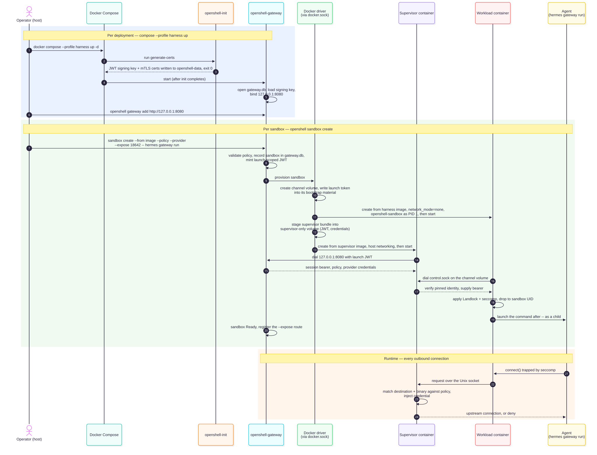
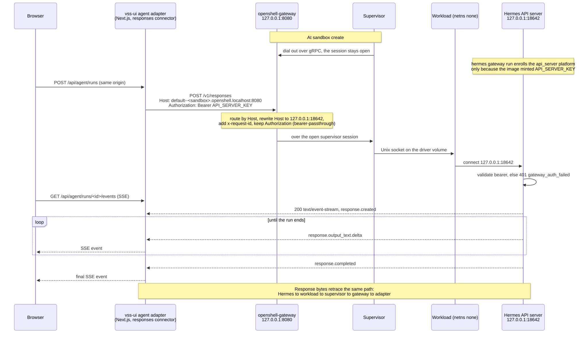

# VSS Agent Harness on OpenShell

Runs the VSS agent harness (Hermes today; OpenClaw on the same pattern) inside
an [OpenShell](https://docs.nvidia.com/openshell/latest/) 0.1.6 sandbox, with
the gateway declared as a Compose service alongside VSS and driven directly by
the `openshell` CLI or Python SDK.

For why VSS drives OpenShell directly rather than through NemoClaw V1, see
[`nemoclaw-v1-vs-openshell.md`](nemoclaw-v1-vs-openshell.md).

| File | Role |
|---|---|
| [`docker-compose.yml`](docker-compose.yml), [`.env`](.env), [`gateway.toml`](gateway.toml) | Step 1 — the `openshell-init` and `openshell-gateway` services and their version-2 gateway config |
| [`policy-hermes.yaml`](policy-hermes.yaml), [`boundary-policy.yaml`](boundary-policy.yaml) | Step 2 — the Hermes sandbox policy and the boundary ceiling `openshell-prover check` verifies it against |
| [`Dockerfile.policy`](Dockerfile.policy) | Step 3 — overlay on `vss-harness-hermes` that bakes the policy, links the 0.1.6 CA bundle path, and parameterises the inference endpoint and model |
| [`vss-inference-profile.yaml`](vss-inference-profile.yaml), [`vss-inference-build-profile.yaml`](vss-inference-build-profile.yaml), [`vss-inference-local-profile.yaml`](vss-inference-local-profile.yaml) | Step 4 — provider profiles for an OpenAI-compatible endpoint, `build.nvidia.com`, and a host-local model server |

---

## 1. How OpenShell works

### What the gateway is

OpenShell's control plane. One long-lived container per deployment, the only
component that touches the container backend, with a single listener that
serves both the CLI/SDK and the supervisors dialing in. Per the
[architecture page](https://docs.nvidia.com/openshell/about/architecture), it
creates each sandbox as two parts — a trusted **supervisor** and an isolated
**workload** — keeps their state in SQLite or Postgres, issues the JWTs that
bind them, and delivers policy and provider credentials to the supervisor.

Enforcement is not its job — that belongs to the supervisor, below. Logs,
Prometheus metrics and OCSF audit records flow back through the gateway.

One sandbox is therefore two containers, and the trust split lands on that
boundary. The supervisor is the fragile half: on 0.1.6, if it exits, the driver
marks the sandbox `ControlSupervisorExited` and stops the workload — the
failure mode [#11997](https://github.com/NVIDIA/NemoClaw/issues/11997) reports.
A restart brings up a fresh supervisor and keeps the workload's files, not its
process.

### What the supervisor is

The trusted half of a sandbox, one per sandbox, and the only component that
decides anything at runtime. The gateway creates it and hands it the policy and
the provider credentials; from there every connection the agent attempts is
matched against that policy, credentialed, resolved and dialed by the
supervisor on the agent's behalf. The workload has no network of its own, so
there is no second path out. *What OpenShell enforces* below covers the rules it
applies; what matters here is where it comes from and what that costs.

**It ships with the gateway, not with the harness image.** On 0.1.x both halves
come from images the gateway is configured with — `openshell-sandbox` copied
into the workload as PID 1, `openshell-supervisor` run as a companion container
— so the supervisor's version tracks the gateway, not `.openclaw/Dockerfile`.
Moving to 0.1.x is therefore a gateway upgrade, not an image rebuild.

That also means a containerised gateway no longer needs its data directory at
the same absolute path on host and container. The upstream Compose recipe still
says it does, but at v0.1.5 the driver's `build_binds` returns nothing and its
README states "No workload launch depends on a host bind mount".

### What OpenShell deploys

The first three rows are declared once per deployment in VSS's Compose file
(§3 step 1). The rest are made by the gateway's compute driver — Docker here,
selected by `compute_driver = "docker"` — through the host's Docker socket on
each `sandbox create`. The driver builds the boundary but never makes a policy
decision.

| Resource | Process | Contents and networking |
|---|---|---|
| **Per deployment** — Compose, `harness` profile | | |
| `openshell-init` container | `generate-certs`, then exits | One-shot: writes the JWT signing keys and mTLS certificates into the data volume |
| `openshell-gateway` container | `openshell-gateway` | Host networking, one listener on `127.0.0.1:8080` for the CLI, SDK and supervisors, health on `:8081`; mounts the Docker socket |
| `openshell-data` volume | — | `gateway.db` (SQLite record of every sandbox), the JWT signing key, and the key-encryption key that seals provider credentials |
| **Per sandbox** — the Docker driver | | |
| Workload container | `openshell-sandbox` as PID 1, the harness (`hermes gateway run`) as its child | The harness image, `network_mode=none`, one non-root UID, all capabilities dropped |
| Supervisor container | `openshell-supervisor` | From the supervisor image, host networking; dials the gateway and makes every outbound connection |
| Channel volumes | — | Sandbox bootstrap keys, and the Unix socket the two containers speak over — never the network |
| Supervisor-only volume | — | The supervisor's JWT and gateway credentials; never mounted into the workload |



0.1.6 reversed which end of that socket dials the other, which imposes a
version rule: a new sandbox needs matching supervisor and sandbox-runtime
binaries, so step 1 pins both images with the gateway.

The per-sandbox rows are siblings of the gateway container, not part of any
Compose project: `compose down` leaves them running, and `openshell sandbox
delete` removes both containers and their volumes.

### What OpenShell enforces

The security boundary is OpenShell's, and it sits outside the agent's trust
domain, so a compromised agent cannot switch it off:

- **Filesystem and syscalls** — Landlock confinement and seccomp filtering, in
  the kernel.
- **Network** — default-deny; a connection is allowed only when its
  destination *and* calling binary match the same policy block. On 0.1.x the
  workload has no network at all and reaches out only through the supervisor.
- **Credentials** — the agent sees an `openshell:resolve:env:<KEY>`
  placeholder; the real secret is added at egress for approved endpoints only.
- **Process** — non-root identity (root is rejected), and the image's
  `ENTRYPOINT` is replaced by the supervisor.
- **Policy changes** — the prover checks each change before approval and flags
  new credentialed reach, new HTTP methods and cloud-metadata access.


---

## 2. Architecture

Drawn for the 0.1.x target, not the deployed 0.0.116.



- **Gateway** is the control plane, a Compose service behind the `harness`
  profile. It owns sandbox lifecycle and state,
  signs the only credentials in the system, delivers policy and provider
  credentials, and runs the policy prover. Its **compute driver** provisions
  each sandbox as two containers and builds the isolation boundary.
- **Workload** runs the harness image (OpenClaw, VSS plugin, skills, `vss` CLI,
  baked policy) with networking turned off. Its only path out is the
  supervisor; if the supervisor exits, the agent is stopped rather than running
  unchecked.
- **Supervisor** is the trusted half and the only decision point. It checks every
  connection against the policy, then opens it: to HAProxy `:7777` and the
  orchestrator MCP `:9988` for VSS, and to external inference and chat services
  with the real credential added at egress. The agent never holds a key.
- **Gateway link** delivers policy and credentials to the supervisor and
  carries logs, exec sessions and the exposed harness API, whose `:18642` is the
  loopback target inside the sandbox; the URL itself is served on the gateway's
  own port under a per-sandbox hostname.

A chat turn from the VSS UI to Hermes. The gateway hops were measured on 0.1.5
with a probe server; the Hermes end was measured against the harness image.



**Deployed from the host.** VSS and the harness are both deployed from the
host — by notebooks, CI, or the `vss-build-vision-ai` coding agent. Each
deploys VSS first, then installs the harness against the running build. The
agent inside the sandbox drives VSS but never deploys or tears it down.

Drawn for the Compose deployment, where the gateway, the sandbox and the VSS
services share one Docker host. On Kubernetes the shape is the same with the
Kubernetes compute driver: the supervisor runs in its own pod, reaches the
workload over mutual TLS on a private Service, and a NetworkPolicy replaces
Docker's networking-off as the outer fence.


---

## 3. Steps

**1 — Gateway becomes a Compose service.** Decided: the gateway is a container
VSS declares, replacing the systemd unit NemoClaw installs today. OpenShell
publishes a reference
[`deploy/docker/docker-compose.yml`](https://docs.nvidia.com/openshell/latest/how-it-works/gateways/container-deployment)
to start from:

```yaml
services:
  openshell-init:                # one-shot: writes the sandbox JWT signing
    image: ghcr.io/nvidia/openshell/gateway:${OPENSHELL_TAG}  # keys the Docker
    profiles: [harness]                                       # driver requires
    command: [generate-certs, --output-dir, /var/lib/openshell/tls]
    user: "0"                    # seeds a root-owned fresh named volume
    environment: { HOME: /var/lib/openshell }
    volumes: [openshell-data:/var/lib/openshell]
  openshell-gateway:
    image: ghcr.io/nvidia/openshell/gateway:${OPENSHELL_TAG}
    profiles: [harness]          # never materialises for a no-harness build
    depends_on: { openshell-init: { condition: service_completed_successfully } }
    restart: unless-stopped
    network_mode: host           # the supervisor dials the host's own loopback
    command: ["--bind-address", "127.0.0.1", "--port", "8080"]
    group_add: ["988"]           # docker GID, numeric: distroless, no /etc/group
    environment:
      OPENSHELL_GATEWAY_CONFIG: /etc/openshell/gateway.toml
      OPENSHELL_DB_URL: "sqlite:/var/lib/openshell/gateway.db?mode=rwc"  # barred from the TOML
      XDG_DATA_HOME: /var/lib/openshell
      HOME: /var/lib/openshell
    volumes:
      - /var/run/docker.sock:/var/run/docker.sock
      - openshell-data:/var/lib/openshell
      - ./gateway.toml:/etc/openshell/gateway.toml:ro
volumes:
  openshell-data: {}
```

`gateway.toml` is upstream's
[`deploy/docker/gateway.toml`](https://github.com/NVIDIA/OpenShell/blob/v0.1.6/deploy/docker/gateway.toml),
with `health_bind_address` on loopback and the
JWT key paths `init` writes. Three edits VSS has to make to it:

- **Pin `sandbox_runtime_image` and `supervisor_image` to the gateway's
  release.** Upstream ships both as `latest`. Since 0.1.6 a new sandbox
  requires matching supervisor and sandbox-runtime binaries, so a drifting tag
  is a sandbox that refuses to start, not a version-hygiene nicety.
- **Write the version 2 schema.** 0.1.5 rejects the `version = 1` file NemoClaw
  installs on this host: `this build requires version 2; migrate legacy
  fields`. The renames that bite, each a separate startup failure:
  `compute_drivers = ["docker"]` becomes `compute_driver = "docker"`,
  `[openshell.drivers.docker].sandbox_namespace` is gone, and
  `gateway_jwt.ttl_secs = 0` — what NemoClaw writes — is refused as "expected a
  nonzero u64".
- **Decide the authentication posture, and configure the sandbox JWT
  regardless.** 0.1.6 refuses to start unless some user authentication is
  configured; upstream's recipe takes the opt-out,
  `allow_unauthenticated_users = true`, which is defensible only because the
  listener is on loopback — it means any process on the host can drive the
  control plane, so a shared host needs the mTLS certificates `init` already
  writes. The opt-out does not cover the Docker driver's separate requirement:
  without a `[openshell.gateway.gateway_jwt]` block the gateway starts and
  serves happily, then fails every `sandbox create` with `docker sandboxes
  require launch-scoped gateway authentication`. That is what `openshell-init`
  above is for.

```bash
docker compose --profile harness up -d
openshell gateway add http://127.0.0.1:8080 --local --name vss
```

Three constraints the service has to respect:

- **Host networking, loopback bind.** `supervisor_network_mode` defaults to
  `host`, so the supervisor shares the host's network namespace and dials
  `127.0.0.1:<gateway port>` when no `grpc_endpoint` is set. Putting the
  gateway on host networking too means there is no published port to get wrong
  and no bridge peers that can reach it; a LAN machine dialling `127.0.0.1`
  only ever reaches itself. Do not switch the supervisor to `bridge`: it would
  then have its own loopback, and the driver rejects a loopback-only gateway
  for it. The alternative — a dedicated Compose network joined only by the
  gateway and `vss-ui`, with the gateway bound there — is defensible and keeps
  the UI on Compose DNS, but it trades a boundary Docker enforces for one a
  network declaration enforces, and whoever reaches the listener can create
  sandboxes and read credentials while `allow_unauthenticated_users` is `true`.
- **Pass the bind flags explicitly.** The image's `CMD` is `--bind-address
  0.0.0.0 --port 8080` and flags beat the TOML, so the TOML's `bind_address` is
  ignored unless the command is replaced. Name the flags rather than clearing
  the command with `command: []`, which Compose treats as unset.
- **Docker socket, not privilege.** This is Docker-outside-of-Docker: the
  gateway creates sibling containers on the host. It needs read/write on the
  socket via `group_add`, not `--privileged`, and not root in production.

The data directory is a named volume, and needs backups rather than being
treated as cache: it holds the SQLite record of every sandbox, the JWT signing
key, and the key-encryption key that provider credentials are sealed with.
Keeping it across `compose down` is what keeps sandboxes' gateway records.

**One project, one profile.** The gateway sits in the VSS project behind the
`harness` profile, so a deployment stays one `compose up` and one `compose
down`, and a no-harness build — the correct outcome for one that only ingests,
indexes or serves an API — never materialises a Docker-socket mount it would
not use. Ordering is not a reason to split the projects: the harness is
installed against a build that is already running. The sandbox still never
becomes a service; Compose owns the gateway, and the gateway owns the sandboxes
it creates as siblings.

**Why not the installer.** No CLI verb provisions a gateway, so the only
alternative is OpenShell's installer, which runs the same binary under a
systemd user unit. Declaring the Compose service instead keeps the image tag,
port and mounts under review with the rest of the stack rather than as host
state. The cost is the socket mount above.

**2 — Convert the policy and prove it.** Translate the preset to OpenShell policy
YAML, then verify the result rather than eyeballing it.

`policy-hermes.yaml` is the candidate — the preset's 11 policies in explicit
form, plus the filesystem, landlock and process sections the preset used to
inherit from the base policy (abridged). It is per-harness because OpenShell
matches a connection on its destination *and* its calling binary, so the
`binaries` lists below are what make it Hermes's rather than OpenClaw's:

```yaml
version: 1
filesystem_policy:
  read_only:  [/usr, /bin, /sbin, /lib, /lib64, /etc, /opt, /proc]
  read_write: [/sandbox, /tmp, /dev/null, /dev/urandom]
landlock: { compatibility: best_effort }
process:  { run_as_user: "998", run_as_group: "999" }   # `sandbox` in .hermes
network_policies:
  vss-backend:
    name: vss-backend-readwrite
    endpoints:
      - { host: host.openshell.internal, port: 7777, protocol: tcp }
      - { host: host.openshell.internal, port: 9988, protocol: tcp }
    binaries: [{ path: /usr/bin/python3.13 }]
  claude_code:
    name: claude_code
    endpoints:
      - host: api.anthropic.com
        port: 443
        protocol: rest
        enforcement: enforce        # audit-mode REST is `unsupported`, not a pass
        rules:
          - allow: { method: POST, path: "/v1/**" }
    binaries: [{ path: /usr/local/bin/node }]
  # ... the remaining 9 policies from assets/vss_nemoclaw_policy.yaml
```

**`binaries` must name the interpreter, not the launcher.** OpenShell matches a
process by the real path the kernel reports, and every `hermes` entry point in
the image is a Python script, so no process ever carries one of those paths —
the connection is opened by `/usr/bin/python3.13`. OpenShell's documentation
makes the same point with `pip`. Inspecting the image also gives `sandbox` as
`998:999`, not the `10001` of the OpenClaw base, so one `boundary-policy.yaml`
cannot cover both harnesses: the prover compares process identity and exact
binary paths, and the two images agree on neither.

**A plain TCP grant is `protocol: tcp`, not the preset's `access: full`, and an
L4 grant cannot share a named policy with REST rules.** That is why the VSS
ports and the harness's REST hosts are separate named entries above.

The `allowed_ips` the preset carries from 0.0.116 are dropped above: with the
default host-mode supervisor the driver publishes host loopback as the backend
address for `host.openshell.internal`, so the `172.17.0.0/16`-style grants
match nothing.

`boundary-policy.yaml` is the ceiling VSS is willing to grant a harness sandbox,
written once by hand. Same paths and same binaries, deliberately wider where it
matters — every method on Anthropic rather than `POST /v1/**`:

```yaml
version: 1
filesystem_policy:
  read_only:  [/usr, /bin, /sbin, /lib, /lib64, /etc, /opt, /proc]
  read_write: [/sandbox, /tmp, /dev/null, /dev/urandom]
landlock: { compatibility: best_effort }
process:  { run_as_user: "998", run_as_group: "999" }
network_policies:
  vss-backend-max:               # L4 only; mixing REST in here is `unsupported`
    name: vss-backend-max
    endpoints:
      - { host: host.openshell.internal, port: 7777, protocol: tcp }
      - { host: host.openshell.internal, port: 9988, protocol: tcp }
    binaries: [{ path: /usr/bin/python3.13 }]
  harness-rest-max:
    name: harness-rest-max
    endpoints:
      - host: api.anthropic.com
        port: 443
        protocol: rest
        enforcement: enforce
        rules:
          - allow: { method: GET,  path: "/**" }
          - allow: { method: POST, path: "/**" }
    binaries: [{ path: /usr/bin/python3.13 }]
```

```bash
openshell-prover check policy-hermes.yaml --boundary boundary-policy.yaml
# result: within_boundary
# coverage: domains=filesystem,network_l4,network_rest,process,landlock
```

Both files must name the **same** filesystem paths and the same exact binary
paths: a candidate `/tmp/cache` under a boundary `/tmp`, or `/usr/bin/curl` under
a boundary glob `/usr/bin/*`, returns `unsupported` rather than passing, because
an image symlink could redirect either. The prover also refuses policies using
GraphQL or MCP rules rather than ignoring them, so the result is honest about
what it covered.

**3 — Build the image and bake the policy in**, so one artifact carries the
plugin, skills, workspace docs, `vss` CLI and the access boundary at one
`VSS_REF`. `.hermes/` already produces that image;
[`.openshell/Dockerfile.policy`](Dockerfile.policy)
derives from it and adds the policy plus two fixes for assumptions the NemoClaw
base makes about its runtime:

- **CA bundle.** The image's certifi `cacert.pem` links to NemoClaw's proxy-CA
  path, so the overlay links that path to where OpenShell 0.1.6 mounts the
  bundle, `/run/openshell-supervisor-ca/material/ca-bundle.crt`.
- **Inference target.** `config.yaml` names the managed inference route 0.1.6
  replaced with sandbox-scoped provider attachments. Under that model the base
  URL and model are the workload's to set, so the overlay leaves them as
  `${env:VSS_HERMES_BASE_URL}` and `${env:VSS_HERMES_MODEL}` for step 5.

The model `api_key` becomes `${env:COMPATIBLE_API_KEY}` and stays a
placeholder: the proxy strips whatever bearer the agent sends and injects the
provider's real key, so only its presence matters.

```bash
docker build -t vss-harness-hermes:$VSS_REF .hermes
docker build -f .openshell/Dockerfile.policy \
  --build-arg HARNESS_IMAGE=vss-harness-hermes:$VSS_REF \
  -t vss-harness-hermes:$VSS_REF-policy .openshell
```

Precedence is `--policy` > `OPENSHELL_SANDBOX_POLICY` > image policy > built-in
default. Keep the runtime-discovered parts — `allowed_ips` from
`orchestrator_mcp_helper.sandbox_host_cidrs`, the `.invalid` Kubernetes ingress
placeholder — on `--policy` at create, or accept the documented fallback CIDRs
for Compose.

**4 — Register the inference provider** (replaces `NEMOCLAW_PROVIDER`/`_MODEL`/
`COMPATIBLE_API_KEY` at onboard):

```yaml
# .openshell/vss-inference-profile.yaml
id: vss-inference
display_name: VSS agent inference
category: inference
inference_capable: true
credentials:
  - name: api_key
    env_vars: [COMPATIBLE_API_KEY]
    required: true
    auth_style: bearer
    header_name: authorization
endpoints:
  - host: inference-api.nvidia.com
    port: 443
    protocol: rest
    enforcement: enforce
    rules:
      - allow: { method: POST, path: "/v1/**" }
binaries:
  - { path: /usr/bin/python3.13 }     # /usr/local/bin/node, for OpenClaw
```

```bash
openshell profile lint   -f .openshell/vss-inference-profile.yaml
openshell profile import -f .openshell/vss-inference-profile.yaml
COMPATIBLE_API_KEY=... openshell provider create \
  --name vss-inference --type vss-inference --credential COMPATIBLE_API_KEY
```

`--credential KEY` reads the value from the environment, which is the form a
custom profile needs: `--from-existing` has no stored credentials to read. The
CLI has to be the gateway's own release, since the two speak Protobuf.

The profile is per endpoint family, because it is what authorizes the host.
One file each covers the notebook's three choices, and step 5 names the one it
imported:

| `deploy_nemoclaw.ipynb` | Profile | Credential |
|---|---|---|
| (a) OpenAI-compatible endpoint | `vss-inference-profile.yaml` | `COMPATIBLE_API_KEY` |
| (b) model served on this host | `vss-inference-local-profile.yaml` | optional |
| (c) build.nvidia.com | `vss-inference-build-profile.yaml` | `NVIDIA_API_KEY` |

A server on a port (b) does not declare is unreachable until the profile
declares it, which is the one thing `NEMOCLAW_ENDPOINT_URL` did not have to
care about. Within a family the model id is free, and step 5 sets it.

**5 — Create the sandbox and expose the harness API:**

```bash
openshell sandbox create \
  --name vss-harness-hermes \
  --from vss-harness-hermes:$VSS_REF-policy \
  --policy ./policy-hermes.yaml \
  --provider vss-inference \
  --env VSS_PUBLIC_URL="$VSS_PUBLIC_URL" \
  --env VSS_HERMES_BASE_URL=https://inference-api.nvidia.com/v1 \
  --env VSS_HERMES_MODEL=aws/anthropic/bedrock-claude-opus-5 \
  --restart-policy on-failure \
  --expose 18642 --expose-authorization-mode bearer-passthrough --detach \
  -- sh -c 'chmod 770 /sandbox;
            C=/sandbox/.hermes/config.yaml
            sed -i -e "s#\${env:VSS_HERMES_BASE_URL}#$VSS_HERMES_BASE_URL#g" \
                   -e "s#\${env:VSS_HERMES_MODEL}#$VSS_HERMES_MODEL#g" "$C"
            E=/sandbox/.hermes/.env
            grep -q "^API_SERVER_KEY=" "$E" || {
              K=$(head -c 32 /dev/urandom | od -An -tx1 | tr -d " \n")
              printf "API_SERVER_KEY=%s\n" "$K" >> "$E"; }
            chmod 640 "$E"
            exec hermes gateway run'

openshell sandbox exec -n vss-harness-hermes -- vss configure --base-url "$VSS_PUBLIC_URL"
openshell sandbox exec -n vss-harness-hermes -- vss configure check
openshell sandbox exec -n vss-harness-hermes -- vss-hermes-sync
openshell policy get vss-harness-hermes --full         # verify effective policy
```

To verify, run the CLI agent, then the API server the UI uses:

```bash
openshell sandbox exec -n vss-harness-hermes -- \
  hermes chat -Q -q 'Reply with the single word: pong'

KEY=$(openshell sandbox exec -n vss-harness-hermes --no-tty -- \
  sh -c '. /sandbox/.hermes/.env; printf %s "$API_SERVER_KEY"')
curl -s -H "Authorization: Bearer $KEY" -H 'Content-Type: application/json' \
  http://default--vss-harness-hermes.openshell.localhost:8080/v1/chat/completions \
  -d '{"model":"hermes-agent","messages":[{"role":"user","content":"List the VIOS sensors."}]}'
```

`sandbox connect` attaches to the main process's output, not a shell — detach
with Ctrl-P Ctrl-Q, since Ctrl-C reaches `hermes gateway run`. For a shell, use
`openshell sandbox exec -n vss-harness-hermes --tty -- bash`. A `Connection
error` from the agent means the proxy denied the call; the supervisor
container's log names the host and reason.

**The two `--env` values are the model choice, and the `sed` is what makes
them stick.** They replace `NEMOCLAW_ENDPOINT_URL`/`NEMOCLAW_MODEL`, so a
redeploy against a different model is a flag rather than a rebuild. Rendering
them into the file is not redundant: `hermes chat` expands a `${env:}` ref, but
the API server the UI talks to reads the file as written and sends the
placeholder as the model id, which the endpoint rejects with `HTTP 403`. The
model `api_key` ref needs no rendering — the proxy replaces the bearer either
way.

**The trailing command is the harness itself, not a start script.** OpenShell
treats it as the sandbox's canonical main process: it streams the output and
returns the exit status, so a dead agent surfaces as `Error` with
`MainProcessFailed` instead of a healthy-looking container. NemoClaw instead
runs `nemoclaw-start`, and VSS's images carry `CMD ["sleep", "infinity"]` so an
exec-driven sandbox stays alive — which means today nothing watches the agent.

**The command carries the two preconditions the image's own launcher would have
met.** Hermes's secret-boundary guard requires `/sandbox` to be group-readable,
which OpenShell does not leave it, and it requires `API_SERVER_KEY` in
`/sandbox/.hermes/.env` at mode 640 rather than in the environment. Both are
the sandbox's to satisfy here, because `nemoclaw-start` — which does this work
in the image — requires a root PID 1 that the gateway's policy validation
refuses. One image value also needs changing if `nemoclaw-start` does not run:
`HERMES_ENVIRONMENT_HINT` tells the agent its "inference [is] routed through
NemoClaw", and the hint is what the model reads.

`--expose` publishes one of the sandbox's loopback ports at a URL the gateway
manages, so the path becomes client → gateway listener → supervisor → sandbox
with no host-side forward process in it. The URL is
`http://<workspace>--<sandbox>.openshell.localhost:<gateway port>/` — the
gateway's **own** listener, routed by `Host`, so the exposed port is a target
rather than an address and `--expose 18642` publishes nothing on 18642.
`openshell.localhost` is the built-in default domain, so reaching it needs no
certificate, SAN or DNS work; `--server-san` is what admits a different domain,
and is the knob the Brev check below turns. Measured against gateway 0.1.5,
and `bearer-passthrough` re-confirmed on 0.1.6: WebSocket upgrades and plain
HTTP both survive the route, and `bearer-passthrough` delivers the application
`Authorization` header intact where the default `strip` removes it — a bearer
`GET /v1/models` through the route returns Hermes's own `hermes-agent` model. Who can *reach* the route is set by the
bind in step 1, not by the route — the loopback bind is what refuses a
bridge-networked client, so putting the gateway on a network the UI can reach
is a decision about who may create sandboxes, not a data-path constraint.

**Expose `:18642`, the API server, not `:18789`, the dashboard.** The API
server is what the UI adapter talks to and where Hermes serves `/health`. The
port is `18642`, not the documented `8642`: measured in the harness image, the
API server binds the sandbox's own loopback at `API_SERVER_PORT` from
`/sandbox/.hermes/.env`, and `gateway.api_server.port` in `config.yaml` does not
move it. `8642` and `18789` are not Hermes listeners at all — `nemoclaw-start`
runs socat forwarders that republish them from private loopback ports, because
NemoClaw's forward arrives from outside the network namespace. OpenShell
exposes a loopback port from the inside, so `--expose 18642` reaches the API
server directly and the socat pair goes away with the script.

The dashboard does not survive the route as shipped: Hermes refuses a WebSocket
upgrade whose `Host` or `Origin` does not match the address it bound, and the
gateway rewrites `Host` while preserving `Origin`, so the page loads and its
sockets close. Setting Hermes' `dashboard.public_url` to the routed origin
clears that, so routing the dashboard is a config decision rather than a dead
end; until then operators reach it with `openshell forward start 18789`, where
the browser origin is loopback.

That one forward is all that survives of three host-side processes.
`dashboard-relay.py` exists only to reach a forward pinned to loopback and
`dashboard-forward-watchdog.py` only to repair one that holds its port while
carrying no HTTP — neither has a job once the UI's path is a URL and the
remaining forward is an operator starting it by hand.

`--restart-policy` defaults to `no`, which leaves an exited Hermes dead and the
route silently unanswered; `on-failure` has the driver replace the runtime after
a nonzero main-process exit.

**Compose cannot declare the sandbox, so this step needs a script on both
sides.** `gateway.toml` has no sandbox section, and the containers the driver
creates are siblings Compose never sees — `compose down` leaves them running.
Wrap the commands above in one rerunnable script that skips only the `create`
when the sandbox already exists, so an interrupted first run is finished by the
next one, and pair it with a second that calls `openshell sandbox delete`
alongside `compose down`.

Still to confirm: exposed services use the gateway's own listener and TLS
configuration, so the managed URL has to be reachable through the Brev secure
link.

**The UI keeps its existing agent adapter.** The embedded adapter under
`services/ui/apps/nv-metropolis-bp-vss-ui/utils/server/agentAdapter/` already
connects browser chat to an external harness from inside the UI's Next.js
process — a Responses connector for Hermes, an OpenClaw native-WebSocket one,
session mapping, SSE replay, cancellation and snapshot-artifact validation. It reaches the harness today at `ws://host.docker.internal:<relay-port>`, so
this setup repoints `AGENT_BACKEND_URL` at the gateway-managed URL; the Compose
plumbing (`VSS_AGENT_ADAPTER_ENABLED`, `VSS_AGENT_BACKEND_URL`) is already in
place.
Two constraints come with it. The UI has to reach the gateway's listener, and
under step 1's loopback bind that means `vss-ui` moves to `network_mode: host`
and its Compose-DNS `VSS_PROXY_BASE_URL` becomes
`http://127.0.0.1:${HAPROXY_PORT}`; the alternative is to put the gateway and
`vss-ui` alone on a dedicated Compose network and bind the gateway there, which
keeps both on Compose DNS at the cost of giving one more container the right to
create sandboxes. And Hermes is served by the `responses` connector — already
the default `VSS_AGENT_BACKEND_PROTOCOL` in every profile — so
`AGENT_BACKEND_PATH` keeps its `/v1/responses` default and
`AGENT_BACKEND_TOKEN` carries the `API_SERVER_KEY`. Custom headers are a limit
of the OpenClaw connector alone, so Hermes' `X-Hermes-Session-Key` stays
configuration rather than a code change.

Measured against the harness image, the connector needs no changes: the wire
format it already sends is the stateful Responses semantics the API server
implements, `/health` answers unauthenticated, `/v1/responses` rejects a
missing or wrong bearer with `401 gateway_auth_failed`, and the minted key
returns the SSE event names the connector parses.

**6 — Or drive it from Python**, which fits the notebooks and the orchestrator
MCP helper better than shelling out to two CLIs. OpenShell publishes SDKs for
Python, TypeScript, Go and Rust against the same gRPC control plane the CLI
uses, and asks only that the SDK and gateway come from one release:

```python
from openshell import SandboxClient

with SandboxClient.from_active_cluster() as client:
    sb = client.create(workspace="default", name="vss-harness-hermes")
    client.wait_ready(sb.name, workspace="default", timeout_seconds=300)
    print(client.exec(sb.name, ["vss", "configure", "check"],
                      workspace="default").stdout)
```


### Adding a second harness later

The work above is per-harness, so OpenClaw returns as a parallel set of the
same artifacts — no new code path, because OpenShell has no harness concept to
teach. Concretely: build `.openclaw/` to a second image, write
`policy-openclaw.yaml` (same shared blocks, but `binaries` naming
`/usr/local/bin/openclaw` and `/usr/local/bin/node`, and `clawhub.ai` and
`openclaw.ai` in place of `nousresearch.com`), bake the OpenClaw config into
that image, and create with `-- openclaw gateway run --port 18789`.

Only two differences between the harnesses change anything structural (see
[What each manifest declares](nemoclaw-v1-vs-openshell.md#what-each-manifest-declares)).
OpenClaw authenticates its dashboard by device pairing rather than a bearer
key, so the auto-approval that `nemoclaw-start` performed has to be replaced or
the pairing accepted by hand. And its `inference.provider_type` is
`gateway_managed` rather than a `base_url` key in its own config, so the step 4
provider attaches differently. Everything else — port, health path, config dir
and format, package binary — is data.


---

## 4. Verification

Five checks that cover the prover, the gateway, the exposed route, the
inference provider and the VSS backend grant:

```bash
# 1. Policy stays inside the boundary ceiling
openshell-prover check .openshell/policy-hermes.yaml \
  --boundary .openshell/boundary-policy.yaml
# -> result: within_boundary
# -> coverage: domains=filesystem,network_l4,network_rest,process,landlock

# 2. Sandbox reaches Ready and the effective policy matches what was baked
openshell sandbox list
openshell policy get vss-harness-hermes --full

# 3. Exposed route reaches Hermes's API server and bearer-passthrough preserves
#    the application Authorization header
curl -s -o /dev/null -w '%{http_code}\n' \
  -H 'Host: default--vss-harness-hermes.openshell.localhost' \
  http://127.0.0.1:8080/health                              # -> 200

KEY=$(openshell sandbox exec -n vss-harness-hermes -- \
  sed -n 's/^API_SERVER_KEY=//p' /sandbox/.hermes/.env)
curl -s -H 'Host: default--vss-harness-hermes.openshell.localhost' \
  -H "Authorization: Bearer $KEY" \
  http://127.0.0.1:8080/v1/models                           # -> 200, hermes-agent

# 4. Sandbox reaches VSS over the vss-backend L4 grant
openshell sandbox exec -n vss-harness-hermes -- vss configure check
openshell sandbox exec -n vss-harness-hermes -- vss vios list

# 5. End-to-end agent turn through the inference provider
openshell sandbox exec -n vss-harness-hermes -- \
  hermes chat -q "Run vss configure check and report which services are ok."
```
