# VSS Agent Harness: NemoClaw V1 vs. OpenShell Direct

Decision note for where the VSS harness sandbox should be provisioned from.
Compares staying on NemoClaw and moving to its V1 line against dropping NemoClaw
and driving OpenShell directly through its CLI/SDK.

Sources: [NemoClaw `v1` branch](https://github.com/NVIDIA/NemoClaw/tree/v1)
(`docs/`, `examples/`), [OpenShell docs](https://docs.nvidia.com/openshell/latest/)
at v0.1.6 and its
[architecture page](https://docs.nvidia.com/openshell/about/architecture),
[NeMo Fabric docs](https://docs.nvidia.com/nemo/fabric/) and its
[adapter reference](https://github.com/NVIDIA/NeMo-Fabric/blob/main/adapters/README.md),
this repo's `deploy/docker/scripts/nemoclaw/README.md`, `.openclaw/Dockerfile`,
and `assets/vss_nemoclaw_policy.yaml`. Claims about the Hermes image were
checked against `ghcr.io/nvidia/nemoclaw/hermes-sandbox` itself, and claims
about gateway behaviour against the OpenShell source at `v0.1.6`. Section 3's
steps were then executed end to end against gateway 0.1.6 on an `aarch64` host

---

## 1. Background — OpenShell, the layer both options sit on

### Where VSS is today



Seven imperative steps; three coupled version pins (`BASE_IMAGE`,
`OPENCLAW_VERSION`, plugin lockfile).


The OpenShell architecture, design and step-by-step bring-up live in
[`README.md`](README.md); this note holds the comparison against NemoClaw V1,
the multi-harness analysis and the verdict.

### What NemoClaw adds

Four things, and none of them is the boundary above:

| What | Where it lives | Does it harden the sandbox? |
|---|---|---|
| **Harness configuration** — image, policy additions, entrypoint, manifest | `agents/<name>/` | No. It decides what runs and what the policy *says*; OpenShell is still the thing that enforces it |
| **Toolchain purge** — `gcc`, `g++`, `cpp`, `make`, `netcat`, `ncat` removed | the published base image | Yes, genuinely. OpenShell accepts any image and has no view of the build |
| **Build-arg credential filtering** — provider keys and bot tokens stripped from the create command | the `nemoclaw` CLI | Yes, genuinely, but narrow: it keeps secrets out of image history, not out of the sandbox |
| **Entrypoint hardening** — `ulimit` rlimits, capability drops, `setpriv` privilege separation | `scripts/nemoclaw-start.sh` | No, in practice — see below |

The entrypoint row is the one to be careful about, because it is where
NemoClaw's own documentation puts the emphasis. The start script drops
capabilities and re-executes the agent under `setpriv`, but OpenShell runs the
sandbox with `no-new-privileges`, which blocks exactly that call — the script's
own comment says so. OpenShell also discards the image `ENTRYPOINT` at create,
and `.openclaw/Dockerfile` already deletes the rlimit hooks and asserts they
are gone. On the deployed stack this row contributes nothing.

**V1 drops the image-side hardening.** `image/fabric/Dockerfile` has no purge,
no `setpriv` and no rlimit hooks; it runs as `USER node`, uid 10001. The purge
is less dropped than made unnecessary: `build-essential` is confined to a
`common-wheels` builder stage that is discarded, so the runtime image never
installs the toolchain the purge existed to remove. Build-arg filtering is the
one addition that survives. V1's posture is therefore OpenShell's, reached
through a cleaner base image instead of a cleanup step.

Under Option 2 that leaves two items to carry into a Dockerfile VSS already
owns — the toolchain purge and the build-arg denylist. Both are one-time and
bounded. Everything else is configuration OpenShell would enforce anyway, or
inert.

### Sandbox shape: deployed 0.0.116 vs target 0.1.x



The host runs `openshell-gateway 0.0.116`, where the supervisor runs *inside* the
workload — one container, with the policy proxy, OPA engine and inference router
sharing a trust domain with the agent. 0.1.x moves the supervisor into its own
container, turns the workload's networking off entirely, and makes the mediated
channel the only way out, so a compromised agent can no longer reach the
component that decides for it. That is the security case for the 0.1.x upgrade
both options already require, and it is why a running deployment shows one
sandbox container today rather than two.

This is the sandbox boundary only. Where the gateway itself runs is a separate
question, and the three options genuinely differ — see below.

### Where the gateway runs, per option

| | How the gateway runs | Where that comes from |
|---|---|---|
| **Current (v0.0.127)** | Native binary under a systemd user unit — `ExecStart=openshell-gateway`, `StateDirectory=openshell/gateway`, certs generated with `--server-san host.openshell.internal`. Homebrew service on macOS. **No container.** | `scripts/lib/openshell-gateway.service.in` and `scripts/install.sh` on NemoClaw `main`; the unit on this host matches the template verbatim |
| **Option 1 (V1), `management: managed`** | **A container**, from an SDK-pinned digest `ghcr.io/nvidia/openshell/gateway@sha256:bdb4fe24…`, created on `engine: unix:///var/run/docker.sock`, user API on `http://127.0.0.1:17681`, its own `172.30.N.0/24` where N is the first byte of SHA-256(`metadata.uid`). `imagePullPolicy` accepts `IfNotPresent`/`Never` on Docker; `Always` is rejected. Managed gateways speak plain local HTTP and **reject** `credential` and `tls`. | `docs/reference/configuration.md` §Gateway Alternative 1, branch `v1` |
| **Option 1 (V1), `management: external`** | No gateway created. Point `endpoint:` at one that already exists; `credential` and `tls` are accepted here. Most checked-in examples use this. | same §Gateway Alternative 2; `local.yaml`, `fabric-openclaw.yaml`, `explicit-policy.yaml` |
| **Option 2 (OpenShell direct)** | **A Compose service VSS declares** — `ghcr.io/nvidia/openshell/gateway` behind a `harness` profile in the VSS project. Accepts the Docker-socket mount as the price of dropping the host unit. The alternative OpenShell ships is its installer's own systemd unit, deliberately not used; see step 1. | ["Running the Gateway as a Container"](https://docs.nvidia.com/openshell/latest/how-it-works/gateways/container-deployment) and ["Manage Gateways"](https://docs.nvidia.com/openshell/v0.1.5/how-it-works/gateways/overview) |

Both options therefore run the gateway as a container, and the remaining
difference is who declares it: V1 from `deployment.yaml`, Option 2 from a
Compose file VSS owns. That narrows what V1's `management: managed` uniquely
buys to a pinned digest and an owned network. Nothing in either option puts the
gateway *inside* the sandbox — it signs every credential in the system, so it is
always on the other side of the boundary from the agent.

---

## 2. Option 1 — VSS moves to NemoClaw V1

### What V1 is

A ground-up Rust rewrite. Desired-state YAML is compiled by the SDK into
**OpenTofu** graphs, executed through five providers (Docker, Helm, OpenShell,
Fabric, NemoClaw). **NeMo Fabric** is a new layer inside the sandbox that owns
adapter identity, native configuration schemas, validation and agent execution.
The whole CLI is six commands: `onboard`, `plan`, `apply`, `export`, `destroy`,
`plan --destroy`. Every per-sandbox imperative command VSS uses today is gone.

| Command | What it does |
|---|---|
| `onboard [FILE]` | Interactive wizard that writes a new `deployment.yaml`; needs a terminal and creates nothing |
| `plan FILE` | Previews the changes `apply` would make, without touching runtime resources |
| `apply FILE` | Computes a checked plan and executes it: creates or updates the gateway, sandbox, providers and policy, then checks readiness |
| `export` | Writes the deployment as currently observed, from retained state, back out as YAML |
| `destroy` | Removes the workloads it owns, without confirmation, deleting sandbox files and conversation history |
| `plan --destroy` | Previews what `destroy` would remove and what it would retain |

### Concrete steps

**1 — Build the toolchain and bundle** (no release exists, so this replaces
`curl install.sh | bash`):

```bash
cargo ci tools                                   # pinned protoc -> .tools/protoc-36.1
cargo run -p nemoclaw-build -- bundle            # -> dist/linux_amd64
export PATH="$PWD/dist/linux_amd64/bin:$PATH"
nemoclaw --help                                  # must list plan, apply, export, destroy
```

**2 — Build the agent image.** This is where VSS stops:

```bash
cargo images build --platform linux/amd64 openclaw
docker image inspect nc-fabric:openclaw --format '{{index .RepoDigests 0}}'
```

That yields a *stock* OpenClaw image. `plan` requires Fabric discovery metadata
that only this builder attaches, and there is no documented way to add the VSS
plugin, skills tree, workspace docs and `vss` CLI while keeping it.

**3 — Author `deployment.yaml`** (abridged; the policy block is the long part):

```yaml
apiVersion: nemoclaw.nvidia.com/v1alpha1
kind: NemoClawConfig
metadata:
  name: vss-harness
  uid: 6bf061fe-34ce-492a-9be0-f81182de72b2      # fresh uuidgen = deployment identity
spec:
  gateway:
    management: managed                           # NemoClaw brings up the OpenShell gateway
    runtime: { provider: docker }
    endpoint: http://127.0.0.1:17681
    engine: unix:///var/run/docker.sock
    image: ghcr.io/nvidia/openshell/gateway@sha256:...
    networkCIDR: 172.30.121.0/24
  inferenceProviders:
    - name: nvidia-hub
      provider: openai
      api: openai-responses
      endpoint: https://inference-api.nvidia.com/v1
      credential: { env: COMPATIBLE_API_KEY }     # reference, never the value
  sandboxes:
    - name: vss-harness-sandbox
      image:
        ref: <Fabric-labelled VSS harness image>@sha256:...   # <-- unresolved, see step 2
      harness:
        kind: nvidia.fabric.openclaw
        settings:
          native_config:
            gateway:
              mode: local
              bind: loopback
              port: 18789
              controlUi:
                enabled: true
                allowedOrigins: ["https://<brev-secure-link>"]   # replaces CHAT_UI_URL
      network:
        policy:
          explicit:                               # replaces the ENTIRE preset
            version: 1
            filesystem_policy:                    # /opt covers /opt/fabric + /opt/nemoclaw
              read_only:  [/usr, /bin, /sbin, /lib, /lib64, /etc, /opt, /proc]
              read_write: [/sandbox, /tmp, /dev/null, /dev/urandom]
            landlock: { compatibility: best_effort }
            process: { run_as_user: "10001", run_as_group: "10001" }
            network_policies:
              vss-backend:
                name: vss-backend-readwrite
                endpoints:
                  - { host: host.openshell.internal, port: 7777, access: full,
                      allowed_ips: [172.17.0.0/16, 172.18.0.0/16] }
                  - { host: host.openshell.internal, port: 9988, access: full,
                      allowed_ips: [172.17.0.0/16, 172.18.0.0/16] }
                binaries: [{ path: /usr/local/bin/node }, { path: /usr/bin/python3 }]
              ngc:
                name: ngc
                endpoints:
                  - { host: authn.nvidia.com,      port: 443, access: full }
                  - { host: api.ngc.nvidia.com,    port: 443, access: full }
                  - { host: xfiles.ngc.nvidia.com, port: 443, access: full }
                binaries: [{ path: /usr/local/lib/ngc-cli/ngc }]
              # ... the remaining 9 policies from assets/vss_nemoclaw_policy.yaml,
              # with all 10 `tls: terminate` lines dropped (rejected by the pinned
              # OpenShell) and `enforcement: enforce` made explicit (the default is
              # now audit, which logs instead of blocking)
      agent:
        name: main
        inference:
          routes:
            - name: primary
              providerRef: nvidia-hub
              overrides:
                model: aws/anthropic/bedrock-claude-opus-5
```

**4 — Plan and apply:**

```bash
nemoclaw plan  deployment.yaml --state-dir .nemoclaw --non-interactive
nemoclaw apply deployment.yaml --state-dir .nemoclaw --non-interactive -o json
# exits nonzero with reason_code=fabric_health_unsupported (#13031), but keeps
# the sandbox and agent files; verify with `fabric-agent invoke` instead
```

> **Note — non-interactive moved from `onboard` to `apply`.** V1 `onboard` only
> authors YAML: it needs a terminal and creates nothing. Automation skips it,
> commits `deployment.yaml` (or a template rendered and piped in as
> `apply -`), and runs `apply --non-interactive`, which reads credentials from
> env and fails naming any that are missing. Keep `metadata.uid` and
> `--state-dir` fixed for the deployment's life. Later changes are YAML edits
> plus re-apply, replacing `policy-add` and `config set`.

**5 — VSS-side work is unchanged and still imperative:**

```bash
export OPENSHELL_GATEWAY_ENDPOINT=http://127.0.0.1:17681
export OPENSHELL_WORKSPACE=<value reported by plan/apply>
openshell sandbox exec -n vss-harness-sandbox -- vss configure --base-url "$VSS_PUBLIC_URL"
openshell sandbox exec -n vss-harness-sandbox -- vss configure check
openshell sandbox exec -n vss-harness-sandbox -- vss-openclaw-sync
openshell forward start 18789 vss-harness-sandbox -d
```

### Architecture



The ❓ is step 2, stated plainly: `cargo images build` is the only producer of a
Fabric-labelled image, and nothing documents how to get the VSS plugin, skills
tree, workspace docs and `vss` CLI *into* what it emits. Two candidates, neither
confirmed: a second Dockerfile stage `FROM nc-fabric:openclaw@sha256:…`, which
should inherit the `io.nemoclaw.fabric.bridge` label and `/opt/nemoclaw/bridge.json`
that `plan` requires, or teaching the builder itself to emit a VSS variant.
Re-running `docker buildx bake` over a modified tree is not a third option — it
omits those labels, so `plan` cannot select the result.

### Pros / cons

**Pros**

- **One document replaces three steps.** `onboard --from`, `policy-add --from-file`
  and `config set` become fields. Steps 1, 3b, 4, 5 and 7 of the canonical flow
  (`deploy/docker/scripts/nemoclaw/README.md`) do not collapse.
- **`plan` is a real dry run.** Reports resource actions, retained resources,
  deferred work and unverified checks before anything mutates.
- **Automation gets honest.** `--non-interactive -o json` with real exit codes
  replaces the `run_setup_notebook.py` hack that injects
  `NAME = os.environ.get("NAME", NAME)` because section 1.2's three provider
  cells all execute and the last one wins.
- **`controlUi.allowedOrigins` is editable.** A wrong Brev origin becomes an edit
  and a re-apply instead of a sandbox that is dead for its lifetime.
- **Credentials stay references.** `credential: {env: NAME}` never enters state,
  output or diagnostics.
- **Named, shared blocks.** `harnesses:`, `inferences:`, `integrations:` across
  1–32 sandboxes. Discount the inference half — `deploy_vss_switchyard.ipynb`
  already routes through a model router, which `inferences:` would merely declare
  as one endpoint.
- **The gateway stops being a host service.** `management: managed` runs it as a
  container from an SDK-pinned digest with an owned network and storage, so
  there is no systemd unit to install or version-match. Its `networkCIDR` is
  declared, so the policy's `allowed_ips` can match a stated subnet instead of
  the deploy-time `docker inspect` that `sandbox_host_cidrs()` falls back from
  whenever the sandbox is not up yet. Option 2 can run the same container; V1 is
  what makes both declarative.

**Cons**

- **No path to a VSS harness image.** The blocking item. Fabric metadata comes
  only from `cargo images build`; `.openclaw/Dockerfile` starts from a v0 runtime
  digest that has none. Worse, `deploy_nemo_relay.ipynb` assembles part of the
  harness *after* the sandbox is running (`openclaw plugins install` via
  `nemoclaw exec`, gateway restart, load check) — V1 has no equivalent of
  mutating a live sandbox, so that notebook becomes an image-build step first.
- **Policy surgery, not translation.** Explicit policy replaces the whole preset,
  so filesystem and process sections must be authored; `/opt/fabric` and
  `/opt/nemoclaw` read grants are validated and fail `plan` if missing; 10
  `tls: terminate` lines are rejected; omitted `enforcement` silently means audit.
  No reusable policy block, so a second sandbox duplicates ~470 lines.
- **Blast radius on recovery.** There is no targeted sandbox replacement or
  runtime-reset command. The documented way out of an `unknown` runtime is
  whole-deployment `destroy`, which deletes every bound sandbox's files and
  conversation history, including other agents' in the same deployment.
- **`apply` always exits nonzero** at the Fabric health step
  ([#13031](https://github.com/NVIDIA/NemoClaw/issues/13031)), so automation must
  accept `fabric_health_unsupported` and check the agent itself.
- **VSS pins and ships a source-built bundle.** No release
  ([#12638](https://github.com/NVIDIA/NemoClaw/issues/12638)) and no
  compatibility policy ([#12645](https://github.com/NVIDIA/NemoClaw/issues/12645)),
  so each deployment keeps the bundle and state directory it was created with.
- **Image changes are new deployments.** Apply refuses to replace a sandbox
  image, so every `VSS_REF`, plugin or skills bump needs a fresh UID and state
  directory, with the agent workspace — its memory — carried across by hand using
  `openshell sandbox download`/`upload`, which is Option 2's mechanism anyway.
- **An always-on agent on the platform V1 is built for**
  ([#11997](https://github.com/NVIDIA/NemoClaw/issues/11997)). V1 bundles and
  images are Linux AMD64, which leaves VSS's `aarch64` edge targets — DGX Spark
  and Thor, where `-sbsa` images already ship — unaddressed either way. A
  CPU-only Brev run got an OpenClaw reply, but no run has been
  observed past the 15-minute bearer-renewal boundary, where an earlier one froze
  with `ControlSupervisorExited` — an agent going silent mid-session rather than
  failing at deploy. Closed `not_planned` for replanning, **not** because it was
  fixed; `docs/limits.md` still lists the limit.

---

## 3. Option 2 — VSS drops NemoClaw, drives OpenShell directly


The concrete steps, policy conversion and architecture are in
[`README.md`](README.md).

### Command mapping

| VSS step today | OpenShell direct |
|---|---|
| `curl install.sh \| bash` | an `openshell-gateway` Compose service from the published image, registered with `openshell gateway add` |
| `nemoclaw onboard --from <Dockerfile>` | `docker build` + `openshell sandbox create --from <image>` |
| `policy-add --from-file` | `--policy ./policy-<harness>.yaml` at create, or `COPY policy-<harness>.yaml /etc/openshell/policy.yaml` |
| provider registration at onboard | `openshell profile import` + `provider create` + `--provider` |
| `config set` (hooks) | image-level config overlay, already owned by the harness Dockerfile |
| `mcp add` | network grant in the policy; the HTTP path already needs nothing |
| `gateway-token` | Still a read-out, both harnesses: Hermes mints its own `API_SERVER_KEY` in the sandbox, OpenClaw keeps a gateway token the UI adapter uses to bypass device pairing. `sandbox exec` fetches either |
| `upload` ENV.md | `--env` at create; `openshell sandbox upload` for the Kubernetes-only rendered copy |
| forward + relay + watchdog | `openshell service expose` — a gateway-managed URL |
| `nemoclaw-start` as the entrypoint | the harness command itself after `--`, so OpenShell tracks the agent's exit status |


### Replacing what `nemoclaw-start` did

Most of it moves to build time rather than being reimplemented. The script's
own steps, and where each lands:

| `nemoclaw-start` did | Under Option 2 |
|---|---|
| Write the harness config (`/sandbox/.hermes`, yaml) | Baked into the image — it is deterministic, and a build-time file needs no post-create restart |
| Point the harness at managed inference | `--provider` (step 4); the agent sees a placeholder and the supervisor adds the key at egress |
| Issue the dashboard token / auto-approve pairing | Nothing to do: the image mints `API_SERVER_KEY` itself and refuses to start if one is passed in (below); the device-pairing helper is OpenClaw-only |
| socat-forward `:8642` and `:18789` outward | Dropped — `--expose` reaches the loopback ports from inside the namespace |
| Seed the workspace, fix ownership under the config dir | Image build, under the same `USER sandbox` the sandbox runs as |
| Clear raw inference keys, tighten rlimits, `setpriv` | Dropped — OpenShell owns this boundary and `no-new-privileges` blocks the `setpriv` step anyway (§1) |
| `wait` on the gateway process | OpenShell's canonical main process does this |

What remains is a config file in the image, not a launcher. The key never
leaves the sandbox: step 5's command mints one into `/sandbox/.hermes/.env`,
and `hermes gateway run` enrols the API server only when it finds a usable one
there. Passing one with `--env` is worse than redundant — the image aborts
with `[SECURITY] Refusing Hermes startup because the process environment
contains raw secret-shaped values`, naming `API_SERVER_KEY`. So the UI's token
is read out of the sandbox with `sandbox exec` after create, the same shape as
OpenClaw's gateway token.

No launcher is needed for the environment either: the base image's passwd entry
is `sandbox:x:998:999::/sandbox:/bin/bash`, so `HOME` resolves to `/sandbox` and
`HERMES_HOME` to `/sandbox/.hermes`, the path the image already assumes. If one
does prove necessary, it should end with `exec hermes gateway run`, so the exit
status still reaches OpenShell. One image value does need changing:
`HERMES_ENVIRONMENT_HINT` tells the agent its "inference [is] routed through

### What VSS does not carry over from NemoClaw

Not every step in
[`deploy/docker/scripts/nemoclaw/README.md`](../deploy/docker/scripts/nemoclaw/README.md)
has an Option 2 equivalent. These drop out rather than move:

- **The installer and `onboard`.** Both exist to produce a gateway and a
  sandbox; step 1 and step 5 do that directly.
- **`policy-add` after create.** OpenShell takes the policy at create, so the
  window where a sandbox is up without its boundary never opens.
- **`dashboard-relay.py` and `dashboard-forward-watchdog.py`.** Both exist to
  get past a forward pinned to loopback. `--expose` gives a gateway-managed URL
  instead, so the UI's path carries no forward process; `openshell forward`
  survives as the operator's way to open the dashboard, which is not routed.
  `gateway-token` does **not** drop out with them: the UI adapter still needs a
  bearer — Hermes' minted `API_SERVER_KEY`, OpenClaw's shared gateway token —
  so only its source moves, from `nemoclaw <sandbox> gateway-token` to a
  `sandbox exec`.
- **`config set --restart`.** Config is in the image; nothing mutates a live
  sandbox.
- **`CHAT_UI_URL` at onboard.** NemoClaw bakes the dashboard origin because
  `gateway.*` cannot be edited afterwards. The UI's own data path needs no
  pre-authorised origin, since it is the `responses` API rather than the
  dashboard. Routing the dashboard itself does need one — Hermes's
  `dashboard.public_url` — but that is a later choice, not a create-time input.
- **The ENV.md upload.** `--env` at create carries `VSS_PUBLIC_URL`; the
  Kubernetes-only rendered copy becomes a separate `sandbox upload` call —
  `create --upload` cannot be combined with the trailing command step 5 needs.
- **`mcp add`.** Already skipped today on the HTTP path; the policy's `:9988`
  grant is what the agent needs.


### Architecture



The gateway becomes a Compose service behind the `harness` profile; the policy
joins the image; the relay and watchdog scripts are replaced by
`service expose`.

### Pros / cons

**Pros**

- **The gateway is already OpenShell's, and now VSS declares it.** The unit on
  the host today is an OpenShell gateway that NemoClaw merely installed. Moving
  it into Compose from the published image follows an upstream recipe, and
  replaces a systemd unit nobody owns with a service in the repository.
- **Smaller change than Option 1, because VSS already drives OpenShell.**
  `deploy_nemoclaw.ipynb` and the canonical flow already call `sandbox exec`,
  `sandbox get` and `forward start/list/stop`; `.openclaw/Dockerfile` builds an
  OpenShell sandbox image; `assets/vss_nemoclaw_policy.yaml` is an OpenShell
  policy. Option 2 extends what the repo does. Option 1 replaces the image build,
  the policy form and the control flow at once.
- **A parallel path to V1, not a fork away from it.** Both futures need the same
  0.1.x-compatible policy and the same end to `policy-add`, `config set`,
  `mcp add` and `upload`. Doing that work now leaves V1 one
  `deployment.yaml` away instead of undoing anything.
- **The UI's host-side relay and watchdog collapse to one gateway URL, verified
  to carry the adapter's WebSocket.** Both exist for a NemoClaw constraint, not
  an OpenShell one — `nemoclaw recover` retires a non-loopback forward as stale
  and re-creates the loopback one, then judges the replacement by a TCP connect
  that a wedged forward still accepts. `--expose` removes the forward and both
  scripts outright. The Hermes dashboard is the exception: it stays behind an
  operator-side `forward` until `dashboard.public_url` is set (step 5).
- **The harness set stays VSS's decision.** OpenShell takes any image at
  `sandbox create --from`, so `.openclaw/` and `.hermes/` are build choices, not
  entries on someone else's supported list.
- **The separate policy step disappears, and what replaces it is a real
  surface.** The policy is baked in the image or passed as one `--policy` flag,
  so there is no preset-merge semantics and no post-create window where the
  sandbox is up without its boundary. Beyond create there is `policy update`
  for precise merges, `policy get --base/--full`, revision rollback, a global
  policy, and the advisor for agent-proposed rules.
- **The conversion is verifiable.** `openshell-prover check` proves the new
  policy grants no more than a boundary you define — the only machine-checkable
  answer to "did 470 lines of translation widen access?"
- **Python SDK matches the repo.** `uv add openshell`, `create`, `wait_ready`,
  `exec`, `create_from_template`, service exposure, labels. Go, Rust and
  TypeScript also available.
- **A blocked request is debuggable first-hand**, from the enforcing layer
  rather than second-hand through NemoClaw's aggregation: `action=deny` log
  lines naming the host, port and calling binary, the effective policy from
  `policy get --full`, and OCSF export for SIEM.
- **One version to track**, instead of `BASE_IMAGE`, `OPENCLAW_VERSION` and the
  plugin lockfile having to move together.
- **Released and supported.** v0.1.6, a support matrix, an upgrade guide, a
  weekly release cadence, and it ships `aarch64` builds — this note's gateway
  and Hermes sandbox were brought up on a DGX Spark, the platform Option 1
  cannot target at all.

**Cons**

- **Image hardening sits in a NemoClaw artifact, not in the CLI.** Of the two
  additions that are real (§1), the toolchain purge is baked into the published
  base image that `.openclaw/Dockerfile` pins by digest, so keeping
  `BASE_IMAGE` is what keeps it — and keeps a NemoClaw release to track. The
  section below removes the dependency rather than pricing it.
- **The build-arg denylist becomes VSS's job.** Narrow today — `onboard-args`
  forwards only model and UI values — so this guards a future build arg rather
  than a current leak.
- **No state-preserving rebuild.** A gap against today's v0, not a regression from
  migrating — and cheap to close, since the workspace is a directory:
  `sandbox download` before replace, `upload` after.
- **Policy format conversion is still required** — shared with Option 1, but here
  the prover can check it.
- **Loses blueprint digest verification** and NemoClaw's aggregated
  `logs`/`status`/host-readiness reporting.
- **Two harness images** (`.openclaw/`, `.hermes/`) still need the chosen image
  strategy. Unchanged from today.
- **An invalid baked policy stops the sandbox** with no fallback to the default
  policy. Fail-closed is correct, but lint the policy in CI alongside the image.
- **The Compose gateway carries its own constraints.** A Docker-socket mount in
  a VSS-owned file, a loopback bind that the UI service has to be placed to
  reach, and bind flags that must be named on the command because the image
  `CMD` overrides the TOML.

### Removing the last NemoClaw dependency: the base image

Option 2 leaves no NemoClaw code on the runtime path: the `.openshell/` configs
name it only in provenance comments, and `nemoclaw-start` is already replaced
by the trailing command. What stays is `BASE_IMAGE`. Both ways out were built
on `aarch64` and run as sandboxes against a live deployment:

| | What it means | Verdict |
|---|---|---|
| **Keep `hermes-sandbox`** | Status quo: Hermes plus NemoClaw's plugin, config, launcher and env | Works, but carries everything below |
| **Move to `hermes-sandbox-base`** | NemoClaw's own `agents/hermes/Dockerfile` builds from it — Hermes without the integration layer | The smaller step; still a NemoClaw artifact |
| **Build Hermes from source** | `uv sync` the upstream checkout onto a standard base | **Recommended** — the only one that leaves no NemoClaw artifact |

**What `hermes-sandbox-base` gives**, measured on `aarch64` by building
`.hermes/Dockerfile` against it and running the result as a sandbox:

| | `hermes-sandbox` | `hermes-sandbox-base` |
|---|---|---|
| Layers, built image | 126 of overlay2's 127 | **50** |
| Size, built image | 2.15 GB | **1.8 GB** |
| Hermes | 0.20.6 | 0.21.3 |
| `NEMOCLAW_*` env vars | 12 | **0** |
| `nemoclaw-start`, NemoClaw plugin, rlimit hooks | present | **absent** |
| `HERMES_ENVIRONMENT_HINT` | names NemoClaw | **unset** |
| `sandbox` user, `/sandbox/.hermes` | 998:999 | **unchanged** |

The layer figure is the operational one: at 126 of 127 the current image is one
layer from failing to run, which is why `.hermes/Dockerfile` must not split its
`RUN` and why `Dockerfile.policy` collapses its overlay into a single `COPY`.
Both constraints lift. Process identity is unchanged, so `policy-hermes.yaml`
and `boundary-hermes.yaml` apply as written.

**What is lost, and what replaces it.** Every row was hit during the trial
build and run:

| Lost | Mitigation |
|---|---|
| Toolchain purge — `gcc` and `make` are present | Purge in `.hermes/Dockerfile`, where VSS already owns the layer |
| `config.yaml` — the base ships none | Author one with `hermes config set`, so `Dockerfile.policy` writes a file instead of patching one. Seven lines carry it; see below. Set `model.default` and `model.provider`, not `model.model` — the latter is accepted and then rejected upstream at request time |
| `API_SERVER_PORT`/`API_SERVER_HOST` in `.env` | Hermes binds its documented default `8642`, so `--expose 8642` replaces `--expose 18642` and the port note in `README.md` goes away |
| certifi's bundle is a real file, not a symlink | Append the supervisor CA at start rather than repointing `/etc/openshell-tls/ca-bundle.pem` |
| Bundled Hermes skills differ — no `github`, `mlops`, `smart-home`; adds `web` | `.hermes/Dockerfile` checks that Hermes' built-in skills still install, using `github` as the example; switch it to `devops`, which both images ship |

**What replacing the config does and does not drop.** NemoClaw's file is 175
lines and 91 leaf keys, compared against the image's own `DEFAULT_CONFIG`:

| | Keys | Carry over? |
|---|---|---|
| Restate the Hermes default exactly | 21 | No — noise |
| `platforms.<name>.enabled: false` for 30 channels | 30 | No — a platform absent from the config is not enabled, so the block asserts the default |
| NemoClaw bookkeeping — `_nemoclaw_upstream`, `plugins.enabled: [nemoclaw]`, `_config_version: 33` (behind the image's 44) | 5 | No — and the version is stale enough to force a migration |
| Endpoint restated as `providers.custom` and `custom_providers` | 9 | No — `model.*` already carries it |
| `platform_toolsets.api_server` | 1 | No — measured identical, 39 tools either way, and its list names `audio`, `nemoclaw` and `vss`, which the current sandbox already warns are unknown |
| `platforms.api_server.extra.port: 18642` | 2 | No — replaced by the `8642` default |
| Genuinely differ from the default | 12 | Three of them, below |

Only three of the twelve change behaviour worth keeping, and each is one line:
`agent.max_turns: 60` (default is uncapped), `approvals.mode: manual` (default
`smart`) and `browser.restrict_evaluate: true` (default `false`). The other
nine are curator retention windows, tool-search limits, update preferences and
display cosmetics. So four lines of model wiring plus those three is a faithful
port, and nothing mandatory is lost.

With all five mitigations in the table above applied — toolchain purge,
authored `config.yaml`, `--expose 8642`, the appended supervisor CA and the
`github`→`devops` skill check — the sandbox reaches `Ready`, the exposed route answers
`/health` 200 and returns `hermes-agent` for a bearer `GET /v1/models` (401
without), `vss configure check` reports the same groups as the current sandbox,
`vss vios list` returns the sensor, and an agent turn completes through the
provider. The `vss_cli` tool handler failed on both images alike — Hermes 0.21
refuses a handler result that is neither a string nor its multimodal envelope —
so the plugin now JSON-encodes its result rather than returning a bare dict.

The one judgement call is the Hermes version: the base tracks 0.21.3 where the
current image is 0.20.6, so the move is a base swap and a Hermes upgrade at
once. Pin it by digest, as `.hermes/Dockerfile` already pins today.

**Building Hermes from source removes the artifact instead of trading it.**
[`Dockerfile.hermes-from-source`](Dockerfile.hermes-from-source) is the built
and verified form: upstream Hermes at tag `v2026.9.14` (0.21.3) installed onto
`nvcr.io/nvidia/base/ubuntu:24.04`, with the `vss` CLI, skills, workspace docs,
plugin and baked boundary added as before.

- **Hermes comes from source, not PyPI.** The PyPI package stops at `0.19.0`
  (§4), so the build clones the GitHub repo at a release tag.
- **Installing it is one command.** `uv sync` in that checkout installs Hermes;
  its code needs no changes.
- **Hermes' own Dockerfile is not used.** It packages Hermes as a standalone
  service, with its own process supervisor (s6-overlay), its own user (uid
  10000) and a startup script. In a sandbox OpenShell supervises the process,
  the image runs as uid 998 and `sandbox create` starts Hermes, so none of it
  applies.

| | `hermes-sandbox` | From source |
|---|---|---|
| Layers, built image | 126 of overlay2's 127 | **13** |
| Size, built image | 2.15 GB | **0.73 GB** |
| Python packages in Hermes' venv | 248 | **72** |
| `config.yaml` | 175 lines, patched by `sed` | **11 lines, authored** |
| Build and network tools | `node`, `npm`, `ssh`, `curl` present; `gcc` purged | **none installed** |
| NemoClaw artifacts on the build | base image | **none** |

Three properties make this cheaper than its line count suggests:

- **No security configuration changes.** `policy-hermes.yaml`,
  `boundary-hermes.yaml` and `vss-inference-profile.yaml` apply unedited,
  because the interpreter keeps the `/usr/bin/python3.13` path they name and
  the process keeps its 998:999 identity. Staging uv's whole prefix under
  `usr/` is what puts it there; the base ships no `python3` to collide with,
  and the OPA check reads `/proc/<pid>/exe`, which a symlink cannot redirect.
- **The toolchain purge is by construction.** The runtime stage installs only
  `ca-certificates` and `git`, so there is nothing to strip — and no purge step
  to keep in sync with a base image that might reintroduce one.
- **The layer budget stops mattering.** At 13 layers the policy can be baked
  directly, so `Dockerfile.policy` and its single-`COPY` constraint fall away
  along with the unsplittable `RUN` in `.hermes/Dockerfile`.

Two install settings are load-bearing and not obvious from Hermes' own docs.
Install with `uv sync --extra sms`, Hermes' aiohttp-only extra: the
`api_server` platform's adapter needs aiohttp, which is not a core dependency,
and taking it as an extra holds the version to `uv.lock`'s pin. Keep the
install editable — Hermes' `setup.py` refuses to build a wheel or sdist of
itself, so the source tree at `/opt/hermes` is the installed package.

The API server needs no `platforms` entry: it starts by default and binds its
documented `8642`, so `--expose 8642` applies here too.

The `vss` CLI needs one symlink. It installs into its own venv at
`/usr/local/vss`, which `PATH` covers but the `vss_cli` plugin's absolute
`VSS_BIN` default does not, so without `/usr/local/bin/vss` the tool reports
`FileNotFoundError` while the CLI works in a shell.

Run under the unmodified policy against a live deployment, it passes the
same checks as the current sandbox ([README §4](README.md#4-verification)).

What it costs: VSS owns a Hermes build it did not own before, so `HERMES_REF`
joins `VSS_REF` as a pin to move, and upstream's weekly tags are the cadence to
track. The NGC CLI is also absent, so an operation skill that resolves a sample
video by name fails and the `ngc` entry in `policy-hermes.yaml` never matches.

---

## 4. Supporting multiple harnesses

### Three lists, three layers

"Which harnesses are supported" has three different answers, because the three
layers model a harness differently. Conflating them overstates what either
option buys.

| Layer | What "supported" means | The list |
|---|---|---|
| [OpenShell](https://docs.nvidia.com/openshell/about/supported-agents) | Pre-installed in the base image, and whether the default policy already names that agent's endpoints and binary paths | Claude Code (full coverage), GitHub Copilot CLI (full), OpenCode (partial), Codex (none); Ollama and Pi as bundled images. OpenClaw and Hermes are listed only as "Blueprint-managed", deferred to NemoClaw |
| [NeMo Fabric](https://docs.nvidia.com/nemo/fabric/integrations/harness-integrations/overview) | An adapter translating a normalized config, lifecycle, result and telemetry contract into harness-native form | Claude Code, Codex, Cline, Factory Droid, Hermes, LangChain Deep Agents, Kilo Code, mini-SWE-agent, NOOA, OpenClaw, OpenHands, OpenCode, Pi, Qwen Code, Remote Agent |
| [NemoClaw](https://docs.nvidia.com/nemoclaw/user-guide/openclaw/reference/platform-support) | A validated lifecycle: onboarding, policy, dashboard, state transfer | OpenClaw (default), Hermes, LangChain Deep Agents Code — plus Pi, a release candidate in [`agents/`](https://github.com/NVIDIA/NemoClaw/tree/main/agents) on `main` that is not selectable by default |

**OpenShell has no harness abstraction.** Its unit is an image plus a policy:
`sandbox create --from` takes any standard Linux image, replaces its
`ENTRYPOINT` with the supervisor, and runs the command passed after `--`.
Isolation is agent-agnostic; only the endpoints and binaries named in the
policy differ. So the list above is documentation convenience, not a
capability boundary — anything that runs in a container runs, at the cost of
one image and one policy per harness.

Treat the bundled-image rows as stale. [OpenShell-Community is
retired](https://github.com/NVIDIA/OpenShell-Community) and states that bare
names such as `base`, `ollama` and `pi` are no longer expanded by `--from`,
while the Supported Agents and Manage Sandboxes pages still describe the old
behaviour.

**NemoClaw is the narrowest of the three and intends to stay there.** Its
platform-support page lists "Other LangChain, AutoGen, CrewAI, or non-listed
agent harnesses" as Unsupported, with new runtimes tracked as a research epic
"not on the current roadmap" (issue #4861).

### How NemoClaw adds a harness (v0; V1 replaces this with Fabric adapters)



Selection is directory scanning, not a fixed list: every directory under
[`agents/`](https://github.com/NVIDIA/NemoClaw/tree/main/agents) holding a
`manifest.yaml` counts, with candidates hidden unless
`NEMOCLAW_CANDIDATE_AGENTS=1` and a qualification receipt are set — which is
why `main` carries Pi while the platform-support page documents three.

Four artifacts in the agent directory supply the four things OpenShell is
given. Nothing else about the harness reaches it:

| Artifact | Becomes | OpenShell surface |
|---|---|---|
| `Dockerfile`, `Dockerfile.base` | the harness image — `npm`, `pip` or `curl` install | `sandbox create --from` |
| `policy-additions.yaml` | the baseline policy, merged with the selected presets | `--policy` |
| `start.sh` | `startupCommand` on `CreateOpenShellSandboxRequest` | the command after `--` |
| `manifest.yaml` | ports, health probe, config paths, inference keys | `--forward`, provider attach, post-create config writes |

The policy binding is enforced rather than inherited:
`requireAgentPolicyAdditionsPath()` fails a non-OpenClaw agent that ships no
readable `policy-additions.yaml`, "refusing to substitute the OpenClaw
baseline".

This is the concrete form of the per-harness cost that the dimensions table
below prices: an image, a policy, an entrypoint and a manifest per harness,
none of which OpenShell can supply, because the sandbox it creates carries no
harness identity at all. A `ps -ef` inside the deployed VSS sandbox
(`sandbox-ps.txt` in `nemoclaw-debug.tar.gz`) shows `openshell-sandbox` on
PID 1 with the image's `ENTRYPOINT` discarded, NemoClaw's start script as its
child, and `openclaw-gateway` below that (log `tee`/`tail` helpers omitted):

```text
UID          PID    PPID  C STIME TTY          TIME CMD
root           1       0  0 16:54 ?        00:00:10 /opt/openshell/bin/openshell-sandbox --workdir /sandbox
sandbox       97       1  0 16:54 ?        00:00:00 bash /usr/local/bin/nemoclaw-start
sandbox      560      97  1 16:54 ?        00:01:59 openclaw-gateway
```

#### What `start.sh` does

`start.sh` turns a generic image into a running, correctly configured harness,
then stays alive as that harness's supervisor. For OpenClaw it is
[`scripts/nemoclaw-start.sh`](https://github.com/NVIDIA/NemoClaw/blob/main/scripts/nemoclaw-start.sh),
installed as `/usr/local/bin/nemoclaw-start`; §3 above decomposes what it does
and where each piece lands under Option 2. Hermes and Pi ship their own with the
same shape, sharing `scripts/lib/sandbox-init.sh` for the security steps.

The OpenClaw script runs to about 5,600 lines, most of it migration, permission
and pairing logic — which is where NemoClaw's knowledge of a harness actually
lives. VSS does not own it: `.openclaw/Dockerfile` inherits it from
`BASE_IMAGE`, so under Option 2 OpenClaw either keeps that base image or takes
on an equivalent launcher. Hermes is the measured counter-case — the
from-source build in §3 needs none of it, because the handful of preconditions
its launcher met are the trailing command's.

### What each manifest declares

The manifest is the whole integration contract — the reason another harness is
a new directory rather than a new code path. The fields that actually differ:

| Field | `openclaw` | `hermes` | `pi` | `langchain-deepagents-code` |
|---|---|---|---|---|
| `language` | nodejs | python | nodejs | python |
| `install_method` | `npm` | `curl` | `npm` | `pip` |
| `binary_path` | `/usr/local/bin/openclaw` | `/usr/local/bin/hermes` | `/usr/local/bin/pi` | `/usr/local/bin/dcode` |
| `runtime.kind` | gateway (default) | gateway (default) | `terminal` | `terminal` |
| `gateway_command` | `openclaw gateway run` | `hermes gateway run` | — | — |
| `runtime.interactive_command` | `openclaw tui` | `hermes` | `pi` | `dcode` |
| `health_probe` | `localhost:18789/`, 30 s | `localhost:8642/health`, 90 s | — | — |
| `forward_ports` | `18789` | `18789`, `8642` | — | — |
| `config.dir` | `/sandbox/.openclaw` | `/sandbox/.hermes` | `/sandbox/.pi/agent` | `/sandbox/.deepagents` |
| `config.format` | json | yaml | json | toml |
| `device_pairing` / web auth | `true`, device pairing | `false`, bearer `API_SERVER_KEY` | `false` | `false` |
| `inference.provider_type` | `gateway_managed` | `custom` | `openai_compatible` | `openai_compatible` |
| `inference.base_url_config_key` | — (providers block) | `model.base_url` | `providers.openshell.baseUrl` | `models.providers.openai.base_url` |
| `inference.default_model` | — | — | `nemotron-3-super-120b-a12b` | `nemotron-3-ultra-550b-a55b` |
| `mcp.support` | `bridge`, `openclaw-config` | `bridge`, `hermes-config` | `disabled` | `bridge`, `deepagents-config` |
| `package_registry.binary` | `/usr/local/bin/npm` | `/usr/local/bin/pip3` | `/usr/local/bin/npm` | `/opt/venv/bin/pip3` |
| `phone_home_hosts` | openclaw.ai, clawhub.ai | nousresearch.com | — | — |

The `inference` rows are how four harnesses reach one managed route without
NemoClaw knowing any of their config formats: each manifest names the key where
its own base URL lives, and everything resolves to `https://inference.local`.

Harness identity also changes the security posture, not just the plumbing. Pi's
`policy-additions.yaml` fails Landlock closed where the deployed OpenClaw
sandbox runs `best_effort`, and its `binaries` list names the Node interpreter
rather than the package, the same rule `README.md` step 2 hits with Hermes and
Python.
Those binary paths are the only sense in which OpenShell is harness-aware.

### What Fabric gives VSS's two harnesses specifically

The 15-row table above is the wrong number to plan against. Only `.openclaw/`
and `.hermes/` matter here, and they sit at opposite ends of Fabric's maturity:

- **OpenClaw is a shim, not an integration.**
  [`nemo-fabric-adapters-openclaw`](https://pypi.org/project/nemo-fabric-adapters-openclaw/)
  "starts an isolated OpenClaw Gateway and invokes its OpenAI-compatible Chat
  Completions endpoint", supports only the default `openclaw` runtime, does not
  install OpenClaw, and does not support Relay telemetry. It is absent from the
  [configuration-compatibility matrix](https://github.com/NVIDIA/NeMo-Fabric/blob/main/adapters/README.md)
  entirely, which covers only Claude, Codex, Deep Agents, Hermes and
  mini-SWE-agent. Driving OpenClaw as a chat-completions endpoint is not how
  VSS uses it — the VSS plugin, skills tree and `vss` CLI live in the gateway
  and dashboard the adapter bypasses. OpenClaw's own docs also class that
  endpoint as full operator access, to be kept on loopback or private ingress.
- **Hermes is the better-integrated harness, with a version trap.** Models,
  workspace, skills, MCP, instructions, turn limits and Relay telemetry are all
  normalized, and `tools.enabled`/`tools.blocked` map to Hermes-native toolset
  selectors — a policy the adapter cannot enforce fails planning rather than
  being silently ignored, which is the right failure. But the [adapter
  guide](https://docs.nvidia.com/nemo/fabric/integrations/harness-integrations/hermes-agent)
  requires `nemo-relay>=0.9,<0.11` while the published Hermes `v2026.9.24` ships
  Relay 0.8, so telemetry needs a Hermes checkout rather than a release, and an
  incompatible pairing fails at startup. Hermes Agent 0.20+ is no longer
  installable from PyPI at all.

So the telemetry that makes a multi-harness CI leg worth running is exactly
what is missing on both: unsupported on OpenClaw, and gated behind an
unreleased Hermes build.

### Pros / cons, by dimension

| Dimension | OpenShell direct | Fabric / NemoClaw |
|---|---|---|
| **Configuration simplicity** | One Dockerfile and one policy per harness, with no sharing between them — a second harness largely duplicates `assets/vss_nemoclaw_policy.yaml`'s ~470 lines | One `FabricConfig` declares models, tools, MCP and skills once; the adapter translates per harness. But Fabric normalizes *agent* config only, so the per-harness policy duplication remains either way |
| **Integration behaviour** | Uniform isolation, deliberately non-uniform above it: each harness keeps its native config, auth and skills notion | Normalized result, error, artifact and lifecycle contract, which is what makes outcomes comparable. Coverage is uneven and documented as such; see the OpenClaw gap above |
| **Developer experience** | Debugging is first-hand — `action=deny` log lines naming host, port and calling binary; `policy get --full` for the effective policy; `openshell-prover check` to prove a conversion. Adding a harness is an image and a policy | `plan()` and `doctor()` reject unsupported configurations before execution rather than mid-run. Cost is a third layer where a gap can live in the harness, the adapter or the contract, with the least visibility and no ability to patch |
| **CI usefulness** | Contributes nothing to comparability; it only guarantees every leg runs under the same isolation | The right shape for `skills-eval.yml`, which already hand-rolls this with `coding_harness`/`operational_harness` and three adapters in `.github/skill-eval/agents/`. Blocked in practice: no OpenClaw telemetry, Hermes telemetry needs an unreleased build, and NVIDIA calls the NemoClaw–Fabric integration "still being hardened for release compatibility, conformance, and downstream validation" |
| **Bug / maintenance risk** | One dependency at 0.1.x with a support matrix and upgrade guide; failures are VSS's to fix | Three coupled version lines — OpenShell, Fabric runtime, per-adapter package — with the documented rule to use matching runtime and adapter releases "unless a different pairing has been explicitly validated", plus per-adapter Python floors (Hermes 3.11–3.13 via the `nemo-fabric` extra, NOOA 3.12–3.13). NemoClaw concedes Hermes has an empty model-provider compatibility registry "backfilled after failures", no Hermes unit tests, and that "production parity with OpenClaw is not yet asserted" |

### Bottom line

For multi-harness support the two options are not symmetric, and NemoClaw is
the wrong axis: it supports the fewest harnesses of the three layers and says
it will not add more. The real choice is OpenShell direct — broad, because any
image works, at one image and one policy per harness — against Fabric, which
is genuinely built for harness portability but whose contract is thinnest
precisely on OpenClaw, VSS's default.

They are separable, which is the useful conclusion. Fabric is an in-sandbox
execution layer; adopting it in `.github/skill-eval` to make eval legs
comparable does not move sandbox ownership, and that is the same boundary
NVIDIA describes for the NemoClaw integration. Nothing here changes the
Option 2 verdict below; it argues against treating V1 as the only route to
more than one harness.

---

## 5. Verdict

**Take Option 2 — drive OpenShell directly — and do it incrementally.**

**Option 1 is not qualified on the platform it targets today.** Linux AMD64 has not been
shown to survive the 15-minute bearer renewal an always-on agent depends on
([#11997](https://github.com/NVIDIA/NemoClaw/issues/11997)), and every apply
exits nonzero at Fabric health
([#13031](https://github.com/NVIDIA/NemoClaw/issues/13031)). Add no release, no
support policy, an alpha schema, and no path to a Fabric-labelled VSS image.
NemoClaw's own migration guide says to keep the
existing deployment and evaluate V1 beside it — that is advice not to migrate.

**Leaving NemoClaw costs little.** Gateway bring-up does not need NemoClaw: the
host unit running today is already an OpenShell gateway from a published
binary, so Option 2 redeclares it as a Compose service rather than building
anything new. What NemoClaw uniquely adds is image hardening and credential
filtering — both bounded, one-time ports into a Dockerfile VSS already owns.

**Option 2 moves VSS toward Option 1, not away from it.** Both futures need the
same policy work (OpenShell 0.1.x-compatible, `tls: terminate` removed, explicit
`enforcement`, filesystem and process sections) and both need VSS to stop
depending on `policy-add`, `config set`, `mcp add` and `upload`.
Doing that against a released OpenShell that runs on both VSS architectures is
strictly better than
against a pre-release Rust branch. If V1 matures, the remaining delta is
authoring one YAML document plus the Fabric image question — which NVIDIA must
solve for every downstream consumer anyway.

### Sequence

1. **Move the gateway into Compose** — the published image behind a `harness`
   profile — and verify against the existing sandbox before changing anything
   else. Retire the systemd unit only once that is proven.
2. **Convert the policy and prove it** with `openshell-prover check`. Highest-risk
   step, and the only one with a machine-checkable success criterion.
3. **Bake the policy into the image**, keeping the runtime-discovered CIDR and
   ingress values on `--policy` at create.
4. **Replace the remaining `nemoclaw` calls** with `openshell` and Python SDK
   equivalents; evaluate `service expose` as the relay/watchdog replacement.
5. **Port the hardening** and add build-arg credential filtering.
6. **Add a workspace preserve/restore helper** around image replacement, closing
   the `rebuild` gap on VSS's own terms.
7. **Track V1** on [#11997](https://github.com/NVIDIA/NemoClaw/issues/11997),
   [#13031](https://github.com/NVIDIA/NemoClaw/issues/13031) and
   [#12638](https://github.com/NVIDIA/NemoClaw/issues/12638).

### One thing to raise with NVIDIA now

Ask the NemoClaw team how a third party produces a Fabric-labelled agent image
that extends a bundled harness with its own plugin, skills and CLI. It blocks
Option 1 outright, it is the requirement least likely to be solved incidentally,
and VSS is unlikely to be the only downstream consumer of v0's
`--from <Dockerfile>` workflow.
