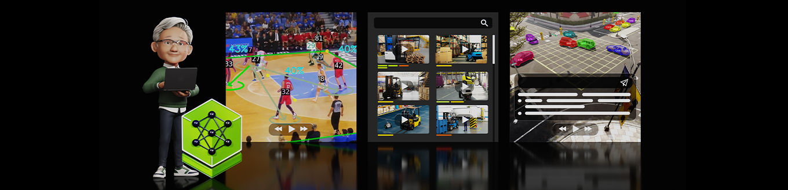

<h2>NVIDIA AI Blueprint: Video Search and Summarization (VSS)</h2>

**Build GPU-accelerated video AI agents that search, analyze, summarize, and reason over live or recorded video using natural language.**

NVIDIA AI Blueprint for Video Search and Summarization (VSS) combines vision-language models, RAG, and NVIDIA NIM microservices to deliver real-time video analytics, visual Q&A, alert verification, clip retrieval, and long-video summarization.

- Search video streams or archives using natural language queries
- Summarize hours of video
- Ask visual questions and automatically generate reports
- Detect and verify real-time alerts with VLMs

**[🚀 Try the Demo](https://build.nvidia.com/nvidia/video-search-and-summarization)** · **[⚡ Quickstart](#quickstart-guide)** · **[📚 Documentation](https://docs.nvidia.com/vss/latest/index.html)** · **[🏗️ Architecture](#software-components)** · **[📦 Latest Release](https://github.com/NVIDIA-AI-Blueprints/video-search-and-summarization/releases/latest)**

### Table of Contents
- [Overview](#overview)
- [Use Case / Problem Description](#use-case--problem-description)
- [Agent Workflows](#agent-workflows)
- [Software Components](#software-components)
- [Target Audience](#target-audience)
- [Repository Structure Overview](#repository-structure-overview)
- [Documentation](#documentation)
- [Prerequisites](#prerequisites)
- [Hardware Requirements](#hardware-requirements)
- [Quickstart Guide](#quickstart-guide)
- [Contributing](#contributing)
- [License](#license)

## Overview

The [NVIDIA Blueprint for Video Search and Summarization (VSS)](https://docs.nvidia.com/vss/latest/index.html) provides a suite of reference architectures for building vision agents and AI-powered video analytics applications. Those architectures bring together accelerated vision microservices, vision language models (VLMs), and large language models (LLMs) so you can use them in existing applications, as standalone microservices, or as part of a larger vision agent.

VSS is organized into three areas of processing and analysis: **real-time video intelligence** (feature extraction, embeddings, and stream understanding with results published to a message broker), **downstream analytics** (enrichment of metadata into trajectories, incidents, and verified alerts), and **agentic and offline processing** (orchestrated tools for search, Q&A, summarization, and clip retrieval, including via the Model Context Protocol).

This repository implements the blueprint and powers the [NVIDIA build experience](https://build.nvidia.com/nvidia/video-search-and-summarization) for natural-language video agents—search, summarization, visual Q&A, and related workflows—backed by generative AI, VLMs and LLMs, and [NVIDIA NIM](https://build.nvidia.com/) microservices as configured in the stacks below.

## Use Case / Problem Description

The NVIDIA AI Blueprint for Video Search and Summarization addresses the challenge of deploying visual agents capable of interacting with large volumes of video data, both stored and streamed. This can be used to create vision AI agents, that can be applied to a multitude of use cases such as monitoring smart spaces, warehouse automation, and SOP validation. This is important where quick and accurate video analysis can lead to better decision-making and enhanced operational efficiency.

## Agent Workflows
We provide multiple reference [Agent Workflows](https://docs.nvidia.com/vss/latest/agent-workflows.html) which demonstrate how the individual components can be leveraged by an agent:

| Workflow | Description |
|----------|-------------|
| [Q&A and Report Generation (Quickstart)](https://docs.nvidia.com/vss/latest/quickstart.html) | Video retrieval, VLM-based Q&A, and report generation on short video clips |
| [Alert Verification](https://docs.nvidia.com/vss/latest/agent-workflow-alert-verification.html) | Realtime processing of videos using perception (object detection, tracking) and behavior analytics to generate alerts, which are subsequently verified with VLM to reduce false positives |
| [Real-Time Alerts](https://docs.nvidia.com/vss/latest/agent-workflow-rt-alert.html) | Continuous processing of video streams through VLM for anomaly detection |
| [Video Search](https://docs.nvidia.com/vss/latest/agent-workflow-search.html) | Natural language search across video archives using video embeddings (alpha) |
| [Long Video Summarization](https://docs.nvidia.com/vss/latest/agent-workflow-lvs.html) | Analysis and summarization of extended video recordings through chunking and aggregation of dense captions |

## Software Components

  

1. **NIM microservices**: Here are models used in this blueprint:

    - [Cosmos3 Nano Reasoner](https://build.nvidia.com/nvidia/cosmos3-nano-reasoner)
    - [NVIDIA Nemotron 3.5 Lightning 30B A3B](https://build.nvidia.com/nvidia/nemotron-3.5-lightning-30b-a3b)

2. **Real-time video intelligence**: The Real-Time Video Intelligence layer extracts rich visual features, semantic embeddings, and contextual understanding from video data in real-time, publishing results to a message broker for downstream analytics and agentic workflows. It provides three core microservices for processing video streams.

3. **Downstream analytics**: The Downstream Analytics layer processes and enriches the metadata streams generated by real-time video intelligence microservices, transforming raw detections into actionable insights and verified alerts.

4. **Agent and offline processing**: The top-level agent leverages the Model Context Protocol (MCP) to access video analytics data, incident records, and vision processing capabilities through a unified tool interface. It integrates multiple vision-based tools including video understanding with Vision Language Models (VLMs), semantic video search using embeddings, long video summarization for extended footage analysis, and video snapshot/clip retrieval.

## Target Audience
This blueprint is designed for ease of setup with extensive configuration options, requiring technical expertise. It is intended for:

1. **Video Analysts and IT Engineers:** Professionals focused on analyzing video data and ensuring efficient processing and summarization. The blueprint offers 1-click deployment steps, easy-to-manage configurations, and plug-and-play models, making it accessible for early developers.

2. **GenAI Developers / Machine Learning Engineers:** Experts who need to customize the blueprint for specific use cases. This includes modifying the pipelines for unique datasets and fine-tuning LLMs as needed. For advanced users, the blueprint provides detailed configuration options and custom deployment possibilities, enabling extensive customization and optimization.

## Repository Structure Overview

VSS is a monorepo organized by responsibility. Deployment definitions assemble
the stack from implementations in `services/`; shared packages and the VSS CLI
live in `libs/`; and `skills/`, `docs/`, and `tools/` support operating,
documenting, and developing the blueprint.

> **Start here:** Developers should read [CONTRIBUTING.md](CONTRIBUTING.md).
> Coding agents should read [AGENTS.md](AGENTS.md), then the nearest nested
> `AGENTS.md` for the area they modify.

### Find Your Starting Point

| Goal | Start here | What you will find |
|------|------------|--------------------|
| Deploy or configure a VSS stack | [`deploy/docker/`](deploy/docker/) or [`deploy/helm/`](deploy/helm/) | Docker Compose and Helm definitions, reusable service fragments, developer and industry profiles, configuration, and deployment tests. |
| Change a product component | [`services/`](services/) | Deployable backends, real-time video intelligence, analytics, agents, storage, and user interfaces. Begin with the component's README and local `AGENTS.md`, when present. |
| Use or extend the VSS CLI and shared code | [`libs/vss/`](libs/vss/), [`libs/nvschema/`](libs/nvschema/), or [`libs/analytics/`](libs/analytics/) | The deployment-facing `vss` CLI, shared schemas, and reusable spatial AI data utilities. |
| Automate a deployed VSS workflow with an agent | [`skills/README.md`](skills/README.md) | Skills for building and deploying stacks, searching video, summarizing recordings, managing alerts, running benchmarks, and other operational tasks. |
| Edit the documentation | [`docs/README.md`](docs/README.md) and [`fern/docs.yml`](fern/docs.yml) | Authored MDX and assets under `docs/`, with Fern navigation and site configuration under `fern/`. |
| Debug, inspect, or prepare data | [`tools/`](tools/) | Focused utilities for message-broker inspection, synthetic-data post-processing, MV3DT configuration, and Logstash integration. |
| Understand CI and repository automation | [`.github/workflows/`](.github/workflows/) | Build, test, documentation, compliance, and release automation used by pull requests and maintained branches. |

### Top-Level Map

| Path | Responsibility |
|------|----------------|
| `deploy/` | Runnable Docker Compose and Helm deployments. Profiles here select and configure components from `services/`. |
| `services/` | Product and microservice implementations: agent, alerting, analytics, configurators, real-time video intelligence, service discovery and routing, UI, video summarization, and video I/O and storage. |
| `libs/` | Shared libraries, schemas, analytics utilities, and the `vss` CLI used by skills and developers to interact with a deployed stack. |
| `skills/` | Agent-readable workflows for building, deploying, operating, and benchmarking VSS. |
| `docs/` | Documentation source pages, designs, model information, and site assets. |
| `fern/` | Documentation navigation, redirects, and Fern site configuration; it does not contain the authored pages. |
| `tools/` | Standalone development, debugging, data-conversion, and integration utilities. |
| `assets/` | Images and other assets used by the repository README and project-level material. |
| `.github/` | CI workflows, issue templates, validation scripts, and repository automation. |
| `.openclaw/` and `.hermes/` | Integrations and workspace configuration for supported agent harnesses. |

The typical dependency direction is `deploy/` &rarr; `services/` &rarr;
`libs/`. Agent skills drive a running deployment through the `vss` CLI rather
than calling service endpoints directly. Documentation under `docs/` describes
those workflows and components, while `fern/` determines how that content is
published and navigated.

## Documentation

Choose the documentation that matches the build you are using:

- **Official releases:** Use the [official VSS documentation](https://docs.nvidia.com/vss/latest/index.html) with versioned, officially released builds.
- **Nightly builds:** Use the [staging VSS documentation](https://nvidia-vss-staging.docs.buildwithfern.com/vss) with nightly or development builds. This content reflects the latest development changes and may differ from the officially released documentation.

## Prerequisites

### Obtain API Key

- NVIDIA AI Enterprise developer licence required to local host NVIDIA NIM.
- API catalog keys:
   - NVIDIA [API catalog](https://build.nvidia.com/) or [NGC](https://org.ngc.nvidia.com/setup/api-keys) ([steps to generate key](https://docs.nvidia.com/ngc/gpu-cloud/ngc-user-guide/index.html#generating-api-key))

### Container Image Availability

> **Development Container Notice:** Images tagged `develop-*` or `nightly-*` are pre-release artifacts intended for development and testing only. They may change without notice and are provided “AS IS.” Official release images are published through NVIDIA NGC. For production deployments, use only a versioned release image from NGC that has completed NVIDIA’s release review.

## Hardware Requirements

The platform requirement can vary depending on the configuration and deployment topology used for VSS and dependencies like VLM, LLM, etc. For a list of validated GPU topologies and what configuration to use, see the [GPU requirements](https://docs.nvidia.com/vss/latest/prerequisites.html#development-profile-gpu-requirements).

## Quickstart Guide

### Launchable Deployment

**Ideal for:** Quickly getting started with your own videos without worrying about hardware and software requirements.

Follow the steps from the [documentation](https://docs.nvidia.com/vss/latest/cloud-brev.html) and notebook in [deploy/docker/scripts](deploy/docker/scripts/) directory to complete all pre-requisites and deploy the blueprint using Brev Launchable in a 2xRTX PRO 6000 SE AWS instance.
- [deploy/docker/scripts/deploy_vss_launchable.ipynb](deploy/docker/scripts/deploy_vss_launchable.ipynb): This notebook is tailored specifically for the AWS CSP which uses Ephemeral storage.

### Docker Compose Deployment

**Ideal for:** Deploying a VSS agent on your own hardware or bare metal cloud instance.

#### System Requirements

- OS:
    - x86 hosts: Ubuntu 24.04
    - DGX Station (GB300): DGX OS 7.6.0
    - DGX-SPARK: DGX OS 7.5.0
    - IGX-THOR (T5000 and T7000): IGX-SW 2.0 Production (LTS), including IGX OS 2.0 (Ubuntu 24.04)
    - Jetson AGX-THOR: JetPack 7.2 (Jetson Linux/L4T r39.2)
    - Jetson AGX Orin and Jetson Orin NX: public JetPack 7.2.2 release
- NVIDIA Driver:
    - 595.58.03 (x86 hosts with Ubuntu 24.04)
    - 595.58.03 (DGX Station GB300)
    - 580.173.02 (DGX-SPARK)
    - 580.00, bundled with IGX-SW 2.0 (IGX-THOR)
    - 595.78 (Jetson AGX Orin, AGX-THOR, and Jetson Orin NX)
- NVIDIA Container Toolkit: 1.17.8+
- Docker Engine: 28.3.3 <= Docker Engine < 29.5.0
- Docker Compose: v2.39.1+
- NGC CLI: 4.10.0+

> **Docker upper bound:** Docker Engine 29.5.0+ may fail pulling NGC-hosted images. Use Docker Engine 28.3.3 or another supported version below 29.5.0.

Please refer to [Prerequisites section here for installation details](https://docs.nvidia.com/vss/latest/prerequisites.html).

## Contributing
See [CONTRIBUTING.md](CONTRIBUTING.md) for the development workflow, branch naming convention, and PR guidelines.

## License

This project's licensing is documented across the following files:

- [`LICENSE`](LICENSE) — Apache-2.0 for the repository. Elasticsearch, Kibana, and Redis configuration files remain dual-licensed as described there.
- [`LICENSE-3rd-party.txt`](LICENSE-3rd-party.txt) — index of per-service third-party attribution files, including [`services/ui/LICENSE-3rd-party.txt`](services/ui/LICENSE-3rd-party.txt) for the UI image.
- [`LICENSE.DATA`](LICENSE.DATA) — NVIDIA Asset License.
