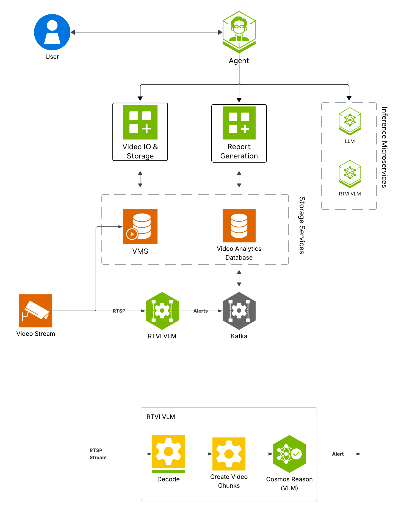
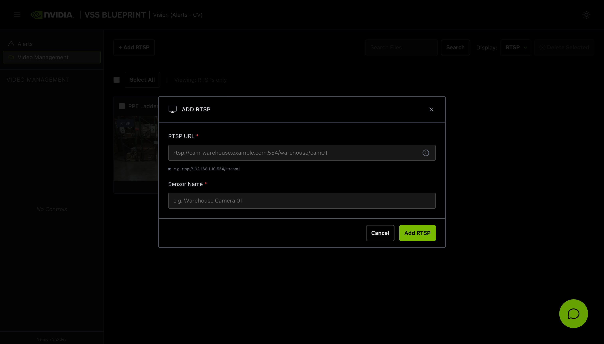
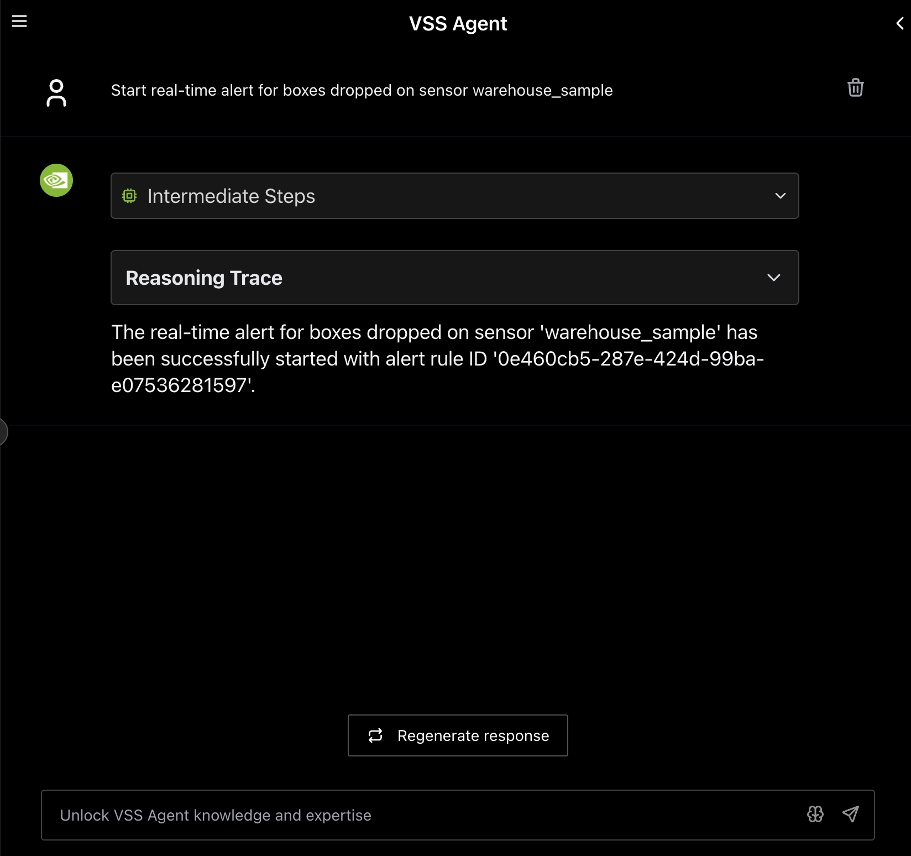
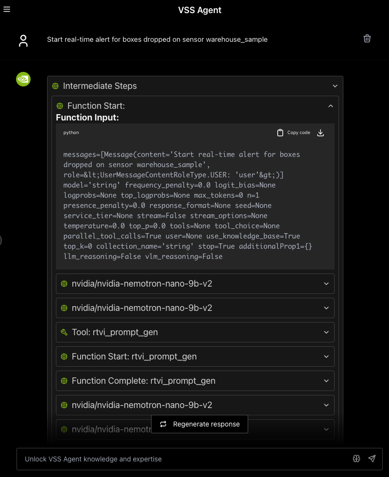
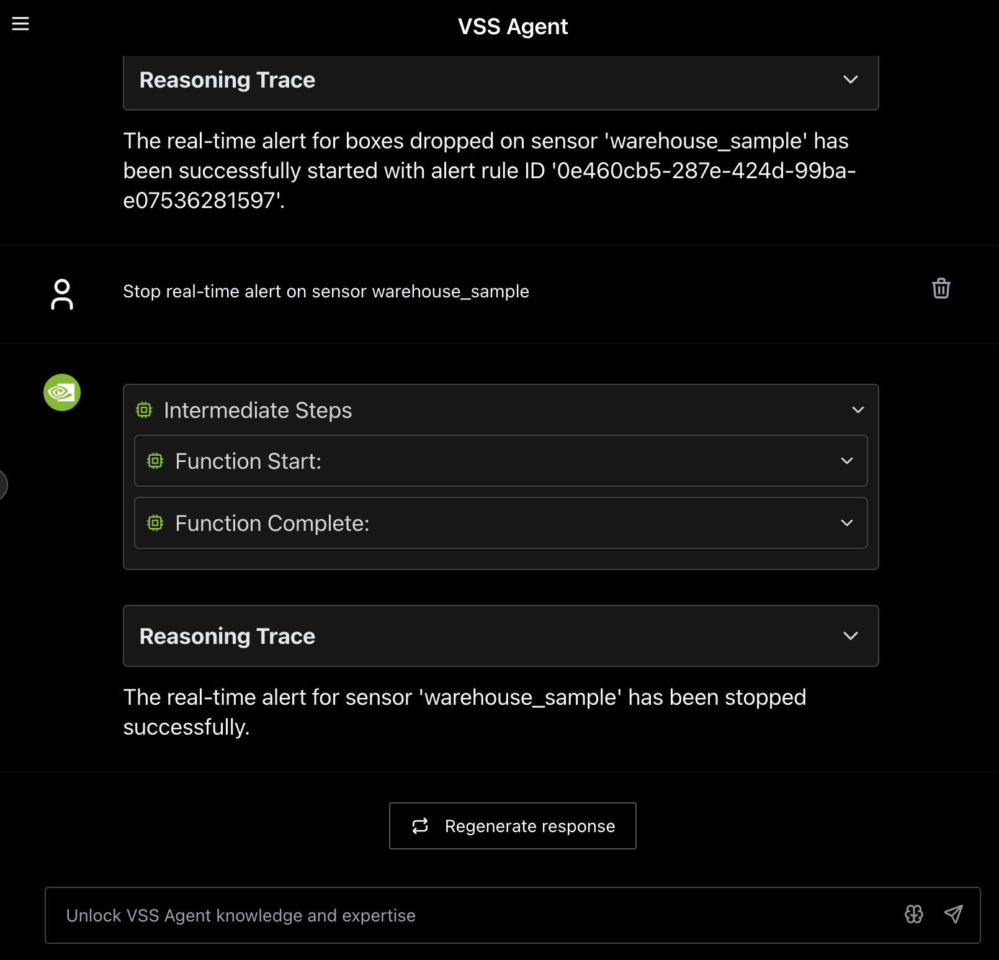
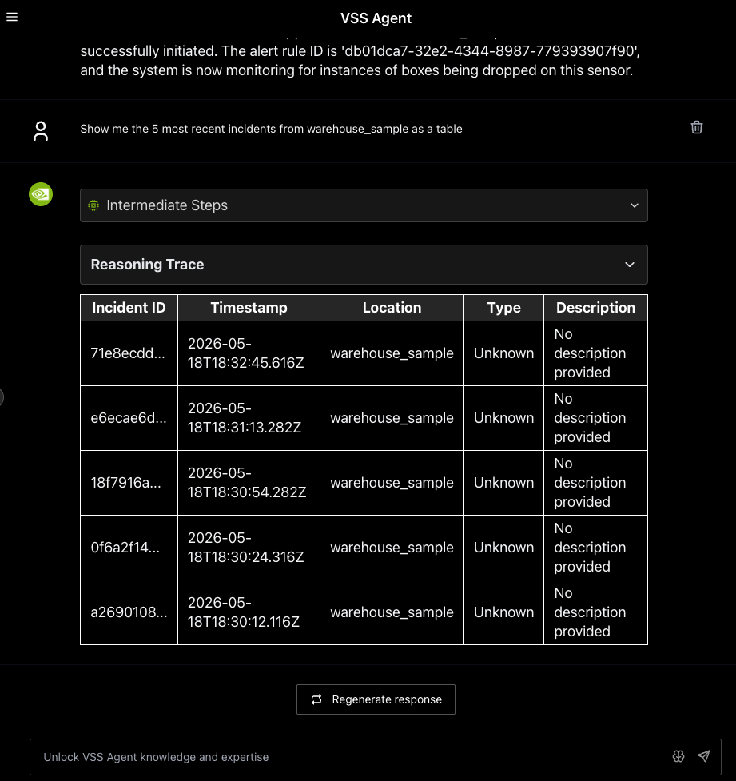
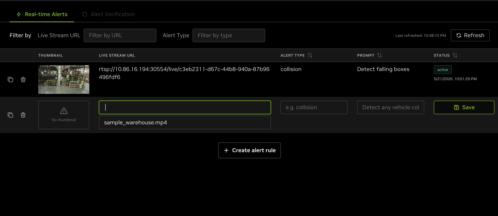
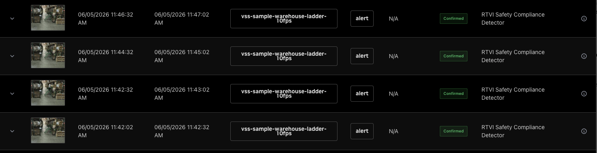
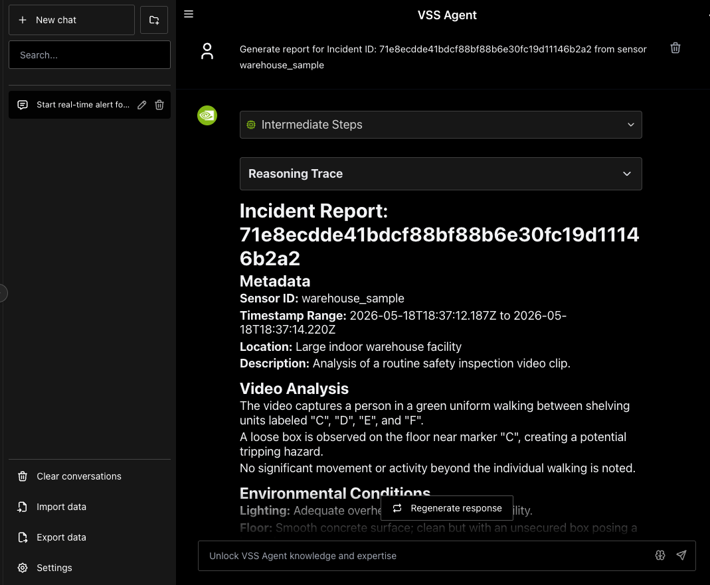

The Real-Time Alert Workflow monitors live video streams and generates alerts when the VLM detects anomalies or specified events.

**Use Cases**

- Traffic collision detection
- Unusual behavior detection
- Equipment malfunction identification
- Safety hazard detection

**Estimated Deployment Time:** 15-20 minutes

The following diagram illustrates the real-time alert workflow architecture:



**Key Features of the Real-Time Alert Agent:**

- Continuous frame sampling and VLM-based anomaly detection from video streams using the RTVI VLM microservice
- Natural language queries for detected alerts
- Configurable alert prompts and invocation settings for custom detection scenarios
- Report Generation

## What's being deployed

- **VSS Agent:** Agent service that uses a configured LLM endpoint to route requests and orchestrate tool calls to VSS microservices and model endpoints (LLM/VLM NIMs) to answer questions and generate outputs
- **VSS Agent UI:** Web UI with chat, video upload, and different views
- **RTVI VLM:** [Real-Time VLM Microservice](/system-components/vision-microservices/real-time-vlm) for vision-language model inference used by real-time alerting
- **Video IO & Storage (VIOS):** Video ingestion, recording, and playback services used by the agent for video access and management
- **NVStreamer:** Video streaming service for video playback
- **Nemotron LLM (NIM):** LLM inference service used for reasoning, tool selection, and response generation
- **ELK:** Elasticsearch, Logstash, and Kibana stack for log storage and analysis
- **Phoenix:** Observability and telemetry service for agent workflow monitoring

This list describes the stock profile used by the manual Compose deployment.
Build Vision AI customizes that profile for the requested capabilities. With
the default NemoClaw harness, or with no harness, it does not deploy the
in-stack VSS Agent or Phoenix. It also omits the Agent's local LLM unless
another selected service needs it. Ask for the in-stack VSS Agent if you plan
to use the Agent REST API or the manual Agent UI workflow below.

## Prerequisites

Before you begin, ensure all of the prerequisites are met. See [Prerequisites](/getting-started/prerequisites) for more details.

## Deploy

<Note>
For instructions on downloading sample data and the deployment package, see [Download Sample Data and Deployment Package](/getting-started/quickstart#configure-ngc-access) in the Quickstart guide.
</Note>

### Default Alert Prompt

The default alert prompt detects a ladder PPE violation: a person on a ladder without a hardhat or safety vest. It answers no when there is no ladder in the scene and is intended for the default `warehouse_sample.mp4` clip.

If you use a clip other than the default one, we recommend updating `always_on_rules[].always_on_params.system_prompt` and `always_on_rules[].always_on_params.prompt` in `deploy/docker/developer-profiles/dev-profile-alerts/vlm-as-verifier/realtime-config.yml` before deployment to match the events you want to detect.

Chunked inference is the default. To try streaming, follow
[Enable Streaming VLM (Optional)](#enable-streaming-vlm-optional) before
starting the profile. It provides two inference options: native streaming
inside RTVI VLM or a separate streaming NIM container.

### With Agent Skills

#### Step 1: Deploy with Agent Skills

Use VSS Agent Skills from an agent such as Claude Code, Codex, or NemoClaw to deploy and manage the real-time alerts workflow.
First, install the [`vss-build-vision-ai`](/vision-agent/build-vision-ai-skill) skill as described in [Agent Skills](/vision-agent/agent-skills) and make it
accessible to your agent. The host must meet the same deployment requirements listed above (supported GPU/hardware for that profile)
and must meet the [Prerequisites](/getting-started/prerequisites).

For a dev alerts real-time deployment, the skill asks whether to use
**Chunking (default)** or **Streaming**. If you choose Streaming, it then asks
whether inference should run **natively inside RTVI VLM** or in a **separate
streaming NIM container**. You can specify either choice in your deployment
prompt; the agent asks only for choices you have not already supplied. See
[Enable Streaming VLM (Optional)](#enable-streaming-vlm-optional) for the two
streaming configurations.

The `vss-build-vision-ai` skill composes the stack from the capabilities you name and selects the `<platform>` and `<mode>` to match your system, as detailed in [Development Profile GPU Requirements](/getting-started/prerequisites#development-profile-gpu-requirements).
Refer to the requirements table for valid platform and mode combinations compatible with your hardware.

<Note>
Optional: You can enable notifications by setting `webhook.openclaw.enabled` to `true` in the `deploy/docker/developer-profiles/dev-profile-alerts/vlm-as-verifier/configs/config.yml` config.
</Note>

**Deploy prompt structure**

```text title="Deploy prompt structure"
Deploy the VSS alerts profile in real-time mode.
```

Name an image tag in the prompt to run a release's images instead of the
`containers.env` default. See
[Container image tag](/vision-agent/build-vision-ai-skill#container-image-tag).

```text title="Deploy prompt with a release image tag"
Deploy the VSS alerts profile in real-time mode with image tag ${VSS_DOCS_IMAGE_TAG:-develop-latest}.
```

The `vss-build-vision-ai` skill uses Cosmos3 Nano Reasoner BF16 as the default VLM. You can ask the agent
which VLM models are available during the deployment process, or request a different model
directly in your deployment prompt:

```text title="VLM model prompts"
Which VLM models are available for the alerts profile?
Deploy the VSS alerts profile in real-time mode with the Cosmos3 Super Reasoner FP8 VLM.
```

The agent sets `VLM_NAME` and `RTVI_VLM_MODEL_PATH` in the generated
`_builds/<name>/override.env` to the model you request. The same options and
hardware constraints listed in
[Available VLM Models](#rt-alert-available-vlm-models) apply.

#### Step 2: Add a Video Stream

To manage real-time alerts from your agent, install the `vss-manage-alerts` skill as described in [Agent Skills](/vision-agent/agent-skills).
Your agent can then start, stop, and inspect alerts through VSS with natural-language prompts, without requiring manual interaction with the UI.

Add a stream with the `vss-manage-video-io-storage` skill.

**Add an RTSP stream to VIOS**

```text title="Add an RTSP stream to VIOS"
Add RTSP stream <rtsp stream URL> to VIOS with the sensor name warehouse_sample.
```

<Note>
If you do not have an RTSP stream, you can use [NVStreamer](/system-components/middleware/video-io-storage-vios/nv-streamer) at `http://<HOST_IP>:31000` to upload a video file and create an RTSP stream.
</Note>

What the agent does:

1. Loads the `vss-manage-video-io-storage` skill and verifies that VIOS is reachable.
2. Extracts the RTSP URL and requested sensor name from the prompt.
3. Registers the stream with VIOS by calling `POST /vst/api/v1/sensor/add` with `sensorUrl` and `name`.
4. Confirms that VIOS lists the new sensor.
5. Returns the sensor ID or configured name to use in alert prompts.

#### Step 3: Manage Alert Rules

Ask your agent to manage alert rules in natural language. The `vss-manage-alerts` skill routes these requests to the alert-specific workflow, checks that the alerts profile is running in VLM real-time mode, resolves the sensor name through VIOS/VST, and calls Alert Bridge to create, list, or delete persistent real-time rules. To change an existing rule, the agent uses the same rule-management workflow to replace the old rule with a new one.

For rule creation and replacement requests, the skill extracts the sensor and detection condition from your prompt, resolves the sensor ID and RTSP stream URL, derives a short `alert_type` tag, and submits the rule to Alert Bridge. For alert lookups, the skill routes the request through the agent incident-query workflow so that you can review notifications that have fired.

##### Create a Rule with the REST API

For Docker Compose deployments, Alert Bridge listens on port `9080`. Resolve the
sensor UUID and main RTSP URL from VIOS, then create the rule through Alert
Bridge—not directly through RT-VLM:

```bash
curl -sS -X POST "http://<HOST_IP>:9080/api/v1/realtime" \
  -H "Content-Type: application/json" \
  -d '{
    "live_stream_url": "<RTSP_URL>",
    "sensor_id": "<SENSOR_UUID>",
    "sensor_name": "warehouse_sample",
    "alert_type": "missing_ppe",
    "prompt": "Is anyone visible without required personal protective equipment?",
    "system_prompt": "Answer yes or no",
    "chunk_duration": 30,
    "chunk_overlap_duration": 5
  }'
```

| Field | Required by API | Default or convention | Purpose |
| --- | --- | --- | --- |
| `live_stream_url` | Yes | — | Main RTSP URL returned by VIOS. |
| `alert_type` | Yes | — | Stable snake-case category for the condition. |
| `prompt` | Yes | — | Natural-language condition evaluated for each chunk. |
| `sensor_id` | No | VIOS sensor UUID | Lets rules share the same underlying RT-VLM stream. |
| `sensor_name` | No | VIOS sensor name | Human-readable source name. |
| `system_prompt` | No | Empty string | Optional evaluation instruction used by the VLM. The example supplies `"Answer yes or no"` explicitly. |
| `chunk_duration` | No | `30` seconds | Video duration evaluated per inference. |
| `chunk_overlap_duration` | No | `5` seconds | Overlap between consecutive chunks. |

A successful create returns HTTP `201` and a body like:

```json
{
  "status": "success",
  "id": "496aebd1-16d0-4123-81cf-10603e047d02",
  "created_at": "2026-04-21T11:09:40.111515+00:00",
  "message": "Realtime alert rule created"
}
```

Keep the returned `id`; it identifies the rule for `GET /api/v1/realtime/{alert_rule_id}`
and `DELETE /api/v1/realtime/{alert_rule_id}`. A real-time rule has no separate threshold,
sensitivity, or cooldown field. Tune the detection condition in `prompt` and
the evaluation cadence with the two chunk fields. The
`alert_agent.event_filters` settings documented for the Alerts Microservice
apply to upstream alert-verification event filtering, not to this real-time
rule payload.

<Note>
To combine this workflow with long-video summarization, deploy one
[combined custom build](/vision-agent/build-vision-ai-skill#combine-real-time-alerting-and-video-summarization).
Starting the stock alerts and LVS profiles separately on the same host is not
supported.
</Note>

##### Add an Alert Rule

```text title="Add an alert rule"
Detect anyone entering without personal protective equipment on sensor warehouse_sample.
Send me alerts for fallen boxes in camera warehouse_sample.
Watch warehouse_sample for anyone without a safety vest.
```

What the agent does:

1. Parses the sensor name and detection condition from the prompt.
2. Resolves the sensor ID and RTSP stream URL through VIOS/VST.
3. Derives an `alert_type` tag and submits a persistent real-time rule to Alert Bridge.

##### List Active Alert Rules

```text title="List active alert rules"
What alert rules are currently active?
```

What the agent does:

1. Fetches active rules from Alert Bridge.
2. Resolves stream URLs back to readable sensor names when needed.
3. Applies any sensor or alert-type filter from your prompt and returns the current rule IDs.

##### Show Alert Notifications

```text title="Show alert notifications"
List any alerts for alert ID <alert ID>.
```

What the agent does:

1. Routes the request to the incident-query workflow.
2. Queries the stored incidents from Alert Bridge through `GET /api/v1/realtime/incidents`.
3. Summarizes matching notifications with status, sensor, timestamp, and available evidence.

##### Replace an Alert Rule

```text title="Replace an alert rule"
Replace alert rule ID <alert ID> with a rule that watches warehouse_sample for fallen boxes.
```

What the agent does:

1. Uses the rule ID to identify the rule that needs to change.
2. Resolves the requested sensor and detection condition for the replacement rule.
3. Creates the replacement rule through Alert Bridge, then asks for confirmation before deleting the superseded rule.

##### Delete an Alert Rule

```text title="Delete an alert rule"
Delete alert rule ID <alert ID>.
```

What the agent does:

1. Uses the rule ID to identify the rule to stop.
2. Asks you to confirm before stopping the rule.
3. After you confirm, calls Alert Bridge to delete the rule and reports whether it was stopped or was already inactive.

<Note>
The Alerts Microservice supports receiving alerts on the OpenClaw UI. Ensure that notifications are enabled as noted above.

To use this feature, send the following prompt after creating an alert rule. Substitute your own
VST public URL and gateway. Do **not** copy captured sandbox hosts from a previous environment.

```text
Start the alert-notify relay (dashboard backend only).

NOTIFY_BACKENDS=dashboard

VST_ENDPOINT=<vst-host>:<vst-port>

VST_PUBLIC_URL_BASE=https://<your-public-vst-or-tunnel-base>

OPENCLAW_GATEWAY_URL=ws://127.0.0.1:18789

Infer OPENCLAW_GATEWAY_URL and VST_PUBLIC_URL_BASE based on the deployment.
```

`NOTIFY_BACKENDS`, `VST_ENDPOINT`, `VST_PUBLIC_URL_BASE`, and `OPENCLAW_GATEWAY_URL` are
relay process environment variables. `VST_PUBLIC_URL_BASE` is the URL clients use to play
clips (for example a reverse-proxy or Brev tunnel). Infer `OPENCLAW_GATEWAY_URL` from your
OpenClaw deployment. Use `wss://` whenever the gateway crosses a network boundary because
the connection carries the gateway token and alert contents. Use `ws://` only for loopback
(for example `ws://127.0.0.1:18789`) or another trusted internal connection.
`host.openshell.internal` is only reachable from inside that sandbox.
</Note>

### Manually

#### Step 1: Deploy with Docker Compose

<Note>
- Set the NGC CLI API key and authenticate Docker to `nvcr.io` before running the deploy commands. See [Verify Your NGC Access](/getting-started/prerequisites#verify-your-ngc-access).
- Refer to [Configure the LLM](/vision-agent/vss-agents/agent-customization/customize-models/configure-the-llm) and [Configure the VLM](/vision-agent/vss-agents/agent-customization/customize-models/configure-the-vlm) for all LLM and VLM (local and remote) configuration options.
  For RTVI-VLM configuration options, see [Real-Time VLM](/system-components/vision-microservices/real-time-vlm).
- For advanced settings and Agent Customization, edit the profile `user-overrides.env`.
</Note>

```bash
# Set NGC CLI API key
export NGC_CLI_API_KEY='your_ngc_api_key'

# Authenticate Docker for gated NIM and other nvcr.io images. The managed VSS
# images on ghcr.io are public and do not require a registry login.
printf '%s' "$NGC_CLI_API_KEY" | \
  docker login nvcr.io --username '$oauthtoken' --password-stdin
```

See [Configuration](/system-components/configuration) for common variables,
valid values, defaults, and env-file precedence. The complete profile-specific
template is
`deploy/docker/developer-profiles/dev-profile-alerts/overrides.env`.

From the repository checkout root, enter the Compose deployment directory:

```bash
cd deploy/docker
```

`overrides.env` is the checked-in template. Copy it to any
filename matching `*-overrides.env` before selecting a layout. Files matching
that pattern are ignored by Git so local settings and credentials are not
committed. The commands below use `user-overrides.env` as a concrete example;
if you choose another name, use it consistently in every `--env-file` argument.
Repeat the copy only when you want to discard prior layout changes:

```bash
PROFILE=alerts
cp "developer-profiles/dev-profile-${PROFILE}/overrides.env" \
  "developer-profiles/dev-profile-${PROFILE}/user-overrides.env"
```

Before starting Compose, complete the host settings and select one hardware
layout below in `deploy/docker/developer-profiles/dev-profile-alerts/user-overrides.env`.

**Environment-variable overrides:** In `deploy/docker/developer-profiles/dev-profile-alerts/user-overrides.env`, update existing values in place; add a variable only when it is absent. `COMPOSE_PROFILES` is derived from values above it, so appending duplicate model-mode or model-slug variables can select the wrong services.

#### Direct Docker Compose Overrides

Apply all of the following settings in the `user-overrides.env` file created
above:

```ini
MODE=2d_vlm
ALERT_AGENT_ALWAYS_ON=true
COMPOSE_PROFILES=${COMPOSE_PROFILES_VLM}
RTVI_VLM_MESSAGE_BUS=kafka
RTVI_VLM_KAFKA_ENABLED=true
NEXT_PUBLIC_ALERTS_TAB_MANAGE_ALERTS_SUB_TAB_ENABLE_REALTIME_ALERTS=true
NEXT_PUBLIC_ALERTS_TAB_MANAGE_ALERTS_SUB_TAB_ENABLE_CV_ALERTS_VERIFICATION=false
```

In RT-VLM 26.08.2, `MESSAGE_BUS` is the startup source of truth for
generated-message publishing. The packaged Compose variable
`RTVI_VLM_MESSAGE_BUS=kafka` sets it explicitly.
`RTVI_VLM_KAFKA_ENABLED=true` is retained only as the legacy compatibility
field while Compose still forwards it. Later `--env-file` arguments take
precedence over earlier arguments; therefore, changes to `overrides.env` made
after it has been copied do not affect a command that reads
`user-overrides.env`.
`VSS_CONTAINER_REGISTRY` (default `ghcr.io/nvidia-ai-blueprints/vss`) and
`VSS_CONTAINER_TAG` (default `develop-latest`) are defined in
`deploy/docker/containers.env`.

**Host-path and service-address overrides (all hardware profiles):**

- `VSS_APPS_DIR`: Absolute path to this repository's `deploy/docker` directory.
- `VSS_DATA_DIR`: Absolute writable host directory for downloaded models, videos, and service data.
- `HOST_IP`: IP address or hostname that clients use to reach services on this VSS host. Set it to an address reachable by the intended clients.
- `EXTERNAL_IP`: Address VSS puts in externally reachable service URLs. It defaults to `${HOST_IP}`; on a cloud host or when clients connect from outside the host network, set it to the instance's public address or external hostname.

<Note>
The default deployed model is Cosmos3 Nano Reasoner with BF16 precision.
You can change this model by selecting an option from the following table and
setting `VLM_NAME` to the Name value and `RTVI_VLM_MODEL_PATH` to the Path value
in `user-overrides.env`.
</Note>

<a id="rt-alert-available-vlm-models"></a>

**Available VLM Models**

| Model | Name | Path |
| --- | --- | --- |
| CR3 Nano BF16 | `nim_nvidia_cosmos3-nano-reasoner_bf16-final` | `ngc:nim/nvidia/cosmos3-nano-reasoner:bf16-final` |
| CR3 Nano FP8 | `nim_nvidia_cosmos3-nano-reasoner_modelopt-fp8-final_format_fix` | `ngc:nim/nvidia/cosmos3-nano-reasoner:modelopt-fp8-final_format_fix` |
| CR3 Nano NVFP4 | `nim_nvidia_cosmos3-nano-reasoner_modelopt-nvfp4-full-quantize-final_format_fix` | `ngc:nim/nvidia/cosmos3-nano-reasoner:modelopt-nvfp4-full-quantize-final_format_fix` |
| CR3 Super BF16 | `nim_nvidia_cosmos3-super-reasoner_bf16-final` | `ngc:nim/nvidia/cosmos3-super-reasoner:bf16-final` |
| CR3 Super FP8 | `nim_nvidia_cosmos3-super-reasoner_modelopt-fp8-final_format_fix` | `ngc:nim/nvidia/cosmos3-super-reasoner:modelopt-fp8-final_format_fix` |
| CR3 Super NVFP4 | `nim_nvidia_cosmos3-super-reasoner_modelopt-nvfp4-full-quantize-final_format_fix` | `ngc:nim/nvidia/cosmos3-super-reasoner:modelopt-nvfp4-full-quantize-final_format_fix` |

<Note>
Super models have only been tested on RTX PRO 6000 and H100 with a single GPU dedicated to the VLM.

NVFP4 models only work on Blackwell platforms.
</Note>


Set these required placeholder values in the existing assignments:

```ini
VSS_APPS_DIR=/absolute/path/to/video-search-and-summarization/deploy/docker
VSS_DATA_DIR=/absolute/path/to/vss-apps-data
HOST_IP=<reachable-host-ip-or-name>
```

**Prepare host data directories before starting Compose.** Export
`VSS_DATA_DIR` and `VSS_APPS_DIR` with the same absolute paths set above, then
run this block. The guards stop before `mkdir` or `chmod` if either value is
absent or is not absolute:

```bash
: "${VSS_DATA_DIR:?Export VSS_DATA_DIR with the value from user-overrides.env}"
: "${VSS_APPS_DIR:?Export VSS_APPS_DIR with the value from user-overrides.env}"
case "$VSS_DATA_DIR" in
  /*) ;;
  *) echo "VSS_DATA_DIR must be an absolute path" >&2; exit 1 ;;
esac
case "$VSS_APPS_DIR" in
  /*) ;;
  *) echo "VSS_APPS_DIR must be an absolute path" >&2; exit 1 ;;
esac
mkdir -p \
  "$VSS_DATA_DIR/data_log/analytics_cache" \
  "$VSS_DATA_DIR/data_log/calibration_toolkit" \
  "$VSS_DATA_DIR/data_log/elastic/data" \
  "$VSS_DATA_DIR/data_log/elastic/logs" \
  "$VSS_DATA_DIR/data_log/kafka" \
  "$VSS_DATA_DIR/data_log/nvstreamer/vst_data" \
  "$VSS_DATA_DIR/data_log/redis/data" \
  "$VSS_DATA_DIR/data_log/redis/log" \
  "$VSS_DATA_DIR/data_log/vss_video_analytics_api" \
  "$VSS_DATA_DIR/data_log/vst/clip_storage" \
  "$VSS_DATA_DIR/agent_eval/dataset" \
  "$VSS_DATA_DIR/agent_eval/results" \
  "$VSS_DATA_DIR/models" \
  "$VSS_DATA_DIR/videos/dev-profile-alerts"
mkdir -p "$VSS_APPS_DIR/engines/gdino" "$VSS_APPS_DIR/engines/rtdetr-its"
chmod -R a+rwx "$VSS_APPS_DIR/engines"
chmod -R a+rwx \
  "$VSS_DATA_DIR/data_log" \
  "$VSS_DATA_DIR/agent_eval" \
  "$VSS_DATA_DIR/models" \
  "$VSS_DATA_DIR/videos"
```


**Default container image tag**

`containers.env` uses `VSS_CONTAINER_TAG` as the default tag for all images.
Export the tag selected for this documentation branch before choosing a hardware
layout:

```bash
export VSS_CONTAINER_TAG="${VSS_DOCS_IMAGE_TAG:-develop-latest}"
```

Any service-specific image tag or tag suffix shown inside a hardware tab
supersedes or augments this common default. Use the SBSA settings shown in the
GB300 and DGX Spark tabs when deploying on those platforms.


<Tabs>
<Tab title="H100">
<Tabs>
<Tab title="Shared GPU">

```ini
HARDWARE_PROFILE=H100
MODE=2d_vlm
NEXT_PUBLIC_APP_SUBTITLE="Vision (Alerts - VLM)"
ALERT_AGENT_ALWAYS_ON=true
RTVI_VLLM_GPU_MEMORY_UTILIZATION=0.4
COMPOSE_PROFILES=${COMPOSE_PROFILES_VLM}
```
</Tab>
<Tab title="Dedicated GPU">

```ini
HARDWARE_PROFILE=H100
MODE=2d_vlm
NEXT_PUBLIC_APP_SUBTITLE="Vision (Alerts - VLM)"
LLM_DEVICE_ID=1
VLM_DEVICE_ID=2 # Any non-shared GPU; differ from LLM_DEVICE_ID when the LLM is local
RT_VLM_DEVICE_ID=2 # Must match VLM_DEVICE_ID
ALERT_AGENT_ALWAYS_ON=true
LLM_MODE=local
VLM_MODE=local
COMPOSE_PROFILES=${COMPOSE_PROFILES_VLM}
```
</Tab>
<Tab title="Remote LLM">

```ini
HARDWARE_PROFILE=H100
MODE=2d_vlm
NEXT_PUBLIC_APP_SUBTITLE="Vision (Alerts - VLM)"
ALERT_AGENT_ALWAYS_ON=true
LLM_MODE=remote
LLM_NAME_SLUG=none
LLM_BASE_URL=https://<llm-endpoint-without-v1>
LLM_NAME=<llm-model-id-from-v1-models>
LLM_MODEL_TYPE=<nim-or-openai>
COMPOSE_PROFILES=${COMPOSE_PROFILES_VLM}
```
</Tab>
</Tabs>
</Tab>
<Tab title="GB300">
<Tabs>
<Tab title="Default">

```ini
HARDWARE_PROFILE=GB300
MODE=2d_vlm
NEXT_PUBLIC_APP_SUBTITLE="Vision (Alerts - VLM)"
LLM_DEVICE_ID=0 # Adjust to the GB300 GPU ID reported by nvidia-smi.
VLM_DEVICE_ID=0 # Adjust to the GB300 GPU ID reported by nvidia-smi.
RT_VLM_DEVICE_ID=0 # Adjust to the GB300 GPU ID reported by nvidia-smi.
VSS_RT_CV_TAG=${VSS_DOCS_SBSA_IMAGE_TAG:-develop-latest-sbsa}
VSS_RT_VLM_TAG=${VSS_DOCS_SBSA_IMAGE_TAG:-develop-latest-sbsa}
ALERT_AGENT_ALWAYS_ON=true
RTVI_VLLM_GPU_MEMORY_UTILIZATION=0.2
RTVI_VLLM_ATTENTION_BACKEND=TRITON_ATTN
COMPOSE_PROFILES=${COMPOSE_PROFILES_VLM}
```
</Tab>
<Tab title="Remote LLM">

```ini
HARDWARE_PROFILE=GB300
MODE=2d_vlm
NEXT_PUBLIC_APP_SUBTITLE="Vision (Alerts - VLM)"
VLM_DEVICE_ID=0 # Adjust to the GB300 GPU ID reported by nvidia-smi.
RT_VLM_DEVICE_ID=0 # Adjust to the GB300 GPU ID reported by nvidia-smi.
VSS_RT_CV_TAG=${VSS_DOCS_SBSA_IMAGE_TAG:-develop-latest-sbsa}
VSS_RT_VLM_TAG=${VSS_DOCS_SBSA_IMAGE_TAG:-develop-latest-sbsa}
ALERT_AGENT_ALWAYS_ON=true
RTVI_VLLM_GPU_MEMORY_UTILIZATION=0.2
RTVI_VLLM_ATTENTION_BACKEND=TRITON_ATTN
LLM_MODE=remote
LLM_NAME_SLUG=none
LLM_BASE_URL=https://<llm-endpoint-without-v1>
LLM_NAME=<llm-model-id-from-v1-models>
LLM_MODEL_TYPE=<nim-or-openai>
COMPOSE_PROFILES=${COMPOSE_PROFILES_VLM}
```
</Tab>
</Tabs>
</Tab>
<Tab title="RTXPRO6000BW">
<Tabs>
<Tab title="Shared GPU">

```ini
HARDWARE_PROFILE=RTXPRO6000BW
MODE=2d_vlm
NEXT_PUBLIC_APP_SUBTITLE="Vision (Alerts - VLM)"
RTVI_VLLM_GPU_MEMORY_UTILIZATION=0.4
ALERT_AGENT_ALWAYS_ON=true
COMPOSE_PROFILES=${COMPOSE_PROFILES_VLM}
```
</Tab>
<Tab title="Dedicated GPU">

```ini
HARDWARE_PROFILE=RTXPRO6000BW
MODE=2d_vlm
NEXT_PUBLIC_APP_SUBTITLE="Vision (Alerts - VLM)"
LLM_DEVICE_ID=1
VLM_DEVICE_ID=2 # Any non-shared GPU; differ from LLM_DEVICE_ID when the LLM is local
RT_VLM_DEVICE_ID=2 # Must match VLM_DEVICE_ID
ALERT_AGENT_ALWAYS_ON=true
LLM_MODE=local
VLM_MODE=local
COMPOSE_PROFILES=${COMPOSE_PROFILES_VLM}
```
</Tab>
<Tab title="Remote LLM">

```ini
HARDWARE_PROFILE=RTXPRO6000BW
MODE=2d_vlm
NEXT_PUBLIC_APP_SUBTITLE="Vision (Alerts - VLM)"
ALERT_AGENT_ALWAYS_ON=true
LLM_MODE=remote
LLM_NAME_SLUG=none
LLM_BASE_URL=https://<llm-endpoint-without-v1>
LLM_NAME=<llm-model-id-from-v1-models>
LLM_MODEL_TYPE=<nim-or-openai>
COMPOSE_PROFILES=${COMPOSE_PROFILES_VLM}
```
</Tab>
</Tabs>
</Tab>
<Tab title="RTXPRO4500BW">

<Tabs>
<Tab title="Remote LLM">

```ini
HARDWARE_PROFILE=RTXPRO4500BW
MODE=2d_vlm
NEXT_PUBLIC_APP_SUBTITLE="Vision (Alerts - VLM)"
RTVI_VLLM_GPU_MEMORY_UTILIZATION=0.8
ALERT_AGENT_ALWAYS_ON=true
LLM_MODE=remote
LLM_NAME_SLUG=none
LLM_BASE_URL=https://<llm-endpoint-without-v1>
LLM_NAME=<llm-model-id-from-v1-models>
LLM_MODEL_TYPE=<nim-or-openai>
COMPOSE_PROFILES=${COMPOSE_PROFILES_VLM}
```
</Tab>
</Tabs>
</Tab>
<Tab title="L40S">
<Tabs>
<Tab title="Dedicated GPU">

```ini
HARDWARE_PROFILE=L40S
MODE=2d_vlm
NEXT_PUBLIC_APP_SUBTITLE="Vision (Alerts - VLM)"
LLM_DEVICE_ID=1
VLM_DEVICE_ID=2 # Any non-shared GPU; differ from LLM_DEVICE_ID when the LLM is local
RT_VLM_DEVICE_ID=2 # Must match VLM_DEVICE_ID
ALERT_AGENT_ALWAYS_ON=true
LLM_MODE=local
VLM_MODE=local
RTVI_VLLM_GPU_MEMORY_UTILIZATION=0.8
COMPOSE_PROFILES=${COMPOSE_PROFILES_VLM}
```
</Tab>
<Tab title="Remote LLM">

```ini
HARDWARE_PROFILE=L40S
MODE=2d_vlm
NEXT_PUBLIC_APP_SUBTITLE="Vision (Alerts - VLM)"
ALERT_AGENT_ALWAYS_ON=true
LLM_MODE=remote
LLM_NAME_SLUG=none
LLM_BASE_URL=https://<llm-endpoint-without-v1>
LLM_NAME=<llm-model-id-from-v1-models>
LLM_MODEL_TYPE=<nim-or-openai>
RTVI_VLLM_GPU_MEMORY_UTILIZATION=0.8
COMPOSE_PROFILES=${COMPOSE_PROFILES_VLM}
```
</Tab>
</Tabs>
</Tab>
<Tab title="DGX-SPARK">
<Tabs>
<Tab title="Remote LLM">
See [Configure the LLM](/vision-agent/vss-agents/agent-customization/customize-models/configure-the-llm) for remote LLM endpoint options.

```ini
HARDWARE_PROFILE=DGX-SPARK
MODE=2d_vlm
NEXT_PUBLIC_APP_SUBTITLE="Vision (Alerts - VLM)"
VLM_DEVICE_ID=0
RT_VLM_DEVICE_ID=0
VSS_RT_CV_TAG=${VSS_DOCS_SBSA_IMAGE_TAG:-develop-latest-sbsa}
VSS_RT_VLM_TAG=${VSS_DOCS_SBSA_IMAGE_TAG:-develop-latest-sbsa}
PERCEPTION_DOCKERFILE_PREFIX=EDGE-
RTVI_VLLM_GPU_MEMORY_UTILIZATION=0.35
ALERT_AGENT_ALWAYS_ON=true
LLM_MODE=remote
LLM_NAME_SLUG=none
LLM_BASE_URL=https://<llm-endpoint-without-v1>
LLM_NAME=<llm-model-id-from-v1-models>
LLM_MODEL_TYPE=<nim-or-openai>
COMPOSE_PROFILES=${COMPOSE_PROFILES_VLM}
```
</Tab>
</Tabs>
</Tab>
<Tab title="IGX-THOR">
<Tabs>
<Tab title="Remote LLM">
See [Configure the LLM](/vision-agent/vss-agents/agent-customization/customize-models/configure-the-llm) for remote LLM endpoint options.

```ini
HARDWARE_PROFILE=IGX-THOR
MODE=2d_vlm
NEXT_PUBLIC_APP_SUBTITLE="Vision (Alerts - VLM)"
VLM_DEVICE_ID=0 # Adjust to the Thor GPU ID reported by nvidia-smi.
RT_VLM_DEVICE_ID=0 # Adjust to the Thor GPU ID reported by nvidia-smi.
PERCEPTION_DOCKERFILE_PREFIX=EDGE-
VLM_AS_VERIFIER_CONFIG_FILE_PREFIX=EDGE-LOCAL-VLM-
RTVI_VLLM_GPU_MEMORY_UTILIZATION=0.35
ALERT_AGENT_ALWAYS_ON=true
LLM_MODE=remote
LLM_NAME_SLUG=none
LLM_BASE_URL=https://<llm-endpoint-without-v1>
LLM_NAME=<llm-model-id-from-v1-models>
LLM_MODEL_TYPE=<nim-or-openai>
COMPOSE_PROFILES=${COMPOSE_PROFILES_VLM}
```
</Tab>
</Tabs>
</Tab>
<Tab title="AGX-THOR">
<Tabs>
<Tab title="Remote LLM">
See [Configure the LLM](/vision-agent/vss-agents/agent-customization/customize-models/configure-the-llm) for remote LLM endpoint options.

```ini
HARDWARE_PROFILE=AGX-THOR
MODE=2d_vlm
NEXT_PUBLIC_APP_SUBTITLE="Vision (Alerts - VLM)"
VLM_DEVICE_ID=0 # Adjust to the Thor GPU ID reported by nvidia-smi.
RT_VLM_DEVICE_ID=0 # Adjust to the Thor GPU ID reported by nvidia-smi.
PERCEPTION_DOCKERFILE_PREFIX=EDGE-
VLM_AS_VERIFIER_CONFIG_FILE_PREFIX=EDGE-LOCAL-VLM-
RTVI_VLLM_GPU_MEMORY_UTILIZATION=0.35
ALERT_AGENT_ALWAYS_ON=true
LLM_MODE=remote
LLM_NAME_SLUG=none
LLM_BASE_URL=https://<llm-endpoint-without-v1>
LLM_NAME=<llm-model-id-from-v1-models>
LLM_MODEL_TYPE=<nim-or-openai>
COMPOSE_PROFILES=${COMPOSE_PROFILES_VLM}
```
</Tab>
</Tabs>
</Tab>
<Tab title="OTHER">
See [Local LLM and VLM deployments on OTHER hardware](/appendix/faq) and
[Local RTVI-VLM deployments on OTHER hardware](/appendix/faq)
for known limitations and configuration constraints.

<Tabs>
<Tab title="Shared GPU">

```ini
HARDWARE_PROFILE=OTHER
MODE=2d_vlm
NEXT_PUBLIC_APP_SUBTITLE="Vision (Alerts - VLM)"
RTVI_VLLM_GPU_MEMORY_UTILIZATION=0.7
ALERT_AGENT_ALWAYS_ON=true
LLM_ENV_FILE=/path/to/llm.env
VLM_ENV_FILE=/path/to/vlm.env
COMPOSE_PROFILES=${COMPOSE_PROFILES_VLM}
```
</Tab>
<Tab title="Dedicated GPU">

```ini
HARDWARE_PROFILE=OTHER
MODE=2d_vlm
NEXT_PUBLIC_APP_SUBTITLE="Vision (Alerts - VLM)"
LLM_DEVICE_ID=1
VLM_DEVICE_ID=2 # Any non-shared GPU; differ from LLM_DEVICE_ID when the LLM is local
RT_VLM_DEVICE_ID=2 # Must match VLM_DEVICE_ID
ALERT_AGENT_ALWAYS_ON=true
LLM_MODE=local
VLM_MODE=local
LLM_ENV_FILE=/path/to/llm.env
VLM_ENV_FILE=/path/to/vlm.env
COMPOSE_PROFILES=${COMPOSE_PROFILES_VLM}
```
</Tab>
<Tab title="Remote LLM">

```ini
HARDWARE_PROFILE=OTHER
MODE=2d_vlm
NEXT_PUBLIC_APP_SUBTITLE="Vision (Alerts - VLM)"
ALERT_AGENT_ALWAYS_ON=true
LLM_MODE=remote
LLM_NAME_SLUG=none
LLM_BASE_URL=https://<llm-endpoint-without-v1>
LLM_NAME=<llm-model-id-from-v1-models>
LLM_MODEL_TYPE=<nim-or-openai>
VLM_ENV_FILE=/path/to/vlm.env
COMPOSE_PROFILES=${COMPOSE_PROFILES_VLM}
```
</Tab>
</Tabs>
</Tab>
</Tabs>

After replacing every placeholder in the selected layout, from `deploy/docker`
validate the resolved configuration, then start the profile:

```bash
PROFILE=alerts
docker compose -f compose.yml \
  --env-file containers.env \
  --env-file "developer-profiles/dev-profile-${PROFILE}/.env" \
  --env-file "developer-profiles/dev-profile-${PROFILE}/user-overrides.env" \
  config --quiet

docker compose -f compose.yml \
  --env-file containers.env \
  --env-file "developer-profiles/dev-profile-${PROFILE}/.env" \
  --env-file "developer-profiles/dev-profile-${PROFILE}/user-overrides.env" \
  up --detach --pull always --force-recreate --build
```

On the first bring-up, Docker Compose pulls the required containers from the
configured GHCR and NGC registries and builds five support images locally:
Elasticsearch, its initializer, the Kafka topic
initializer, the broker health checker, and the alerts Kibana initializer.
Those builds pull base images from Docker Hub and `docker.elastic.co`; the
Kafka support-image builds also download `jq` from GitHub. Allow outbound access
and disk space for both pulls and local builds. Depending on your network
speed, this may take a few minutes.

**This deployment uses the following defaults:**


- LLM model: nvidia/nemotron-3.5-lightning-30b-a3b
- VLM model: cosmos-reason3 (served via RTVI VLM container)

<Note>
When using a remote VLM of model-type `nim` (not `openai`), see [How does a remote `nim` VLM access videos?](/appendix/faq#how-does-a-remote-nim-vlm-access-videos) for access requirements.
</Note>

Once the deployment is complete, check that all the containers are running and healthy:

```bash
docker ps
```

Once all the containers are running, you can access the [Agent UI](/system-components/user-interface) at `http://<HOST_IP>:7777/`.

#### Enable Streaming VLM (Optional)

To try streaming mode for the VLM, set the options in this section before running
the `docker compose up` command in the section above.

Streaming VLM keeps a persistent inference session for each alert rule on
a live stream. It adds new sampled frames to retained visual context instead
of evaluating every chunk independently. This can reduce repeated visual
prefill work and lets the VLM use recent frames when evaluating an event.
Streaming VLM generally allows much lower alert-generation latency than
chunked inference because each frame is processed as it is sampled and arrives,
by default at a cadence of 1 FPS. Chunked inference waits until a complete
chunk is available—typically 10 seconds of video—before processing any of its
frames. Chunk overlap changes how much video consecutive chunks share, but
each chunk still needs to be complete before inference begins.

With the rule configuration below, the pipeline evaluates one new frame each
second while retaining an eight-frame window, without waiting for that window
to fill before processing new frames. Actual alert latency and throughput
depend on the model, GPU, sampling rate, and number of active rules; validate detection
quality and performance with your own streams.

This option applies to the dev alerts Docker Compose profile in real-time
mode (`MODE=2d_vlm`). Configure the alert rule, then choose one of the two
inference options below:

- **Native streaming inside RTVI VLM:** inference and retained context run in
  the RTVI VLM container.
- **Separate streaming NIM:** RTVI VLM forwards sampled frames to a NIM
  container that performs inference and retains context.

Chunked inference remains the default when neither option is enabled.

##### Configure the Alert Rule

For either option, in
`deploy/docker/developer-profiles/dev-profile-alerts/vlm-as-verifier/realtime-config.yml`,
replace the default rule's `always_on_params` with the following settings.
Keep `model` templated: Alert Bridge substitutes the selected `VLM_NAME` at
startup, so the same rule configuration works with either streaming variant.

```yaml
model: "\$\{VLM_NAME\}"
system_prompt: "You are monitoring a worksite camera. For each current frame, first check for a ladder: if there is no ladder, answer no. If there is a ladder, answer yes if anyone on the ladder is missing a hardhat or safety vest, otherwise no. Respond with only yes or no."
prompt: "Is anyone on a ladder without a hardhat or safety vest in the current frame?"
inference_mode: streaming_vlm
streaming_frame_policy: ordered
streaming_question_on_decode: false
streaming_window_frames: 8
chunk_duration: 1
chunk_overlap_duration: 0
num_frames_per_second_or_fixed_frames_chunk: 1
max_tokens: 16
response_format:
  type: choice
  choices: ["yes", "no"]
```

Adapt the task in `system_prompt` and `prompt` to your video. These settings
process one new frame per second with no chunk overlap and retain an
eight-frame window. Put the full detection task and yes/no output instruction
in `system_prompt`; with `streaming_question_on_decode: false`, the question is
sent only at session start. Native streaming can set this option to `true`
when the prompt requires it on every decode step; keep it `false` for a
separate streaming NIM. Rules sharing a camera must use the same chunk and
sampling settings.

For REST-created rules, use the same fields in the create payload. Changing
the always-on YAML does not update existing REST-created rules.

##### Option 1: Native Streaming Inside RTVI VLM

RTVI VLM performs inference and retains visual context in its own container.
In `deploy/docker/developer-profiles/dev-profile-alerts/user-overrides.env`,
update the existing assignments or add them when absent:

```ini
RTVI_STREAMING_VLM_ENABLED=true
RTVI_VLM_MODEL_TO_USE=cosmos-reason3
RTVI_VLM_SKIP_PIPELINE_WARMUP=true
RTVI_ADD_TIMESTAMP_TO_VLM_PROMPT=false
RTVI_VLM_BATCH_SIZE=8
RTVI_STREAMING_VLM_MAX_SESSIONS=8
RTVI_STREAMING_VLM_MAX_VIDEO_SEGMENTS=8
RTVI_STREAMING_VLM_MAX_TOTAL_VIDEO_SEGMENTS=64
RTVI_STREAMING_VLM_MAX_SESSION_TOKENS=14000
RTVI_STREAMING_VLM_RETAIN_GENERATED_TEXT=false
RTVI_STREAMING_VLM_EXACT_VIDEO_COMPACTION=false
VLLM_STREAMING_VLM_RAW_KEY_SHADOW=false
```

Size both `RTVI_VLM_BATCH_SIZE` and `RTVI_STREAMING_VLM_MAX_SESSIONS` for the number of
concurrent rules, and budget `RTVI_STREAMING_VLM_MAX_TOTAL_VIDEO_SEGMENTS` for
the sum of their retained windows. Provide sufficient GPU memory through
`RTVI_VLLM_GPU_MEMORY_UTILIZATION`; these limits do not reserve additional
physical memory.

Follow the remaining steps to set additional options and deploy the profile.

Check `docker logs vss-rtvi-vlm`
for the `DL Algo Streaming VLM enabled` message, then create a rule and verify
that frames are processed and alerts reach the UI. The initialization message
confirms backend availability; each rule must still select `streaming_vlm`.

##### Option 2: Separate Streaming NIM

RTVI VLM ingests the RTSP stream, samples frames, and sends each sampled frame
as an encoded image to a separate streaming NIM container. NIM retains the
visual context and performs inference; RTVI VLM returns the verdict through
the existing Kafka and Alert Bridge path. NIM inference and RTVI decoding can
use separate GPUs and container versions.

The connection uses NIM's persistent-session API: RTVI creates a session with
`POST /v1/streaming/sessions`, sends each frame to
`POST /v1/streaming/sessions/{session_id}/frame`, and closes it with
`DELETE /v1/streaming/sessions/{session_id}` when the alert rule stops or its
connection closes. A regular `/v1/chat/completions` endpoint alone does not
provide this mode.

**Select the streaming NIM and GPUs.** In
`deploy/docker/developer-profiles/dev-profile-alerts/user-overrides.env`,
update existing assignments or add them when absent:

```ini
MODE=2d_vlm
ALERT_AGENT_ALWAYS_ON=true
COMPOSE_PROFILES=${COMPOSE_PROFILES_VLM}
RTVI_STREAMING_VLM_ENABLED=false
RTVI_VLM_MODEL_TO_USE=openai-compat
VLM_NAME=nvidia/cosmos3-nano-reasoner
STREAMING_NIM_IMAGE=<registry>/<streaming-capable-cosmos3-nim>:<tag>
STREAMING_NIM_DEVICE_ID=1
RT_VLM_DEVICE_ID=0
RTVI_VLM_NVIDIA_VISIBLE_DEVICES=0
RTVI_VLM_BATCH_SIZE=1
RTVI_NIM_MAX_PARALLEL_REQUESTS=10
NIM_STREAMING_MAX_SESSIONS=8
NIM_GPU_MEMORY_UTILIZATION=0.90
RTVI_VLM_MESSAGE_BUS=kafka
RTVI_VLM_KAFKA_ENABLED=true
```

Replace the image placeholder with a streaming-capable Cosmos3 NIM image
available to your registry account. The supplied configuration selects Nano
Reasoner BF16, an eight-frame retention limit, and a 16384-token model length,
matching the separate-NIM setup used for performance testing. Set `VLM_NAME`
to the model ID served by that image. Authenticate to its registry as described
in the prerequisites; the container receives `NGC_CLI_API_KEY` as its
`NGC_API_KEY` for model downloads.

The GPU IDs above are examples. Reserve the NIM GPU for inference; RTVI still
needs a GPU for video decoding. Keep the local LLM on another GPU, or use the
remote LLM layout above. The NIM defaults to using 90% of its GPU memory.
`NIM_STREAMING_MAX_SESSIONS` controls the remote session limit; size it for
concurrent rules. Native `RTVI_STREAMING_VLM_MAX_*` settings do not configure
this NIM. `RTVI_NIM_MAX_PARALLEL_REQUESTS` controls concurrent forwarding
workers in RTVI.

**Select the Compose overlay and deploy.** In the validation, startup, and
teardown commands above, add the following argument immediately after
`-f compose.yml`:

```bash
-f developer-profiles/dev-profile-alerts/compose.streaming-nim.yml
```

Keep the same env files and real-time hardware layout. The overlay starts NIM,
prepares a persistent model-cache volume for its container user, waits for NIM
to become healthy, and configures RTVI with `openai-compat`, remote streaming
enabled, and native streaming disabled. The containers communicate over the
Compose network at `http://streaming-nim:8000/v1`; no NIM host port is needed.
The regular profile's connections to Kafka, VIOS, and Alert Bridge remain in use.

After deployment, check `docker logs vss-alerts-streaming-nim` for startup
errors and `docker logs vss-rtvi-vlm` for frame-processing or NIM connection errors.
Add a stream and verify that the rule produces verdicts and alerts in the UI.
Stopping a rule closes its NIM session; the Compose teardown also stops the
NIM container. As with other Compose volumes, `down -v` deletes the model cache.
To return to chunking, remove the overlay argument and streaming-only overrides.
Restore the profile's integrated VLM model name (`VLM_NAME`),
`RTVI_VLM_MODEL_TO_USE=cosmos-reason3`, `RTVI_STREAMING_VLM_ENABLED=false`, and
the default rule settings with `inference_mode: chunked`, then recreate the
profile. Include `--remove-orphans` when switching back to remove the separate
NIM containers.

#### Step 2: Add a video stream

Add an RTSP stream by clicking the **+ Add RTSP** button on the **Video Management** tab in the agent UI. If you do not have an RTSP stream, you can use [NVStreamer](/system-components/middleware/video-io-storage-vios/nv-streamer) at `http://<HOST_IP>:31000` to upload a video file and create an RTSP stream.

For this profile, use the `warehouse_sample.mp4` stream. When prompting, ensure the sensor name matches exactly what you configured for the stream (for example, `warehouse_sample`).



<Note>
By default, this profile only supports up to one stream being processed at a time.
</Note>

#### Step 3: Start a real-time alert

Launch the Agent UI at `http://<HOST_IP>:7777/`.

Use the [Global Chat Sidebar](/system-components/user-interface#global-chat-sidebar) to interact with the system:

- **Start an RTVI real-time alert** for a stream by specifying the alert type.
   - **Sample prompt:** *Start real-time alert for boxes dropped on sensor warehouse_sample*

   

   

   

   



From the same **Alerts** tab, enable **VLM Verified** to view verified alerts for all active sensors.



#### Troubleshooting

If alerts do not appear in the VSS UI after you create an alert rule, check the following item:

- View the RTVI VLM container logs with `docker logs -f vss-rtvi-vlm` and confirm that the alert rule was created and is being processed. If processing fails, confirm that the stream is valid and that the deployment has enough available GPU memory.

#### Step 4: Generate a Report for the Alert

You can use the chat interface to request creation of a report for the generated alerts. The report is currently generated in markdown format and displayed in the VSS UI.

As a first step, identify the alert ID for which the report needs to be generated. Use the chat interface to retrieve the ID as described earlier, or expand any alert in the **Alerts** tab to display the **Id** field along with associated metadata.

Now, use the ID to request generation of the report while also specifying the associated sensor, as shown in the sample image below.



#### Step 5: Teardown the Agent

To tear down the agent, run the following command:

```bash
cd deploy/docker
PROFILE=alerts
docker compose -f compose.yml \
  --env-file containers.env \
  --env-file "developer-profiles/dev-profile-${PROFILE}/.env" \
  --env-file "developer-profiles/dev-profile-${PROFILE}/user-overrides.env" \
  down -v --remove-orphans
```

This command stops the manually deployed real-time-alert containers and removes
their Compose volumes.

## Service Endpoints

The following endpoints apply to the stock manual Compose deployment. Build
Vision AI reports the endpoints available in the deployment it creates; use
that deployment summary instead of assuming every endpoint below is present.

| Service | URL |
| --- | --- |
| VSS UI | `http://<HOST_IP>:7777` |
| NVStreamer UI | `http://<HOST_IP>:31000/#/dashboard` |
| VST UI | `http://<HOST_IP>:30888/vst/#/dashboard` |
| Phoenix UI | `http://<HOST_IP>:7777/phoenix/projects` |
| Jaeger UI | `http://<HOST_IP>:16686` |

The Jaeger UI is present only when the `jaeger` Compose profile is enabled; see [OpenTelemetry Tracing](/system-components/analytics-microservices/alerts-microservice#opentelemetry-tracing) in the Alerts Microservice page.

### Known Issues

* Removing a camera from VIOS with always-on alerts enabled can leave an orphaned RT-VLM stream record even though the `camera_remove` webhook reports success. Alert Bridge stops caption generation and deletes the stream concurrently; RT-VLM can reject the delete with HTTP 409 while shutdown is in progress. Alert Bridge removes the in-memory rule despite the delete failure, so subsequent VIOS retries return HTTP 200 without cleaning up the stale record. The camera UUID can remain in `GET /v1/streams/get-stream-info` after the pipeline stops. **Workaround:** Wait for caption shutdown to complete, then retry the RT-VLM stream delete for that camera UUID. This issue affects automatic camera removal teardown.

* Deleting a real-time alert rule for a camera that has multiple rules causes all other rules for that camera to stop producing alerts, even though they remain listed as active.

* It is recommended to clear chat and refresh the VSS UI page after deployment to clear any data from a previous deployment.

* VSS-RTVI-VLM logs may repeatedly show a "Generated text is empty" warning and result in incomplete/unreliable alert verdicts

* VLM verdict verification can fail in the UI even when VLM requests are processed successfully. Alert Bridge response parsing accepts only raw verdicts such as `A/B` or `Yes/No` before serializing them to `confirmed` or `rejected`. As a result, a semantically valid `rejected` verdict from Cosmos Reason can fail schema validation and be persisted as `verification-failed`.

* Report generation may produce inaccurate results.

* The VST UI is externally accessible on both port 30000 and 30888 because both ports are exposed on the host network. For security hardening, consider using a firewall to allowlist only the required VST ingress port.
