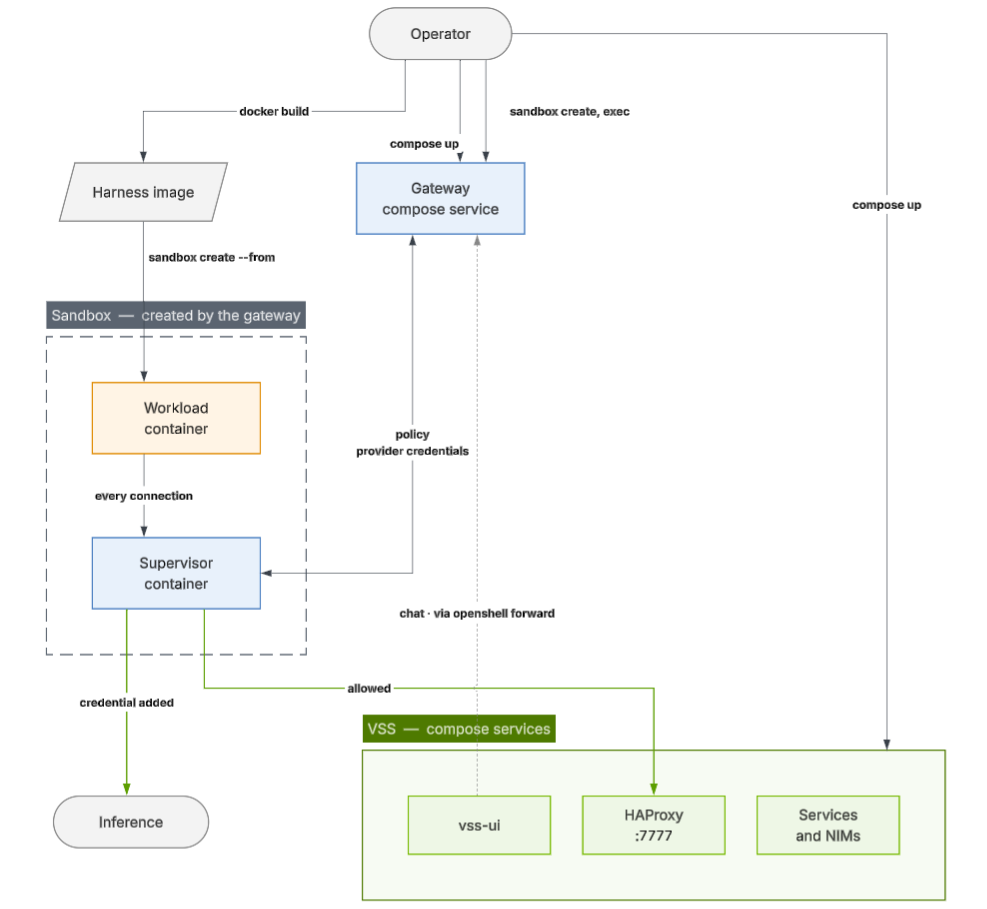
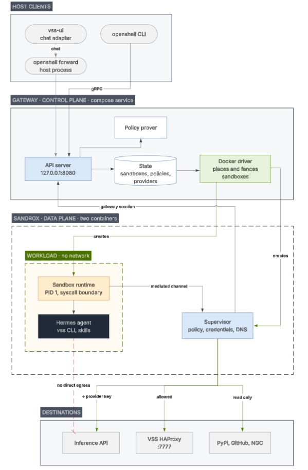

How OpenShell is put together, what a VSS deployment adds to it, and where the security boundary falls. Drawn for OpenShell 0.1.6, the release the integration was tested on.

Both diagrams below show a sandbox with the optional [VSS layer](/vision-agent/agent-harnesses/open-shell/setup-vss-and-skills#optional-add-vss-capabilities) added, since that is the arrangement with the most moving parts. The default sandbox is the same picture with the VSS column and the `:7777` arrow removed.

## Components

* **Gateway** is the control plane, a Compose service behind the `openshell` profile. It owns sandbox lifecycle and state, signs the only credentials in the system, delivers policy and provider credentials, and runs the policy prover. Its **compute driver** provisions each sandbox as two containers and builds the isolation boundary.
* **Workload** runs the harness image — Hermes and the baked policy, plus the Skills and `vss` CLI when the VSS layer is built in — with networking turned off. Its only path out is the supervisor; if the supervisor exits, the agent is stopped rather than left running unchecked.
* **Supervisor** is the trusted half and the only decision point. It checks every connection against the policy, then opens it: to the inference endpoint with the real credential added at egress, and — only where the VSS policy pair is in force — to VSS HAProxy on `:7777`. The agent never holds a key.
* **Gateway link** delivers policy and credentials to the supervisor and carries logs, exec sessions, and the exposed harness API, whose `:8642` is the loopback target inside the sandbox. The URL itself is served on the gateway's own port under a per-sandbox hostname.

## Inside the boundary

The same deployment, one level down. The destinations are the only hosts the sandbox can reach: the policy file it was created with allows them, and the provider profile adds the inference host and the key injected into calls to it. VSS HAProxy is among them only under the VSS policy.

Splitting the sandbox into a workload and a supervisor container is what makes the agent's own compromise survivable. The workload shares the boundary with the agent, so it holds nothing worth stealing — no signing key, no gateway JWT, no provider credential — and decides nothing. It reports what the agent attempted; the supervisor decides.

When the agent opens a connection, the kernel stops the call and the runtime forwards it to the supervisor as "`/usr/bin/python3.13` wants `host.openshell.internal:7777`". The supervisor checks it against the `vss-backend` grant — present only in the VSS policy, so the default sandbox is refused here — and, if allowed, opens the connection itself on the agent's behalf. An inference call takes the same path and additionally gets the provider key added at egress, which is why VSS ships the model's `api_key` as a placeholder.

Each connection is a separate stream on one mutually authenticated HTTP/2 channel, so a slow download cannot block exec or process control, and the workload freezes if that channel drops. The two JWTs are issued per sandbox and per *generation*: restarting a sandbox mints fresh tokens and certificates and invalidates the old ones.

## What the gateway is

OpenShell's control plane. One long-lived container per deployment, the only component that touches the container backend, with a single listener that serves both the CLI/SDK and the supervisors dialing in. Per the [OpenShell architecture page](https://docs.nvidia.com/openshell/about/architecture), it creates each sandbox as two parts, keeps their state in SQLite or Postgres, issues the JWTs that bind them, and delivers policy and provider credentials to the supervisor. Enforcement is not its job. Logs, Prometheus metrics, and OCSF audit records flow back through it.

One sandbox is therefore two containers, and the trust split lands on that boundary. The supervisor is the fragile half: if it exits, the driver marks the sandbox `ControlSupervisorExited` and stops the workload. A restart brings up a fresh supervisor and keeps the workload's files, not its process.

## What the supervisor is

The trusted half of a sandbox, one per sandbox, and the only component that decides anything at runtime. The gateway creates it and hands it the policy and the provider credentials; from there every connection the agent attempts is matched against that policy, credentialed, resolved, and dialed by the supervisor on the agent's behalf. The workload has no network of its own, so there is no second path out.

**It ships with the gateway, not with the harness image.** Both halves come from images the gateway is configured with — `openshell-sandbox` copied into the workload as PID 1, `openshell-supervisor` run as a companion container — so the supervisor's version tracks the gateway rather than the harness image. Moving to a new OpenShell release is a gateway upgrade, not an image rebuild.

## What OpenShell deploys

The first three rows are declared once per deployment in the VSS Compose file. The rest are made by the gateway's compute driver — Docker here, selected by `compute_driver = "docker"` — through the host's Docker socket on each `sandbox create`. The driver builds the boundary but never makes a policy decision.

| Resource | Process | Contents and networking |
|---|---|---|
| **Per deployment** — Compose, `openshell` profile | | |
| `openshell-init` container | `generate-certs`, then exits | One-shot: writes the JWT signing keys and mTLS certificates into the data volume |
| `openshell-gateway` container | `openshell-gateway` | Host networking, one listener on `127.0.0.1:8080` for the CLI, SDK, and supervisors, health on `:8082`; mounts the Docker socket |
| `openshell-data` volume | — | `gateway.db` (the SQLite record of every sandbox), the JWT signing key, and the key-encryption key that seals provider credentials |
| **Per sandbox** — the Docker driver | | |
| Workload container | `openshell-sandbox` as PID 1, the harness (`hermes gateway run`) as its child | The harness image, `network_mode=none`, one non-root UID, all capabilities dropped |
| Supervisor container | `openshell-supervisor` | From the supervisor image, host networking; dials the gateway and makes every outbound connection |
| Channel volumes | — | Sandbox bootstrap keys, and the Unix socket the two containers speak over — never the network |
| Supervisor-only volume | — | The supervisor's JWT and gateway credentials; never mounted into the workload |

OpenShell 0.1.6 reversed which end of the supervisor socket dials the other, which imposes a version rule: a new sandbox needs matching supervisor and sandbox-runtime binaries, so the gateway's Compose service pins both images alongside the gateway tag.

The per-sandbox rows are siblings of the gateway container, not part of any Compose project. `docker compose down` leaves them running, and `openshell sandbox delete` removes both containers and their volumes.

<Note>
The `openshell-data` volume needs backups rather than being treated as cache.
It holds the SQLite record of every sandbox, the JWT signing key, and the
key-encryption key that provider credentials are sealed with. Keeping it
across a `docker compose down` is what keeps sandboxes' gateway records.
</Note>

## What OpenShell enforces

The security boundary is OpenShell's, and it sits outside the agent's trust domain, so a compromised agent cannot switch it off:

* **Filesystem and syscalls** — Landlock confinement and seccomp filtering, in the kernel.
* **Network** — default-deny; a connection is allowed only when its destination *and* calling binary match the same policy block. The workload has no network at all and reaches out only through the supervisor.
* **Credentials** — the agent sees an `openshell:resolve:env:<KEY>` placeholder; the real secret is added at egress for approved endpoints only.
* **Process** — non-root identity (root is rejected), and the image's `ENTRYPOINT` is replaced by the supervisor.
* **Policy changes** — the prover checks each change before approval and flags new credentialed reach, new HTTP methods, and cloud-metadata access.

## A chat turn end to end

Both halves are deployed from the host, and in that order: VSS by the [Build Vision AI Skill](/vision-agent/build-vision-ai-skill) or Docker Compose, then the harness against the running build with the `openshell` CLI. The agent inside the sandbox drives VSS but never deploys or tears it down.

This path assumes a VSS deployment, so the sandbox is the one on the [VSS layer](/vision-agent/agent-harnesses/open-shell/setup-vss-and-skills#optional-add-vss-capabilities). It is drawn for the Compose deployment, where the gateway, the sandbox, and the VSS services share one Docker host. On Kubernetes the shape is the same with the Kubernetes compute driver: the supervisor runs in its own pod, reaches the workload over mutual TLS on a private Service, and a NetworkPolicy replaces Docker's networking-off as the outer fence.
