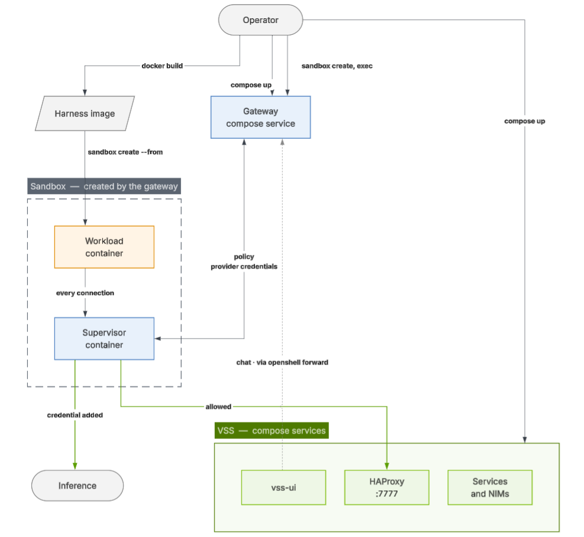

[NVIDIA OpenShell](https://docs.nvidia.com/openshell/latest/) runs an always-on AI agent inside a sandbox whose security boundary sits outside the agent's trust domain, so a compromised agent cannot switch it off. Integrated with the Video Search and Summarization (VSS) blueprint, it runs the Hermes agent harness against a VSS deployment: the gateway is declared as a Compose service alongside the rest of the stack, and an optional image layer gives the agent the `vss` CLI, the VSS operation Skills, and the one network grant that lets it reach the deployment.

Everything below is written for OpenShell 0.1.6, the release the integration was tested on.

## What OpenShell brings to VSS

Running VSS through OpenShell turns a multi-service Docker Compose deployment into a chat session, and puts a provable boundary around the agent that drives it:

* **Natural-language operations.** Prompts like *"List the VIOS sensors"* or *"Summarize warehouse_safety_0001"* are answered by the agent calling the `vss` CLI inside the sandbox, with the VSS operation Skills selecting what the deployment can actually serve.
* **The agent never holds a credential.** The workload sees an `openshell:resolve:env:<KEY>` placeholder. The real key is added at egress by the supervisor, and only for the endpoints the provider profile authorizes.
* **Default-deny networking.** The workload container has no network at all. Every connection is opened on its behalf by the supervisor, and only when both the destination *and* the calling binary match the same policy block.
* **A policy you can prove.** Each sandbox policy has a boundary ceiling it is checked against with `openshell-prover check` before anything is deployed, covering filesystem, L4, REST, process, and Landlock domains.
* **Declared with the stack.** The gateway is a Compose service behind the `openshell` profile, so its image tag, port, and mounts stay under review with the rest of the deployment rather than living as host state.

## Architecture at a glance

The **gateway** is the control plane and the only component that touches the container backend. It creates each sandbox as two containers: an isolated **workload** that runs the harness image with networking turned off, and a trusted **supervisor** that holds the policy and the credentials and makes every outbound connection on the agent's behalf. Splitting them is what makes the agent's own compromise survivable — the workload holds nothing worth stealing and decides nothing.

For the full picture, including what the gateway deploys and what it enforces, see [Architecture](/vision-agent/agent-harnesses/open-shell/architecture).

## Chat surfaces, summaries, and reports

The agent is reachable three ways, and the default sandbox serves all three without a VSS deployment:

* `openshell sandbox exec -n hermes -- hermes chat` for a shell turn.
* The harness API server on `:8642`, published at a gateway-managed URL and authenticated with the sandbox's own `API_SERVER_KEY`.
* The VSS UI's chat tab, once the deployment's UI is pointed at that API server. See [Answer from the VSS UI](/vision-agent/agent-harnesses/open-shell/setup-vss-and-skills#optional-answer-from-the-vss-ui).

Video summaries and reports appear in whichever of those surfaces you asked from. Human in the Loop (HITL) interaction happens as ordinary chat: when the agent needs a scenario, events, objects of interest, or other report details, it asks inline and you reply there. An external VSS UI connected to a harness does not support the VSS Agent's structured HITL dialogs.

The in-stack VSS Agent UI does use HITL dialogs for these prompts and provides generated reports as PDF downloads. Screenshots of those dialogs and PDF report links in the [quickstart](/getting-started/quickstart#generate-a-report-with-the-in-stack-vss-agent) and [Video Summarization workflow](/vision-agent/agent-workflows/video-summarization#step-3-generate-a-report-for-uploaded-videos) show that VSS Agent experience.

## How to run OpenShell with VSS

The [Build Vision AI Skill](/vision-agent/build-vision-ai-skill#agent-harness) brings the sandbox up for you: it is the default harness of a developer-profile build. To run it by hand instead, everything is driven from the `openshell` CLI against a checkout of the [VSS Blueprint repository](https://github.com/NVIDIA-AI-Blueprints/video-search-and-summarization/tree/${VSS_DOCS_GIT_REF:-develop}), in two stages, the second optional:

1. **A Hermes sandbox on its own model.** Bring up the gateway with Compose, build the harness image, register an inference provider, and create the sandbox. No VSS deployment is needed, and the result is a working agent you can prove, exec into, and call over HTTP.
2. **The VSS layer.** A second image layer and a second policy pair add the `vss` CLI, the operation Skills, the `vss_cli` tool plugin, and a grant to reach VSS on port `7777`. Take it only against a deployment that is already up — deploying VSS itself is the [Build Vision AI Skill](/vision-agent/build-vision-ai-skill)'s job.

Both stages are in [Setup VSS and Skills](/vision-agent/agent-harnesses/open-shell/setup-vss-and-skills). Per-variable details, the provider profiles, the policy pairs, and how to change the model or endpoint are in [Additional Configuration](/vision-agent/agent-harnesses/open-shell/additional-configuration).

<Note>
A VSS developer profile can start the gateway for you: append `openshell` to
its `COMPOSE_PROFILES` and the deployment brings up the gateway with the rest
of the stack. That covers the first step of the setup and nothing else — the
image, the provider, and the sandbox are still yours to create, because the
gateway owns sandboxes as siblings that Compose never sees.
</Note>
