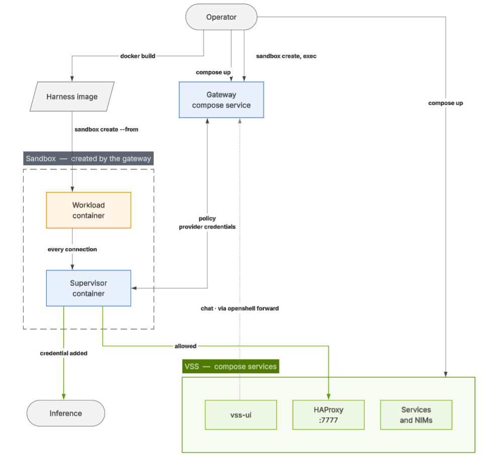

[NVIDIA OpenShell](https://docs.nvidia.com/openshell/latest/) runs the Hermes agent harness inside an isolated sandbox alongside a VSS deployment (tested with OpenShell `0.1.6`).



## Architecture

- **Gateway (`openshell-gateway`)**: Declared in `deploy/docker/services/openshell/compose.yml` behind `--profile openshell` on `127.0.0.1:8080`. Creates and manages sandboxes via `/var/run/docker.sock`.
- **Workload + Supervisor**: Each sandbox runs as two containers sharing a network namespace. The Hermes workload runs unprivileged (`998:999`) with no direct network access and sees only `openshell:resolve:env:HARNESS_API_KEY` placeholders; the supervisor enforces `.hermes/policy.yaml` (Landlock, process identity, binary paths, L4/REST rules) and injects real credentials at egress.
- **Provable Boundary**: `.hermes/policy.yaml` is verified offline against `.hermes/boundary.yaml` with `openshell-prover check`.

## Prerequisites

- Linux host (`x86_64` or `aarch64`) with Docker Engine + Compose v2 (`docker info` without `sudo`).
- `openshell` CLI `0.1.6` (and optional `openshell-prover` `0.1.6`) installed from [NVIDIA/OpenShell releases](https://github.com/NVIDIA/OpenShell/releases/tag/v0.1.6).
- An inference API key exported as `HARNESS_API_KEY` (or placed in gitignored `harness.env` at the repository root).

## Setup

Run from the repository root (`video-search-and-summarization`):

### 1. Load environment defaults and verify the policy

```bash
set -a
source deploy/docker/services/openshell/openshell.env
[ -f harness.env ] && source harness.env
set +a

openshell-prover check .hermes/policy.yaml --boundary .hermes/boundary.yaml
```

### 2. Start the OpenShell gateway and register it

```bash
docker compose \
  --env-file deploy/docker/services/openshell/openshell.env \
  -f deploy/docker/services/openshell/compose.yml \
  --profile openshell up -d

openshell gateway add --name vss "$OPENSHELL_GATEWAY_ENDPOINT"
openshell status
```

### 3. Build or pull the Hermes harness image

To build from your checkout:

```bash
VERSION="$(cd libs/vss/cli && uvx --with hatch-vcs hatch version)"
HARNESS_IMAGE="openshell-hermes-vss:${VERSION//+/-}-from-source"
docker build -f .hermes/Dockerfile \
  --build-arg HERMES_REF="$HERMES_REF" \
  --build-arg VSS_PACKAGE_VERSION="$VERSION" \
  -t "$HARNESS_IMAGE" .
```

### 4. Import the inference provider profile and create the sandbox

`HARNESS_PROVIDER` in `openshell.env` selects `services/openshell/providers/<HARNESS_PROVIDER>-profile.yaml`:

| `HARNESS_PROVIDER` | Host | Example `HARNESS_BASE_URL` |
|---|---|---|
| `agent-inference` (default) | `inference-api.nvidia.com:443` | `https://inference-api.nvidia.com/v1` |
| `agent-inference-build` | `integrate.api.nvidia.com:443` | `https://integrate.api.nvidia.com/v1` |
| `agent-inference-local` | `host.openshell.internal:8000` / `:11434` | `http://host.openshell.internal:8000/v1` |

```bash
openshell profile import -f "services/openshell/providers/$HARNESS_PROVIDER-profile.yaml"
openshell provider create --name "$HARNESS_PROVIDER" --type "$HARNESS_PROVIDER" --credential HARNESS_API_KEY

API_SERVER_KEY="$(openssl rand -hex 32)"
openshell sandbox create --name hermes \
  --from "$HARNESS_IMAGE" \
  --policy .hermes/policy.yaml \
  --provider "$HARNESS_PROVIDER" \
  --env "HARNESS_BASE_URL=$HARNESS_BASE_URL" \
  --env "HARNESS_MODEL=$HARNESS_MODEL" \
  --env "API_SERVER_KEY=$API_SERVER_KEY" \
  --port 8642:http --no-tty -- sleep infinity
```

### 5. Connect to a running VSS deployment

Once a VSS deployment is serving on `VSS_PUBLIC_URL` (default `http://host.openshell.internal:7777`):

```bash
openshell sandbox exec -n hermes -- vss configure "$VSS_PUBLIC_URL"
openshell sandbox exec -n hermes -- vss configure check
openshell sandbox exec -n hermes -- vss-hermes-sync
openshell sandbox exec -n hermes -- hermes chat -q "Which VSS capabilities are available?"
```

To drive the sandbox from the VSS UI chat tab (`http://<host>:9100`), recreate `vss-ui` with `OPENAI_API_BASE="$(openshell sandbox get hermes -o json | jq -r '.ports[0].url')/v1"`, `OPENAI_API_KEY="$API_SERVER_KEY"`, and `VSS_AGENT_MODEL=hermes-agent`.

## Rotating Keys, Models, or Endpoints

- **Rotate `HARNESS_API_KEY` only** (no sandbox recreate needed):
  ```bash
  openshell provider update "$HARNESS_PROVIDER" --credential HARNESS_API_KEY --wait
  openshell sandbox stop hermes && openshell sandbox start hermes
  ```
- **Change `HARNESS_MODEL` or `HARNESS_BASE_URL` / `HARNESS_PROVIDER`**: update `openshell.env`, re-source it, import/create the new `$HARNESS_PROVIDER` if changed, resolve the existing image if needed:
  ```bash
  ID="$(docker inspect "$(docker ps -aqf label=openshell.sandbox=hermes)" --format '{{.Config.Image}}')"
  HARNESS_IMAGE="$(docker images --no-trunc --format '{{.ID}} {{.Repository}}:{{.Tag}}' | awk -v id="$ID" '$1 == id {print $2; exit}')"
  openshell sandbox delete hermes
  ```
  and re-run `openshell sandbox create` above.

## Teardown

```bash
openshell sandbox delete hermes
openshell provider delete "$HARNESS_PROVIDER"
openshell gateway remove vss
docker compose \
  --env-file deploy/docker/services/openshell/openshell.env \
  -f deploy/docker/services/openshell/compose.yml \
  --profile openshell stop
```
