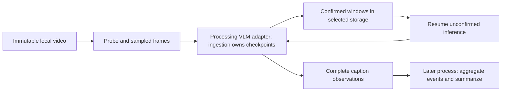

# Generic storage

`vss.storage` stores detached JSON object snapshots behind an asynchronous
compare-and-swap interface. `StorageConfig` is a frozen, versioned configuration
for `memory`, `file`, and optional `elasticsearch`; `create_storage(config)`
returns an adapter owned by the caller. Pass `expected_revision=None` to create a
new key, or the current positive revision to replace it.
`exclusive(namespace, key)` is a separate, nonblocking ownership claim for a
longer operation.

Configuration rejects unknown fields, unsupported versions, booleans and other
noninteger limits, nonpositive limits, and a root on the memory backend. The
defaults are 64 MiB per snapshot, 100,000 records, and four admitted operations.
JSON nesting is limited to 256 levels.
For the file backend, an omitted or `None` root selects `~/.vss`; callers can
provide another root. `StorageConfig(backend="memory")` remains transient.

Invalid identities, revisions, or payloads raise `StorageConfigurationError`;
missing reads raise `StorageNotFoundError` (also a `KeyError`); stale create/CAS
writes raise `StorageConflictError`; configured bounds raise
`StorageLimitError`; corrupted snapshots raise `StorageCorruptError`; and closed
adapters raise `StorageClosedError`. `StorageError` is the common base. If a
commit is visible but a required durability barrier fails, the file adapter
raises `StorageIndeterminateError` so the caller can stop and establish
durability before retrying. Closing with an active claim raises
`StorageBusyError` and leaves the adapter open; otherwise close drains admitted
work, and cancellation is re-raised after cleanup settles.

The memory adapter is transient. The file adapter writes one complete JSONL
snapshot to `<root>/<namespace>/<sha256(key)>.jsonl`, with a versioned header,
application-owned JSON record lines, and a SHA256 footer over the exact preceding
bytes. It serializes writes through stable OS locks, writes a private
temporary sibling, flushes it, atomically replaces the snapshot, and flushes
directory entries where supported. If replacement succeeds but a required
directory flush fails, it raises `StorageIndeterminateError`; callers should
stop the operation and establish durability before retrying.

File operation locks retry asynchronously for up to 30 seconds by default
(previously five seconds). Set a finite positive `lock_wait_timeout_s` through
`StorageConfig(backend="file", lock_wait_timeout_s=60.0)`,
`FileStorageAdapter`, or `FileChunkStore` when slower writes need more time.
Environment-selected file storage accepts `VSS_STORAGE_LOCK_WAIT_TIMEOUT_S`;
it requires `VSS_STORAGE_BACKEND=file`. Custom lock waits do not apply to memory
or Elasticsearch storage. Elasticsearch's request timeout is a separate setting.

This budget controls waiting for a contended key. It does not interrupt a write
or flush that already owns the lock. Expiry raises `StorageBusyError` without
changing the snapshot through that attempt. Retries recheck the current revision
under the acquired lock, so a stale write still raises `StorageConflictError`.
Waiting can be canceled and leaves workers available for other keys. The separate
`exclusive()` job ownership claim still fails immediately when busy.

The file backend requires a trusted, caller-owned local filesystem. Newly created
directories and files use private permissions where supported; existing root
permissions are preserved. Snapshot checksums detect accidental corruption, not
hostile modification. Directory flush guarantees depend on the operating system
and filesystem. This adapter does not provide distributed locking, media storage,
or domain-specific record validation.

File roots use a reusable lock pool under `.locks`: one permanent
`registry.lock`, a versioned `mode.json`, and stable `slot-00000000.lock` files.
The registry serializes assignment only; each owner then holds its slot without
holding the registry. Different keys, namespaces and operation/claim purposes
get distinct slots. All occupied slots are checked before reusing an idle slot,
so a free slot cannot hide an existing owner for the requested key. Released or
crashed owners leave slots immediately reusable, without deleting lock inodes.
Slot count follows peak simultaneous ownership rather than historical job count.
Acquisition scans that pool, so its cost is proportional to the high-water count;
this is not a fixed absolute capacity cap. Metadata is bounded to 32 KiB, begins
after the Windows lock byte, and corrupt occupied metadata fails closed. Free
torn metadata is replaced. A fixed pending marker bounds initialization debris.

Slots are the only lock protocol; there is no `lock_mode` configuration option.
Elasticsearch's same-host claim coordinator uses the same pool. The versioned
marker validates existing slot roots across restart. Unsupported pre-release
per-key lock layouts, including mixed layouts with a slots marker, raise
`StorageConfigurationError` before slot assignment. The library does not convert
or delete those paths; use a fresh root for new work. Keep old demo snapshots as
archives. Never mix old binaries with a slot root or rename/unlink live lock
paths. There is no automatic snapshot-retention API.
The memory adapter forgets idle lock entries while active owners and waiters
keep their shared lock alive; stored snapshots remain until the adapter closes.

Elasticsearch stores one complete canonical JSON snapshot per deterministic
document ID, identified by the exact namespace/key fields. It checks revisions
with Elasticsearch sequence-number/primary-term compare-and-swap, verifies the
checksum and record limits on reads, and requests realtime reads. It creates only
the configured dedicated index when missing. An existing index must have the
supported strict mapping, preserve `_source`, and retain request-level translog
durability; aliases, incompatible mappings, ingest pipelines, and weaker
durability are rejected. The adapter does not change an existing index's mapping
or durability settings. Keep request durability enabled after validation.

## Where storage fits

The storage module imports neither video processing nor inference transports.
Ingestion owns the caption/checkpoint schemas in
`vss.ingestion.persistence`; summarization adapts the same records through
`AdapterChunkStore` and `FileChunkStore`. A new storage backend implements the
four-method `StorageAdapter` contract without knowing about frames, captions,
VLMs or summaries. Native decoder binaries remain caller-installed.

Local decode, sampling and VLM dispatch now live in
`vss.ingestion.vlm`; ordinary `ingest()` uses registered frame-level VLM
providers, RTVI, or another whole-request backend selected by
`VSS_INGESTION_BACKEND`.
The opt-in `ingest(..., backends=["vlm"], storage=...)` path remains a durable
composition entry point: ingestion owns the job and checkpoint, while the shared
processing loop receives storage-neutral callbacks and uses the same
`VSS_PROCESSING_MAX_CONCURRENCY` limit as direct processing. Completed checkpoint
replay does not probe, construct a VLM backend or acquire a processing permit.
Processing does not import ingestion or storage. Both paths return the same
caption classes accepted by summarization.

Moving a backend implementation changes its checkpoint fingerprint. Checkpoints
created with the older `vss.ingestion.vlm` implementation may therefore fail
resume with `StorageConflictError`; completed captions remain retrievable.
Start a new job ID for the new implementation rather than weakening fingerprint
checks or rewriting existing checkpoints.

The flow is (the checkpoint store is selected by the caller):



Ordinary ingestion calls retain their existing behavior and do not persist data.
Storage becomes active through `storage=adapter`, `storage_config=config`, or
explicit `VSS_STORAGE_BACKEND=memory|file|elasticsearch` configuration. An
injected adapter takes precedence over environment settings. Explicit memory
configuration overrides an environment-selected file backend. Supplying both
an adapter and a config is an error. `VSS_STORAGE_ROOT` alone is an error; file
selection without a root uses `~/.vss`.

Persistence deliberately remains opt-in. Automatic checkpoints could recover
expensive inference when a caller forgets to enable them, but would also introduce
external writes, retained caption content, storage failures and capacity use into
otherwise transient calls. An application or service can choose its own storage
default; the library does not enable one implicitly.

## Elasticsearch backend

Elasticsearch is an optional generic snapshot backend. It does not change the
caption schema, provide media storage, or read the older LVS search indices.
Install its client extra only where this backend is selected:

```sh
pip install 'vss[storage]'
```

This extra installs the Python client and its async dependencies, not an
Elasticsearch server. The caller supplies and operates a working ES instance,
endpoint and credentials. The library never starts Docker, downloads a server
or manages its lifecycle. Memory/file storage needs no ES client or server.
The Docker image in GitLab CI is a disposable service used only for native
client/server acceptance; it is not bundled in the wheel.

The public configuration contains nonsecret connection and ownership settings.
An explicit config takes precedence over environment selection; when the caller
omits both `storage` and `storage_config`, ingestion can construct a config from
`VSS_STORAGE_BACKEND=elasticsearch`, `VSS_STORAGE_ES_URL`,
`VSS_STORAGE_ES_INDEX`, `VSS_STORAGE_ES_CLAIM_ROOT`, and
`VSS_STORAGE_ES_CA_CERTS`. The API key is separate in
`VSS_STORAGE_ES_API_KEY`. A `storage_config` passed to summarization likewise
takes precedence over the environment. The backend URL must be an HTTP(S)
endpoint without embedded credentials, a query or fragment. The configured
index must be a concrete, dedicated lowercase index name; its default is
`vss-storage`.

```python
from pathlib import Path

from vss.storage import ElasticsearchConfig, StorageConfig

es = ElasticsearchConfig(
    url="https://es.example.net:9200",
    index="vss-video-checkpoints",
    claim_root=Path("/var/lib/vss/es-claims"),
    request_timeout=30.0,  # seconds per request
    ca_certs=Path("/etc/ssl/certs/es-ca.pem"),
)
config = StorageConfig(
    backend="elasticsearch",
    elasticsearch=es,
    max_snapshot_bytes=64 * 1024 * 1024,
    max_records=100_000,
    max_in_flight=4,
)
```

`create_storage(config)` creates an owned asynchronous Elasticsearch client.
That path imports the optional SDK only when the adapter is constructed; importing
`vss.storage` and its config models does not require the extra. The client reads
its API key from `VSS_STORAGE_ES_API_KEY`. The library does not parse `.env`
files, put the key in `ElasticsearchConfig`, or serialize it into configuration,
snapshots, or known diagnostics. Load secrets through the application's existing
environment manager. The URL, index, CA path and timeout are ordinary config and
may be serialized; do not put credentials in the URL.

```python
from vss.storage import create_storage

async with create_storage(config) as storage:
    # The caller owns this adapter and closes it at context exit.
    ...
```

The adapter verifies or creates only the configured index. It requires the
supported strict mapping, complete stored `_source`, no ingest pipeline, and
`index.translog.durability=request`; it refuses aliases, incompatible indexes,
and settings that cannot be verified. It does not alter an existing index's
mapping or durability. Use an index reserved for VSS snapshots and retain request
durability after setup. The mapping marker and snapshot envelope versions are
separate from the application caption/checkpoint record schemas.

### Same-host claims and client ownership

Elasticsearch stores snapshots remotely, but ingestion ownership is enforced by
OS file locks on the adapter's local claim root. By default that root is
`~/.vss/es-claims`. The claim scope is based on the canonicalized endpoint and
index; every same-host process that can ingest or resume the same job must use
the same endpoint, index, claim root and OS identity, with a trusted local
filesystem. URL scheme/host/default-port/path normalization is applied, but
endpoint aliases are not discovered as equivalent. Different claim roots or
hosts do not coordinate. A shared ES cluster by itself does not provide safe
cross-host exclusive job ownership. Remote reads and summaries are separate from
this local ingestion claim; this backend does not supply distributed leases.

An injected async client must already be authenticated, must target the endpoint
in `ElasticsearchConfig`, and must support the SDK `options()` method so the
adapter can disable retries. Authentication and TLS setup for that client remain
the caller's responsibility. The adapter adjusts a client view but never closes
the injected client. Close the adapter first, then close the original client:

```python
import os

from elasticsearch import AsyncElasticsearch
from vss.storage import ElasticsearchStorageAdapter

api_key = os.environ["VSS_STORAGE_ES_API_KEY"]
client = AsyncElasticsearch(es.url, api_key=api_key)
adapter = ElasticsearchStorageAdapter(config=es, client=client)
try:
    async with adapter as storage:
        ...
finally:
    await client.close()
```

For an adapter-created client, the adapter closes its client and local claim
coordinator when its context exits. In either case, finish or cancel ingestion
and await `job.wait_closed()` before leaving the adapter context.

### Explicit restart and separate summary

The caller must retain the job UUID, original source ID, immutable source, and
compatible model/decoder/pipeline revision. Elasticsearch does not persist or
rediscover the in-memory ingestion queue, select jobs for an agent, or recover a
job automatically after process death. A later process resumes only when it is
given the same ES endpoint/index/claim root, job UUID, source ID, and compatible
inputs. If no checkpoint exists, `resume=True` fails; it does not silently start
new work.

For the first process, omit `job_id` and `resume`, then retain the printed UUID
and source ID outside the process (for example, in the caller's job record):

```python
async with create_storage(config) as storage:
    job = ingest(
        source,
        backends=["vlm"],
        model="your-image-capable-model",
        decoder="opencv",
        pipeline_revision="deployment-v1",
        storage=storage,
    )
    print(f"job_id={job.id} source_id={source.source_id}", flush=True)
    try:
        chunks = (await job)["vlm"]
    finally:
        await job.wait_closed()
```

The following call is for a later process after an interrupted attempt and uses
those retained identifiers:

```python
from uuid import UUID

from vss.ingestion import RequestSource, ingest
from vss.storage import create_storage

job_id = UUID("5f347d43-4df8-4078-941b-38b9738299f5")  # preserve this value
source = RequestSource(url="/data/video.mp4", source_id="camera-17-recording")

async with create_storage(config) as storage:
    job = ingest(
        source,
        backends=["vlm"],
        model="your-image-capable-model",
        decoder="opencv",
        pipeline_revision="deployment-v1",
        storage=storage,
        job_id=job_id,
        resume=True,
    )
    try:
        chunks = (await job)["vlm"]
    finally:
        await job.wait_closed()
```

This explicit restart works only against the backend that contains the
checkpoint. Existing file checkpoints continue to be resumed by opening the
same file backend and root. Selecting Elasticsearch does not find, import or
migrate file snapshots; selecting file storage does not read ES snapshots.
There is no automatic bridge between these backends.

After completion, a later process can summarize the remote caption snapshot
without the source video, decoder, or VLM endpoint. Its summary LLM configuration
is still required:

```python
from vss.summarization import summarize_from_store

completion = await summarize_from_store(str(job_id), storage_config=config)
```

The ES adapter writes each complete snapshot revision as one document. Its
`max_snapshot_bytes` and `max_records` checks apply to the canonical JSON document
before the SDK serializes the HTTP request; they do not promise an exact wire-byte
cap or override Elasticsearch's own request/content limits. The SDK still
serializes the full accumulated snapshot on every write. For N confirmations,
cumulative record serialization and network traffic grow approximately as
1+2+...+N (quadratic). The byte and record limits bound each snapshot, not the
cumulative work of a long job. An uncertain timeout, disconnect or shard failure
raises `StorageIndeterminateError`; do not blindly retry a possibly committed
write. Re-read and reconcile the revision/checkpoint before explicit resume.

## Persist captions and resume

```python
from vss.ingestion import RequestSource, ingest
from vss.storage import FileStorageAdapter

source = RequestSource(url="/data/video.mp4", source_id="camera-17-recording")

async with FileStorageAdapter(root="/data/vss-store") as storage:
    job = ingest(
        source,
        backends=["vlm"],
        model="your-image-capable-model",
        decoder="opencv",
        chunk_duration=30,  # seconds, not nanoseconds
        pipeline_revision="deployment-v1",
        storage=storage,
    )
    print(job.id)  # retain this UUID before awaiting a possibly failing request
    try:
        chunks = (await job)["vlm"]
    finally:
        await job.wait_closed()
```

Keep the job UUID and original `source_id` separately. To resume, submit the same
source and settings with `job_id=<saved UUID>` and `resume=True`, after the prior
job has finished cleanup. Fresh submission with an existing durable job ID fails
before inference. Resume without a compatible checkpoint fails; it does not
silently start a new job.

For local frame-based VLM ingestion, a checkpoint freezes nonoverlapping windows
and an eight-target grid per window. The manifest binds this plan to the source
content hash and resolved backend, endpoint, model, prompts, generation settings,
decoder, and caller-supplied pipeline revision. Actual frame timestamps preserve
the existing source clock. Each successful response is durably confirmed before
the next inference request. Windows proven empty by chronological frame progress
or clean EOF are recorded explicitly. Failed/cancelled decoding cannot establish
unknown windows as empty or publish a complete observation.

Every checkpointed local submit and resume reads the entire source to compute
SHA256 before decoding or replay. Hashing runs on a worker in 1 MiB blocks with
bounded queue concurrency; it does not load the video into memory. This adds a
full file read and can delay startup for multi-GB inputs. Cancellation requests
stop hashing between blocks, close the file and settle the worker; an in-flight
filesystem read cannot be interrupted safely. A path/stat-only cache or partial
hash cannot prove unchanged content, so it is not used as a resume shortcut.
Ordinary ingestion without checkpoints does not do this hash.

### Trusted immutable source identities

Checkpointed local ingestion can opt out of repeated full reads through
`source_identity_provider`, a caller-owned `SourceIdentityProvider` implementing
`async resolve(source: RequestSource) -> ImmutableSourceIdentity`. The result is
frozen, versioned and contains a lowercase SHA256, byte size, provider namespace,
and immutable revision. Namespace/revision labels are nonempty and bounded to
256 characters. Your media catalog can compute the checksum while importing a
video once, retain it alongside the immutable local artifact, and return that
record on subsequent submissions and resumes.

The provider must attest that its revision names the **exact immutable bytes at
the requested local path**, not merely match a source ID. The library checks a
regular local file, byte size and stat before/after resolution and at checkpoint
commits, but it deliberately does not reread the video to verify the supplied
checksum. A dishonest or stale provider can defeat resume safety. A cached
checksum for an ordinary mutable path is not an immutable identity; source_id,
mtime and the existing `source_revision` argument alone do not enable this path.

```python
from vss.ingestion import ImmutableSourceIdentity, RequestSource, ingest


class CatalogIdentity:
    async def resolve(self, source: RequestSource) -> ImmutableSourceIdentity:
        # Application catalog must bind the immutable revision to this local path.
        entry = await catalog.get_immutable_local_revision(source.url)
        return ImmutableSourceIdentity(
            sha256=entry.sha256,
            size_bytes=entry.size_bytes,
            provider_namespace="application-media-catalog",
            revision=entry.revision,
        )


job = ingest(
    source,
    backends=["vlm"],
    storage=storage,
    model=model,
    decoder="opencv",
    pipeline_revision="caption-pipeline-v1",
    source_identity_provider=CatalogIdentity(),
)
responses = (await job)["vlm"]
await job.wait_closed()
```

`catalog`, `source`, `storage` and `model` above belong to your application; this
library does not import/copy media, fetch a remote object, or manage a catalog.
Providers receive a detached source snapshot so callback mutation cannot change
the queued request. They must offload their own blocking work. Provider failures
and malformed results produce sanitized `StorageConfigurationError`; size or
stat drift produces `StorageConflictError`; cancellation propagates normally.
The provider is neither serialized nor closed by the library.

This option is accepted only for persistent local checkpoint mode. The identity
fields are bound to the request fingerprint; changing the provider namespace,
revision, digest or size refuses resume before inference. Provider-mode jobs
must resume with that same identity mode; existing full-hash checkpoints keep
their original fingerprint and continue using the default path. No VLM response,
caption, checkpoint envelope or summarization interface changes.

Resume skips inference for confirmed windows. It can still traverse frames from
the beginning to establish trustworthy timestamps. A provider success followed
by an unacknowledged checkpoint commit can be repeated after restart; this is
not an exactly-once remote inference guarantee. A complete checkpoint can be
replayed and published without another VLM call, after source/settings validation.

Checkpoint mode requires an explicit model, concrete decoder, positive known
video duration, immutable local media and `pipeline_revision`. Update that
revision when model weights, backend defaults or native decoder builds change;
remote mutable weights cannot be automatically pinned by the library. Memory
adapters never support restart resume. Whole-request RTVI and custom ingestion
backends support completed-result storage; partial RTVI resume is deferred.
HTTP source downloading and durable media-byte storage are outside M6.

## Summarize in another process

```python
from vss.storage import FileStorageAdapter
from vss.summarization import AdapterChunkStore, summarize_from_store

async with FileStorageAdapter(root="/data/vss-store") as storage:
    captions = await AdapterChunkStore(storage).get_chunks(str(saved_job_id))
    completion = await summarize_from_store(str(saved_job_id), storage=storage)
```

This path needs stored captions and an LLM configuration, without the source
video, a decoder or VLM access. It returns the existing `CompletionResponse`;
retrieval returns the existing ordered `list[VlmChunkResponse]`. Corrupt,
incompatible or missing observations fail before summary inference. For manual
caption persistence, use `AdapterChunkStore(storage).store_chunks(job_id, chunks)`.
The legacy `InMemoryChunkStore` and `store=` argument remain available.

Injected adapters remain caller-owned. Config-created adapters and the
`FileChunkStore` convenience facade close their own resources. Cancellation of a
job's result does not imply that worker cleanup has finished: await
`job.wait_closed()` before closing an injected adapter or reusing its ID.

Durable caption records preserve caption/transcript/reasoning text, nanosecond
bounds, source identity and supported token counts. They omit cached frame
graphs, temporary artifacts, arbitrary provider statistics and URL credentials,
query strings and fragments. Provider failure diagnostics are sanitized.
Free caption text remains caller data and can contain anything the provider
returns; the library does not promise to discover secrets inside that text.
The generic adapter also stores arbitrary caller JSON without redaction or
encryption. Callers must exclude credentials and other sensitive content before
writing it, and apply their own access and retention policies. Sanitizing known
ingestion metadata does not extend this guarantee to arbitrary JSON or model text.

Managed ingestion records the caller's `original_source_id` separately in the
observation manifest. RTVI caption `chunk.sourceId` keeps its existing uploaded
asset ID, even after that asset is deleted. The original identity survives restart
without rewriting the caption response contract. Inspect it through
`(await storage.read("observations", job_id)).records[0]["original_source_id"]`.
Legacy snapshots and manually stored caption lists may omit this field; an upload
ID alone cannot establish original identity. Verified checkpoint replay can add
missing legacy origin metadata while preserving all caption records.

## Acceptance and limits

The tests were established before implementation and expanded with focused
regressions for review findings: corruption, atomic commits, cross-process claims,
cancellation, confirmed-only resume, plan alteration and transient data exclusion.
See the [test guide](../../../tests/storage/README.rst) and runnable
[persistent video example](../../../examples/persistent_video.py).

The deterministic Elasticsearch tests exercise a client double. Separately, six
native cases passed on local macOS with Elasticsearch 8.19.3 and its Python
client 8.19.3: realtime/CAS, concurrent writes and index creation, fresh-process
reads, checkpoint failure/resume/deferred summary, and config-selected completed
replay. Both supplied videos also passed actual OpenCV decoding through mocked
VLM inference into native ES: three traffic chunks and five five-minute chunks,
eight images per chunk, original identity retained, and zero additional inference
requests on completed replay. Deferred summarization used a mocked generator.
The test server ran on localhost using a checksum-verified official archive;
these checks do not establish production TLS/RBAC, replicas/failover, other ES
versions, Windows claims, or cross-host ingestion ownership.

File writes replace a complete snapshot rather than append individual records.
Each file commit scales with the accumulated checkpoint size. Elasticsearch
likewise writes a whole snapshot document on every revision; its SDK serializes
that full document before sending it. For N confirmations, serialization and
file/network write volume grows approximately as 1+2+...+N (quadratic). The
configured byte and record limits bound each canonical snapshot, not cumulative
work, and the byte limit is checked before ES SDK serialization rather than
against exact HTTP wire bytes. Elasticsearch and server request limits can impose
additional constraints. An incremental log or partial-document scheme is not
implemented.

Same-host claims protect concurrent ingestion only when processes share the
Elasticsearch endpoint/index and a local claim root. Elasticsearch snapshots do
not make claims distributed: a process on another host cannot safely take over
the same job while relying on this backend alone. Remote summary reads are
possible, but automatic queue recovery and cross-host lease/fencing are not
provided. File storage also does not provide validated cross-host locking or
atomic replacement on NFS/Lustre; test those filesystem guarantees independently.
Native Windows locking/durability acceptance remains a separate platform gate.

Reducing serialization and write cost would require a generic incremental
capability plus ingestion using it. An append-only log would need explicit commit
framing, checksums and sequence/revision validation, recovery of interrupted
tails, reader/writer coordination, and atomic compaction. No incremental or
append-log implementation, and no large-job throughput claim, is included here.

On the local Mac run, file-backed storage passed actual CPU decoding with mocked
inference, completed-job replay and separate-process summary. The existing
file-backed traffic-video run also completed live Qwen inference and a
separate-process summary through Inference Hub, recovering earlier capacity
failures through resume. These are file-backend results, not Elasticsearch
acceptance. For 1/100/1,000 typed captions, individual complete observation
writes measured about 0.005/0.013/0.081 seconds and 1.2/94/942 kB respectively.
These are small local snapshot measurements, not a sustained memory or
cumulative-rewrite benchmark.
