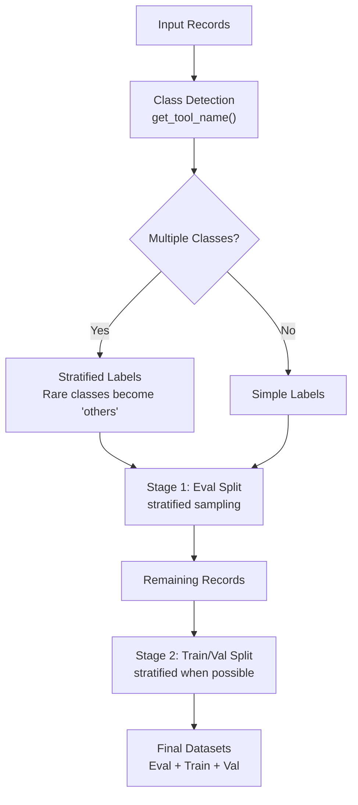

# Configuration Guide

Learn how to configure the Data Flywheel Foundational Blueprint using this guide. It covers all available configuration options, their impacts, and recommended settings.

- [Configuration Guide](#configuration-guide)
  - [Prerequisites](#prerequisites)
    - [System Requirements](#system-requirements)
    - [Required API Keys and Access](#required-api-keys-and-access)
      - [NGC API Key](#ngc-api-key)
      - [NVIDIA API Key (for Remote Configurations)](#nvidia-api-key-for-remote-configurations)
      - [Hugging Face Token](#hugging-face-token)
  - [Before You Start](#before-you-start)
  - [Configuration File Location](#configuration-file-location)
  - [Configuration File Structure](#configuration-file-structure)
    - [Quick Reference](#quick-reference)
  - [Environment Variables](#environment-variables)
    - [Required Environment Variables](#required-environment-variables)
    - [Optional Environment Variables](#optional-environment-variables)
    - [Environment Setup Examples](#environment-setup-examples)
  - [Part 1: System Configuration (Static)](#part-1-system-configuration-static)
    - [NeMo Microservices Configuration](#nemo-microservices-configuration)
    - [Logging Configuration](#logging-configuration)
    - [MLflow Configuration](#mlflow-configuration)
      - [Enabling MLflow](#enabling-mlflow)
    - [LLM Judge Configuration](#llm-judge-configuration)
    - [Modifying System Configuration](#modifying-system-configuration)
    - [Why System Configuration is Static](#why-system-configuration-is-static)
  - [Part 2: Job-Level Configuration (Dynamic)](#part-2-job-level-configuration-dynamic)
    - [LLM Job Configuration](#llm-job-configuration)
      - [Model Integration (NIMs)](#model-integration-nims)
        - [Supported Models](#supported-models)
      - [Data Split Configuration](#data-split-configuration)
        - [Stratified Splitting Behavior](#stratified-splitting-behavior)
        - [Graceful Degradation](#graceful-degradation)
        - [Splitting Process Visualization](#splitting-process-visualization)
        - [Examples](#examples)
        - [Configuration Recommendations by Use Case](#configuration-recommendations-by-use-case)
      - [ICL (In-Context Learning) Configuration](#icl-in-context-learning-configuration)
        - [ICL Example Selection Methods](#icl-example-selection-methods)
          - [Method 1: Uniform Distribution](#method-1-uniform-distribution)
          - [Method 2: Semantic Similarity (Uses Helper Embedding Model)](#method-2-semantic-similarity-uses-helper-embedding-model)
        - [Similarity Configuration](#similarity-configuration)
        - [Helper Embedding NIM Configuration (For ICL Similarity Search)](#helper-embedding-nim-configuration-for-icl-similarity-search)
          - [Option A: Local Deployment (`deployment_type: "local"`)](#option-a-local-deployment-deployment_type-local)
          - [Option B: Remote Deployment (`deployment_type: "remote"`)](#option-b-remote-deployment-deployment_type-remote)
      - [Training Configuration](#training-configuration)
        - [Standard SFT Configuration](#standard-sft-configuration)
        - [DPO Configuration](#dpo-configuration)
    - [Embedding Job Configuration](#embedding-job-configuration)
      - [Model Integration (NIMs)](#model-integration-nims-1)
      - [Data Split Configuration](#data-split-configuration-1)
        - [Date-Based Filtering (Embedding-Specific)](#date-based-filtering-embedding-specific)
        - [Example Split](#example-split)
        - [Configuration Recommendations by Use Case](#configuration-recommendations-by-use-case-1)
      - [Training Configuration](#training-configuration-1)
        - [Option 1: LoRA Merged (Recommended)](#option-1-lora-merged-recommended)
        - [Option 2: All Weights](#option-2-all-weights)
        - [Training Parameters](#training-parameters)
        - [Dataset Parameters for Embeddings](#dataset-parameters-for-embeddings)
      - [Evaluation Configuration](#evaluation-configuration)
        - [Custom Evaluations](#custom-evaluations)
          - [Configuration](#configuration)
          - [Loading Custom Evaluation Data](#loading-custom-evaluation-data)
          - [How Custom Evaluations Work](#how-custom-evaluations-work)
          - [Multiple Custom Evaluations](#multiple-custom-evaluations)
  - [Model Customization](#model-customization)
    - [Overview](#overview)
    - [Configuration Structure](#configuration-structure)
    - [Target Models](#target-models)
    - [Customization Parameters](#customization-parameters)
      - [Customizer Target Parameters](#customizer-target-parameters)
      - [Pod Specification (`pod_spec`)](#pod-specification-pod_spec)
    - [Example Configurations](#example-configurations)
    - [Best Practices](#best-practices)
  - [Data Infrastructure](#data-infrastructure)
    - [Storage Services](#storage-services)
    - [Processing Configuration](#processing-configuration)
  - [Deployment Options](#deployment-options)
    - [Development Environment](#development-environment)
    - [Production Deployment Options](#production-deployment-options)
      - [Docker Compose (Simple Production)](#docker-compose-simple-production)
      - [Kubernetes with Helm (Enterprise Production)](#kubernetes-with-helm-enterprise-production)
    - [Resource Configuration](#resource-configuration)
  - [Configuration Management System](#configuration-management-system)
    - [Overview](#overview-1)
    - [Architecture](#architecture)
      - [Components](#components)
      - [Database Schema](#database-schema)
      - [Configuration Types](#configuration-types)
    - [API Endpoints](#api-endpoints)
      - [List Configurations](#list-configurations)
      - [Create Configuration](#create-configuration)
      - [Get Configuration](#get-configuration)
      - [Update Configuration](#update-configuration)
      - [Delete Configuration](#delete-configuration)
    - [Usage Examples](#usage-examples)
      - [Python Examples](#python-examples)
      - [cURL Examples](#curl-examples)
    - [Configuration Data Structure](#configuration-data-structure)
      - [LLM Job Configuration (`config_type: "llm_job"`)](#llm-job-configuration-config_type-llm_job)
      - [Embedding Job Configuration (`config_type: "embedding_job"`)](#embedding-job-configuration-config_type-embedding_job)
    - [Error Handling](#error-handling)
    - [Initialization](#initialization)
    - [Integration with Job Creation](#integration-with-job-creation)
      - [Configuration Hierarchy](#configuration-hierarchy)
    - [Security Considerations](#security-considerations)
    - [Monitoring and Logging](#monitoring-and-logging)

## Prerequisites

### System Requirements

| Requirement Type | Details |
|-------------------------|---------|
| **Minimum GPU** | **Self-hosted LLM Judge**: 6× (NVIDIA B200, H100, or A100 GPUs)<br>**Remote LLM Judge**: 2× (NVIDIA B200, H100, or A100 GPUs) |
| **Cluster** | Single-node NVIDIA GPU cluster on Linux with cluster-admin permissions |
| **Disk Space** | At least 200 GB free |
| **Software** | Python 3.12<br>Docker Engine<br>Docker Compose v2 |
| **Services** | Elasticsearch 8.19.7<br>MongoDB 7.0.25<br>Redis 7.4.7<br>FastAPI (API server)<br>Celery (task processing) |
| **Resource** | **Minimum Memory**: 1 GB (512 MB reserved for Elasticsearch)<br>**Storage**: Varies by log volume or model size<br>**Network**: Ports 8000 (API), 9200 (Elasticsearch), 27017 (MongoDB), 6379 (Redis) |
| **Development** | Docker Compose for local development with hot reloading<br>Supports macOS (Darwin) and Linux<br>Optional: GPU support for model inference |
| **Production** | Kubernetes cluster (recommended)<br>Resources scale with workload<br>Persistent volume support for data storage |

### Required API Keys and Access

#### NGC API Key

You must [generate a personal API key](https://org.ngc.nvidia.com/setup/api-keys) with the `NGC catalog` and `Public API Endpoints` services selected. This enables:

- Complete deployment of NMP (NeMo Microservices Platform)
- Access NIM services
- Access models hosted in the NVIDIA API Catalog
- Download models on-premises

For detailed steps, refer to the official [NGC Private Registry User Guide](https://docs.nvidia.com/ngc/gpu-cloud/ngc-private-registry-user-guide/index.html#generating-personal-api-key).

#### NVIDIA API Key (for Remote Configurations)

Generate an API key at [build.nvidia.com](https://build.nvidia.com) for accessing:

- Remote LLM judge services through the NVIDIA API catalog
- Remote model inference using NVIDIA Inference Microservice (NIM)

#### Hugging Face Token

Create a token at [Hugging Face Settings](https://huggingface.co/settings/tokens) with read access for data uploading functionality.

> **📖 For Git LFS setup:** See [Get Started Guide - Install Git LFS](get-started/install-and-setup.md#install-git-lfs)

## Before You Start

- Run the [Get Started Guide](./get-started/index.md) to tour the functionality and default settings of the Flywheel service.
- Run the [Notebooks](../notebooks/README.md) to understand how the Flywheel supports different use cases.

> **Important**
>
> Advanced configuration such as Large-scale hyper-parameter sweeps, architecture search, or custom evaluation metrics must run directly in **NeMo microservices**. The configurations in this guide are only for the blueprint itself.
>
> **Note**
>
> For detailed NeMo microservices API documentation, refer to the [official documentation (v26.3.0)](https://docs.nvidia.com/nemo/microservices/26.03.0/api/index.html).

## Configuration File Location

The Data Flywheel Foundational Blueprint uses a YAML-based configuration system. The primary configuration file is located at:

```bash
config/config.yaml
```

## Configuration File Structure

The `config/config.yaml` file is organized into **two distinct parts**, each serving different purposes and managed differently:

```yaml
# ============================================================================
# PART 1: SYSTEM CONFIGURATION (Static - managed by system)
# ============================================================================

nmp_config:        # NeMo Microservices Platform endpoints
logging_config:    # Logging levels and settings
mlflow_config:     # MLflow experiment tracking
llm_judge_config:  # LLM Judge for evaluation

# ============================================================================
# PART 2: JOB-LEVEL CONFIGURATION (Dynamic - managed through API)
# ============================================================================

llm_job_config:         # Configuration for LLM training/evaluation jobs
  nims:                 # NIM model deployments
  data_split_config:    # Data splitting parameters
  icl_config:           # In-Context Learning settings
  training_config:      # Training hyperparameters
  evaluation_config:    # Custom evaluation datasets

embedding_job_config:   # Configuration for embedding training/evaluation jobs
  nims:                 # Embedding NIM deployments
  data_split_config:    # Data splitting parameters
  training_config:      # Embedding training parameters
  evaluation_config:    # Embedding evaluation settings
```

### Quick Reference

| Configuration Type | Management Method | When Applied | Examples |
|-------------------|------------------|--------------|----------|
| **System Configuration** | Edit `config.yaml` file | System restart required | NMP endpoints, logging levels, MLflow settings, LLM Judge |
| **Job-Level Configuration** | API endpoints or `config.yaml` defaults | Dynamic through API | NIM models, training parameters, data splits, ICL settings |

**Key Points:**

- ✅ **System configurations**: Edit `config.yaml` and restart the application
- ✅ **Job configurations**: Use the [Configuration Management API](#configuration-management-system) to create/update/delete dynamically
- 🔄 **Fallback behavior**: If no job config specified in API calls, defaults from `config.yaml` are used

> **📖 See [Configuration Management System](#configuration-management-system)** for detailed API documentation on managing job-level configurations dynamically.

## Environment Variables

The Data Flywheel Foundational Blueprint relies on several environment variables for configuration. These can be set in a `.env` file in the project root or as system environment variables.

### Required Environment Variables

| Variable | Description | Usage | Example |
|----------|-------------|-------|---------|
| `NGC_API_KEY` | API key for NVIDIA Cloud Foundation | NGC login and container downloads only | `nvapi-...` |
| `NVIDIA_API_KEY` | API key for NVIDIA API Catalog | Remote LLM judge services, remote NIM access, remote model inference | `nvapi-...` |
| `HF_TOKEN` | Hugging Face authentication token | Data uploading functionality | `hf_...` |

### Optional Environment Variables

| Variable | Description | Default | Usage |
|----------|-------------|---------|-------|
| `LLM_JUDGE_API_KEY` | API key for remote LLM judge services | Uses `NVIDIA_API_KEY` | Override default API key for remote LLM judge (supports any provider) |
| `EMB_API_KEY` | API key for remote embedding services | Uses `NVIDIA_API_KEY` | Override default API key for remote embeddings (supports any provider) |
| `ES_COLLECTION_NAME` | Elasticsearch collection name | "flywheel" | Data storage and retrieval |
| `ELASTICSEARCH_URL` | Elasticsearch connection URL | "http://localhost:9200" | Database connection |
| `MONGODB_URL` | MongoDB connection URL | "mongodb://localhost:27017" | Database connection |
| `MONGODB_DB` | MongoDB database name | "flywheel" | Database selection |
| `REDIS_URL` | Redis connection URL | "redis://localhost:6379/0" | Task broker and results backend |

### Environment Setup Examples

**Development Setup:**

```bash
# Required for NGC login and container downloads
export NGC_API_KEY="your-ngc-api-key"

# Required for remote configurations
export NVIDIA_API_KEY="your-nvidia-api-key"
export HF_TOKEN="your-huggingface-token"

# Optional (defaults work for development)
export ES_COLLECTION_NAME="flywheel"
export ELASTICSEARCH_URL="http://localhost:9200"
```

**Production Setup:**

```bash
# Required for NGC login and container downloads
export NGC_API_KEY="your-ngc-api-key"

# Required for remote configurations
export NVIDIA_API_KEY="your-nvidia-api-key"
export HF_TOKEN="your-huggingface-token"

# Production URLs
export ELASTICSEARCH_URL="http://elasticsearch.production:9200"
export MONGODB_URL="mongodb://mongodb.production:27017"
export REDIS_URL="redis://redis.production:6379/0"
```

**For full functionality, at minimum configure:**

```bash
export NGC_API_KEY="your-ngc-api-key"
export NVIDIA_API_KEY="your-nvidia-api-key"
export HF_TOKEN="your-huggingface-token"
```

**Using API keys from other providers for remote configurations:**

```bash
# Use OpenAI API key for remote LLM judge
export LLM_JUDGE_API_KEY="sk-..."

# Use Anthropic API key for remote embeddings
export EMB_API_KEY="sk-ant-..."

# Use different providers for different remote services
export NVIDIA_API_KEY="nvapi-..."  # Default for both remote services
export LLM_JUDGE_API_KEY="sk-..."  # Override for remote LLM judge
export EMB_API_KEY="sk-ant-..."    # Override for remote embeddings
```

## Part 1: System Configuration (Static)

System configuration settings are loaded once at application startup from `config.yaml` and **cannot be changed through the API**. These settings control core infrastructure and services that require stability across the application lifecycle.

> **⚠️ Important**: Any changes to system configuration require editing `config/config.yaml` and restarting the application.

### NeMo Microservices Configuration

The `nmp_config` section controls the NeMo Microservices Platform (NMP) integration:

```yaml
nmp_config:
  nemo_base_url: "http://nemo.test"
  nim_base_url: "http://nim.test"
  datastore_base_url: "http://data-store.test"
  nmp_namespace: "dfwbp"
```

| Option | Description | Default |
|--------|-------------|---------|
| `nemo_base_url` | Base URL for NeMo services | `http://nemo.test` |
| `nim_base_url` | Base URL for NIM services | `http://nim.test` |
| `datastore_base_url` | Base URL for datastore services | `http://data-store.test` |
| `nmp_namespace` | Namespace for NMP resources | "dfwbp" |

### Logging Configuration

The `logging_config` section controls the verbosity of log output across all services:

```yaml
logging_config:
  level: "INFO"  # Options: DEBUG, INFO, WARNING, ERROR, CRITICAL
```

| Option | Description | Default | Notes |
|--------|-------------|---------|-------|
| `level` | Log verbosity level | "INFO" | Controls detail level of application logs |

The `logging_config` section configures logging level. Available options:

- `CRITICAL`: Only critical errors
- `ERROR`: Error events
- `WARNING`: Warning messages
- `INFO`: Informational messages (default)
- `DEBUG`: Detailed diagnostic information

### MLflow Configuration

The `mlflow_config` section controls MLflow integration for experiment tracking and model management. MLflow is controlled by the `COMPOSE_PROFILES` environment variable:

```yaml
mlflow_config:
  # enabled: automatically set based on COMPOSE_PROFILES environment variable
  tracking_uri: "http://0.0.0.0:5000"
  experiment_name_prefix: "data-flywheel"
  artifact_location: "./mlruns"
```

| Option | Description | Default | Notes |
|--------|-------------|---------|-------|
| `enabled` | Enable MLflow integration | Automatically set | Determined by checking if "mlflow" is in `COMPOSE_PROFILES` |
| `tracking_uri` | MLflow tracking server URI | "http://0.0.0.0:5000" | URL of the MLflow tracking server |
| `experiment_name_prefix` | Prefix for experiment names | "data-flywheel" | Used to organize experiments |
| `artifact_location` | Location for MLflow artifacts | "./mlruns" | Directory for storing model artifacts |

#### Enabling MLflow

To enable MLflow, set the `COMPOSE_PROFILES` environment variable to include "mlflow":

```bash
export COMPOSE_PROFILES=mlflow
docker compose -f ./deploy/docker-compose.yaml build api ingestion-plugins-api && \
docker compose -f ./deploy/docker-compose.yaml up -d
```

Or run it directly:

```bash
COMPOSE_PROFILES=mlflow docker compose -f ./deploy/docker-compose.yaml build api ingestion-plugins-api && \
COMPOSE_PROFILES=mlflow docker compose -f ./deploy/docker-compose.yaml up -d
```

> **Note:**
>
> - The MLflow service only starts when the "mlflow" profile is enabled by `COMPOSE_PROFILES`
> - The `enabled` field in the configuration is automatically set based on the presence of "mlflow" in `COMPOSE_PROFILES`
> - When enabled, MLflow will be available at `http://localhost:5000`

### LLM Judge Configuration

The `llm_judge_config` section configures the LLM used for evaluating model outputs. This is a **system-level configuration** that remains static throughout the application lifecycle.

**NOTE: By default llm_judge_config is set to local configuration.**

For local deployment, use the following configuration:

```yaml
llm_judge_config:
  deployment_type: "local"
  model_name: "meta/llama-3.3-70b-instruct"
  context_length: 32768
  gpus: 4
  pvc_size: 25Gi
  tag: "1.8.5"
```

> **⏱️ Initial Deployment Time:**
>
> For on-prem deployments using the local LLM judge with the Meta Llama 3.3 70B Instruct model, the initial startup takes **10-20 minutes or more** as the model needs to be downloaded and initialized. The actual time depends on your network speed and bandwidth. This applies to both Docker Compose and Helm chart deployments. Subsequent restarts will be faster as the model is cached locally.

| Option | Description | Required | Example |
|--------|-------------|----------|---------|
| `deployment_type` | Deployment type (remote or local) | Yes | "local" |
| `model_name` | Name of the model to deploy | Yes | "meta/llama-3.3-70b-instruct" |
| `context_length` | Maximum context length in tokens | Yes | 32768 |
| `gpus` | Number of GPUs to allocate | Yes | 4 |
| `pvc_size` | Persistent volume claim size | Yes | "25Gi" |
| `tag` | Model version tag | Yes | "1.8.5" |

For remote deployment, use the following configuration instead:

```yaml
llm_judge_config:
  deployment_type: "remote"
  url: "https://integrate.api.nvidia.com/v1/chat/completions"
  model_name: "meta/llama-3.3-70b-instruct"
```

| Option | Description | Required | Example |
|--------|-------------|----------|---------|
| `deployment_type` | Deployment type (remote or local) | Yes | "remote" |
| `url` | API endpoint for remote LLM | Yes (if remote) | `"https://integrate.api.nvidia.com/v1/chat/completions"` |
| `model_name` | Model identifier | Yes | "meta/llama-3.3-70b-instruct" |

### Modifying System Configuration

To modify any system configuration:

1. **Edit `config/config.yaml`** directly
2. **Restart the application** for changes to take effect
3. **System configurations cannot be changed through the API**

### Why System Configuration is Static

- **Security**: Prevents unauthorized changes to critical system settings
- **Stability**: Ensures consistent system behavior across restarts
- **Simplicity**: Reduces complexity by separating concerns
- **Control**: System administrators maintain full control over infrastructure settings

---

## Part 2: Job-Level Configuration (Dynamic)

Job-level configurations control how individual LLM and embedding jobs are executed. These settings **can be managed dynamically** through the [Configuration Management System](#configuration-management-system) API without restarting the application.

> **📖 Dynamic Management**: Use the [Configuration Management API](#configuration-management-system) to create, update, and delete job configurations at runtime.
>
> **🔄 Fallback Behavior**: If no configuration is specified when creating a job, the system uses default values from `config.yaml`.

### LLM Job Configuration

The `llm_job_config` section in `config.yaml` provides default settings for LLM training and evaluation jobs.

#### Model Integration (NIMs)

The `nims` section configures which models to deploy and their settings:

**Default Behavior**: When a model is listed in the `nims` section, it will automatically run both base evaluation and In-Context Learning (ICL) evaluation by default.

**Customization Control**: Use the `customization_enabled` key to control whether the model can be fine-tuned. When enabled, the model will also run customization and evaluation on customized model using the settings defined in `customizer_configs`.

```yaml
nims:
  - model_name: "meta/llama-3.2-1b-instruct"
    model_type: "llm"
    context_length: 8192
    gpus: 1
    pvc_size: 25Gi
    tag: "1.8.3"
    nim_image_model_name: "meta/llama-3.2-1b-instruct"  # Optional: Override model name in NIM container
    customization_enabled: true
    customizer_configs:
      target: "meta/llama-3.2-1b-instruct@2.0"
      gpus: 1
      max_seq_length: 8192
```

| Option | Description | Required | Example |
|--------|-------------|----------|---------|
| `model_name` | Name of the model to deploy | Yes | "meta/llama-3.2-1b-instruct" |
| `model_type` | Type of NIM (llm or embedding) | No | "llm" |
| `context_length` | Maximum context length in tokens | Yes | 8192 |
| `gpus` | Number of GPUs to allocate | Yes | 1 |
| `pvc_size` | Persistent volume claim size | No | "25Gi" |
| `tag` | Model version tag | Yes | "1.8.3" |
| `nim_image_model_name` | Override for model name in NIM container image. Defaults to `model_name` if not provided. | No | None (uses `model_name`) |
| `customization_enabled` | Whether model can be fine-tuned | No | false |

> **📖 For detailed customization configuration options:** Refer to [Model Customization](#model-customization)
>
> **Note:** All NIMs listed in your configuration will appear in the job response with a status of `"Pending"` as soon as a job starts, even if NIMs are executed one after another. This ensures users have a transparent view of all planned model evaluations for the job. Each NIM's status will update (e.g., to `Running`, `Completed`, or `Error`) as the job progresses.

##### Supported Models

Currently supported models include:

- Meta Llama 3.1 8B Instruct
- Meta Llama 3.2 1B Instruct
- Meta Llama 3.2 3B Instruct
- Meta Llama 3.3 70B Instruct

Note: Not all models may be enabled by default in the configuration. Enable them by uncommenting and configuring the appropriate sections in `config/config.yaml`.

#### Data Split Configuration

The Data Flywheel uses **class-aware stratified splitting** powered by scikit-learn to ensure balanced representation of different tool types across your evaluation, training, and validation datasets.

```yaml
llm_job_config:
  data_split_config:
    eval_size: 100
    val_ratio: 0.1
    min_total_records: 50
    random_seed: null
    limit: 1000  # LLM default: limit to 1000 records
    parse_function_arguments: true
```

| Option | Description | Default | Notes |
|--------|-------------|---------|-------|
| `eval_size` | Number of examples for evaluation | 100 | Minimum size of evaluation set (stratified across tool types) |
| `val_ratio` | Ratio of data used for validation | 0.1 | Must be ≥ 0 and < 1 (10% of remaining data after eval, stratified) |
| `min_total_records` | Minimum required records | 50 | Total dataset size requirement |
| `random_seed` | Seed for reproducible splits | null | Set for reproducible results |
| `limit` | Maximum records to pull from Elasticsearch | 1000 | Set to number to limit records; `null` means no limit (pulls all matching records) |
| `parse_function_arguments` | Parse function arguments to JSON | true | Data validation: converts string function arguments to JSON objects for tool calling workloads |

##### Stratified Splitting Behavior

The flywheel automatically analyzes your data to identify different classes (tool types) and ensures balanced representation across splits:

**1. Class Detection**: Records are classified by their tool usage using the `get_tool_name()` function.

**2. Splitting Strategy**:

- **Frequent classes**: Tool types with multiple records are split using stratified sampling
- **Rare classes**: Tool types with only one record are distributed fairly across splits

**3. Two-Stage Process**:

- **Stage 1**: Creates evaluation set with stratified sampling from frequent classes
- **Stage 2**: Splits remaining data into training and validation sets (also stratified when possible)

##### Graceful Degradation

When stratification isn't possible (e.g., insufficient samples per class), the system automatically falls back to random splitting while maintaining the specified split sizes.

##### Splitting Process Visualization



##### Examples

**Tool-Calling Dataset (60 records)**:

- `get_weather`: 30 records
- `schedule_meeting`: 20 records  
- `no_tool`: 10 records

**With `eval_size: 6, val_ratio: 0.2`**:

- **Eval**: 6 records (stratified: ~3 weather, ~2 meeting, ~1 no_tool)
- **Train**: 43 records (remaining after eval/val splits)
- **Val**: 11 records (20% of remaining 54 records)

**Single-Class Dataset Fallback**:
When all records use the same tool, stratification automatically falls back to random splitting while preserving split ratios.

##### Configuration Recommendations by Use Case

| Use Case | eval_size | val_ratio | min_total_records | random_seed | Notes |
|----------|-----------|-----------|-------------------|-------------|-------|
| **Development/Testing** | 20 | 0.1 | 50 | 42 | Small, reproducible |
| **Production (Balanced)** | 100 | 0.1 | 200 | null | Standard settings |
| **Production (Imbalanced)** | 50 | 0.15 | 500 | null | Larger validation set |
| **Tool-Heavy Workloads** | 200 | 0.2 | 1000 | null | More eval examples per tool |

> **Related Documentation**
>
> - **API Usage**: Refer to [Data Split Configuration](06-api-reference.md#data-split-configuration) for API integration
> - **Best Practices**: Refer to [Tuning Guidelines](04-limitations-best-practices.md#tune-data_split_config-and-icl_config-as-you-learn-workload-characteristics)
> - **Validation Process**: Refer to [Dataset Validation](dataset-validation.md) for data quality requirements
>
> While these values are set in the configuration file, you can override them on a per-job basis by including a `data_split_config` object in the POST request to `/api/jobs`. This gives you the flexibility to use different split configurations for different jobs without modifying the configuration file.
>
> For example, you might want to:
>
> - Use a larger evaluation set for certain workloads
> - Adjust the validation ratio based on dataset size
> - Set a specific random seed for reproducible results
>
> You can override just the parameters you want to change - any parameters not specified in the POST request will automatically use their default values shown in the table above. For instance, you could override just the `eval_size` while keeping the default values for all other parameters.
>
> Refer to the [LLM Pipeline](get-started/llm-pipeline/index.md) or [Embedding Pipeline](get-started/embedding-pipeline/index.md) guides for complete examples.

#### ICL (In-Context Learning) Configuration

> **🎯 Important Context:**
> 
> This section configures In-Context Learning (ICL) for **LLM jobs only**. ICL adds few-shot examples to prompts to improve model performance without fine-tuning.
>
> The "Embedding NIM" mentioned here is used **only for finding similar examples** via semantic search during ICL example selection.

The ICL configuration supports two example selection methods to optimize few-shot learning performance:

```yaml
icl_config:
  max_context_length: 32768
  reserved_tokens: 4096
  max_examples: 3
  min_examples: 1
  example_selection: "semantic_similarity"  # or "uniform_distribution"
  similarity_config:
    relevance_ratio: 0.7
    embedding_nim_config:
      deployment_type: "remote"
      url: "https://integrate.api.nvidia.com/v1/embeddings"
      model_name: "nvidia/llama-3.2-nv-embedqa-1b-v2"
```

| Option | Description | Default | Notes |
|--------|-------------|---------|-------|
| `max_context_length` | Maximum tokens in context | 32768 | Model dependent |
| `reserved_tokens` | Tokens reserved for system | 4096 | For prompts and metadata |
| `max_examples` | Maximum ICL examples | 3 | Upper limit per context |
| `min_examples` | Minimum ICL examples | 1 | Lower limit per context |
| `example_selection` | ICL selection method | "semantic_similarity" | Refer to [ICL Example Selection Methods](#icl-example-selection-methods) |
| `similarity_config` | Similarity configuration | Required for semantic_similarity | Required for `semantic_similarity` selection |

##### ICL Example Selection Methods

The Data Flywheel supports two methods for selecting in-context learning examples for LLM evaluation:

---

##### Method 1: Uniform Distribution

**Configuration:** `example_selection: "uniform_distribution"`

- **Description**: Distributes examples evenly across different tool types
- **Use Case**: Provides balanced representation of all available tools
- **Behavior**: For tool-calling workloads, ensures each tool gets roughly equal representation in the ICL examples
- **Requirements**: ✅ No additional configuration needed
- **Infrastructure**: ✅ No additional resources required

**Example Configuration:**
```yaml
icl_config:
  example_selection: "uniform_distribution"
  max_examples: 3
  min_examples: 1
```

---

##### Method 2: Semantic Similarity (Uses Helper Embedding Model)

**Configuration:** `example_selection: "semantic_similarity"`

- **Description**: Selects examples based on semantic similarity using vector embeddings
- **Use Case**: Finds the most relevant examples for each evaluation query
- **Behavior**: Uses a **helper embedding model** to identify semantically similar examples from historical data
- **Requirements**: ⚙️ Requires `similarity_config` with `embedding_nim_config`
- **Infrastructure**: 🔧 Requires deploying a separate embedding NIM for similarity computation

> **⚠️ Important:** This embedding NIM is used **only for ICL example selection** in LLM jobs. It generates embeddings to find similar historical examples. It is NOT the main model being evaluated or trained.

**Example Configuration:**
```yaml
icl_config:
  example_selection: "semantic_similarity"
  max_examples: 3
  min_examples: 1
  similarity_config:
    relevance_ratio: 0.7
    embedding_nim_config:  # Helper model for similarity search
      deployment_type: "remote"
      url: "https://integrate.api.nvidia.com/v1/embeddings"
      model_name: "nvidia/llama-3.2-nv-embedqa-1b-v2"
```

---

##### Similarity Configuration

When using `semantic_similarity`, you must configure the `similarity_config` section:

```yaml
icl_config:
  example_selection: "semantic_similarity"
  similarity_config:
    relevance_ratio: 0.7
    embedding_nim_config:
      deployment_type: "remote"
      url: "https://integrate.api.nvidia.com/v1/embeddings"
      model_name: "nvidia/llama-3.2-nv-embedqa-1b-v2"
```

| Option | Description | Default | Notes |
|--------|-------------|---------|-------|
| `relevance_ratio` | Ratio of examples selected by pure relevance | 0.7 | Range: 0.0-1.0. Higher values prioritize relevance; lower values ensure tool diversity |
| `embedding_nim_config` | Helper embedding model for similarity search | Required | See deployment options below |

---

##### Helper Embedding NIM Configuration (For ICL Similarity Search)

To use semantic similarity for finding relevant ICL examples, you need an embedding model that converts text into vectors for similarity matching. This helper model runs temporarily during dataset creation to identify the most relevant historical examples for your evaluation queries.

**Two deployment options available:** Local (in your cluster) or Remote (external API)

##### Option A: Local Deployment (`deployment_type: "local"`)

**Best for:** Self-hosted environments, data privacy requirements, high-volume ICL operations

- Spins up a **dedicated helper embedding NIM** in your cluster
- Requires additional GPU resources and storage
- Provides isolated embedding generation for ICL similarity search
- Temporary deployment: spins up during dataset creation, shuts down after completion

```yaml
icl_config:
  example_selection: "semantic_similarity"
  similarity_config:
    relevance_ratio: 0.7
    embedding_nim_config:
      deployment_type: "local"
      model_name: "nvidia/llama-3.2-nv-embedqa-1b-v2"
      context_length: 32768
      gpus: 1
      pvc_size: "25Gi"
      tag: "1.9.0"
```

| Parameter | Description | Required | Example |
|-----------|-------------|----------|---------|
| `deployment_type` | Deployment method | Yes | "local" |
| `model_name` | Helper embedding model identifier | Yes | "nvidia/llama-3.2-nv-embedqa-1b-v2" |
| `context_length` | Maximum context length in tokens | Yes | 32768 |
| `gpus` | Number of GPUs for helper model | Yes | 1 |
| `pvc_size` | Persistent volume claim size | Yes | "25Gi" |
| `tag` | Model version tag | Yes | "1.9.0" |

---

##### Option B: Remote Deployment (`deployment_type: "remote"`)

**Best for:** Cost efficiency, no GPU overhead, quick setup

- Uses an **external embedding API endpoint** for similarity computation
- No local GPU resources required
- Requires API key configuration (uses `EMB_API_KEY` or `NVIDIA_API_KEY` environment variable)
- Suitable for development and low-volume use cases

```yaml
icl_config:
  example_selection: "semantic_similarity"
  similarity_config:
    relevance_ratio: 0.7
    embedding_nim_config:
      deployment_type: "remote"
      url: "https://integrate.api.nvidia.com/v1/embeddings"
      model_name: "nvidia/llama-3.2-nv-embedqa-1b-v2"
```

| Parameter | Description | Required | Example |
|-----------|-------------|----------|---------|
| `deployment_type` | Deployment method | Yes | "remote" |
| `url` | External embedding API endpoint | Yes | "<https://integrate.api.nvidia.com/v1/embeddings>" |
| `model_name` | Helper embedding model identifier | Yes | "nvidia/llama-3.2-nv-embedqa-1b-v2" |

> **💡 API Key:** Remote embedding services use the `EMB_API_KEY` environment variable (falls back to `NVIDIA_API_KEY` if not set). See [Environment Variables](#environment-variables) for setup.

#### Training Configuration

The `training_config` section controls model fine-tuning for LLM jobs. The Data Flywheel supports two training approaches:

| Training Type | Description | Use Case |
|--------------|-------------|----------|
| **SFT (Supervised Fine-Tuning)** | Train on single correct responses | Standard task-specific improvement |
| **DPO (Direct Preference Optimization)** | Train on preference pairs (chosen vs rejected) | Alignment with human preferences |

##### Standard SFT Configuration

```yaml
llm_job_config:
  training_config:
    training_type: "sft"
    finetuning_type: "lora"  # or "all_weights"
    epochs: 2
    batch_size: 16
    learning_rate: 0.0001
    lora:
      adapter_dim: 32
      adapter_dropout: 0.1
```

**Key Parameters:**

| Parameter | Default | Options | Notes |
|-----------|---------|---------|-------|
| `training_type` | "sft" | "sft", "dpo" | Training approach |
| `finetuning_type` | "lora" | "lora", "all_weights" | Low-Rank Adaptation or full fine-tuning |
| `epochs` | 2 | 1-10 | Training epochs with early stopping |
| `batch_size` | 16 | 4-32 | Recommended: 16; use 32 only with validated stability |
| `learning_rate` | 0.0001 | 1e-5 to 1e-3 | Optimizer step size |

**LoRA Parameters (when `finetuning_type: "lora"`):**

| Parameter | Default | Notes |
|-----------|---------|-------|
| `adapter_dim` | 32 | Start with 8, increase if needed |
| `adapter_dropout` | 0.1 | Use 0.05-0.1 for smaller models (7B-13B) |
| `alpha` | 64 | Scaling factor for LoRA updates |

> **📖 For complete LLM training details:** Refer to [Model Customization](#model-customization)

##### DPO Configuration

For preference optimization, use DPO training:

```yaml
llm_job_config:
  training_config:
    training_type: "dpo"
    finetuning_type: "all_weights"
    epochs: 3
    batch_size: 64
    learning_rate: 0.00005
    dpo:
      ref_policy_kl_penalty: 0.1
      preference_loss_weight: 1.0
      preference_average_log_probs: false
      sft_loss_weight: 0.0
      sft_average_log_probs: false
```

**DPO Hyperparameters:**

| Parameter | Default | Range | Purpose |
|-----------|---------|-------|---------|
| `ref_policy_kl_penalty` | 0.05 | 0.0-1.0 | Controls deviation from base model |
| `preference_loss_weight` | 1.0 | 0.0-10.0 | Emphasizes preference learning |
| `sft_loss_weight` | 0.0 | 0.0-10.0 | 0 = pure DPO, >0 = hybrid SFT+DPO |

> **📖 For complete DPO training guide:** Refer to [DPO Training Guide](13-dpo-training.md)

### Embedding Job Configuration

The `embedding_job_config` section in `config.yaml` provides default settings for embedding model training and evaluation jobs.

Embedding job configuration follows a similar structure to LLM job configuration, with specialized parameters for embedding models:

```yaml
embedding_job_config:
  nims:
    - model_name: "nvidia/llama-3.2-nv-embedqa-1b-v2"
      model_type: "embedding"
      context_length: 32768
      gpus: 1
      pvc_size: 25Gi
      tag: "1.9.0"
      customization_enabled: true
      customizer_configs:
        gpus: 1
        max_seq_length: 8192
        target: "nvidia/llama-3.2-nv-embedqa-1b@v2"

  evaluation_config:
    embedding_eval_metrics:
      metrics:
        - "recall_5"
        - "map"
        - "P_5"
        - "P_10"

  data_split_config:
    val_ratio: 0.09
    eval_size: 100
    min_total_records: 50
    random_seed: 42
    from_date: "2021-01-01"
    to_date: "2023-10-31"

  training_config:
    training_type: "sft"
    finetuning_type: "lora_merged"
    epochs: 1
    batch_size: 64
    learning_rate: 0.000025
    # ... additional parameters
```

#### Model Integration (NIMs)

The `nims` section configures which embedding models to deploy:

```yaml
embedding_job_config:
  nims:
    - model_name: "nvidia/llama-3.2-nv-embedqa-1b-v2"
      model_type: "embedding"
      context_length: 32768
      gpus: 1
      pvc_size: 25Gi
      tag: "1.9.0"
      customization_enabled: true
      customizer_configs:
        gpus: 1
        max_seq_length: 8192
        target: "nvidia/llama-3.2-nv-embedqa-1b@v2"
```

| Option | Description | Required | Example |
|--------|-------------|----------|---------|
| `model_name` | Name of the embedding model to deploy | Yes | "nvidia/llama-3.2-nv-embedqa-1b-v2" |
| `model_type` | Type of NIM | No | "embedding" |
| `context_length` | Maximum context length in tokens | Yes | 32768 |
| `gpus` | Number of GPUs to allocate | Yes | 1 |
| `pvc_size` | Persistent volume claim size | No | "25Gi" |
| `tag` | Model version tag | Yes | "1.9.0" |
| `customization_enabled` | Whether model can be fine-tuned | No | false |

> **📖 For detailed customization configuration options:** Refer to [Model Customization](#model-customization)
>
> **📖 Iterative Fine-tuning:** To train on top of an already customized embedding model, see [Iterative Fine-tuning](14-embedding-training.md#3-iterative-fine-tuning-training-on-customized-models) in the Embedding Training Guide.

#### Data Split Configuration

The `data_split_config` section for embedding jobs uses a simpler, **random splitting** approach (not stratified) since embedding triplet data doesn't have natural "classes" like tool names in LLM workloads.

> **Key Differences from LLM Pipeline:**
> - Uses **simple random sampling** instead of class-aware stratified sampling
> - Includes **date-based filtering** for temporal data selection (embedding-specific)
> - When `limit` is `None` (default), **pulls all matching records** from Elasticsearch

```yaml
embedding_job_config:
  data_split_config:
    eval_size: 100
    val_ratio: 0.09
    min_total_records: 10  # Note: Different from LLM (50)
    random_seed: null      # Default: null; set to 42 for reproducibility
    limit: null            # Embedding default: null (pulls all records)
    from_date: null        # Optional: Filter from date (YYYY-MM-DD)
    to_date: null          # Optional: Filter to date (YYYY-MM-DD)
    min_negatives: 1
    max_negatives: 5
```

| Option | Description | Default | Notes |
|--------|-------------|---------|-------|
| `eval_size` | Number of triplets for evaluation | 100 | Fixed size evaluation set |
| `val_ratio` | Ratio of remaining data for validation | 0.09 | Must be ≥ 0 and < 1 (9% of remaining data after eval) |
| `min_total_records` | Minimum required triplets | 10 | Total dataset size requirement |
| `random_seed` | Seed for reproducible splits | null | Default is null; examples showing `42` are explicit overrides for reproducibility |
| `limit` | Maximum records to pull from Elasticsearch | **null** | **Default: None** pulls all matching records; set to a number to limit |
| `from_date` | **Start date for temporal filtering** | **null** | **Embedding-specific**: Filter records from this date (format: YYYY-MM-DD). Must be used with `to_date` |
| `to_date` | **End date for temporal filtering** | **null** | **Embedding-specific**: Filter records to this date (format: YYYY-MM-DD). Must be used with `from_date` |
| `min_negatives` | Minimum negative docs per triplet | 1 | Data validation threshold |
| `max_negatives` | Maximum negative docs per triplet | 5 | Data validation threshold |

##### Date-Based Filtering (Embedding-Specific)

Embedding jobs support temporal filtering to pull data from specific time periods. This is useful for:
- Training on recent data only
- Creating time-based evaluation sets
- Comparing model performance across different time periods

**Usage:**
```yaml
embedding_job_config:
  data_split_config:
    from_date: "2024-01-01"  # Start date (inclusive)
    to_date: "2024-12-31"    # End date (inclusive)
    limit: null              # Pull all records in date range
```

**Important Rules:**
- ✅ Both `from_date` and `to_date` must be provided together (or both `null`)
- ✅ `from_date` must be earlier than or equal to `to_date`
- ✅ Date format: `YYYY-MM-DD` (ISO 8601)
- ✅ Filtering happens **before** splitting into train/val/eval sets

**Example - Recent Data Only:**
```yaml
# Pull only last 6 months of data
data_split_config:
  from_date: "2024-07-01"
  to_date: "2024-12-31"
  limit: null  # No limit - use all records in date range
```

**Example - Limited Recent Data:**
```yaml
# Pull max 5000 records from last 3 months
data_split_config:
  from_date: "2024-10-01"
  to_date: "2024-12-31"
  limit: 5000  # Cap at 5000 records
```

> **Implementation Note:** The system converts dates to Unix timestamps and filters Elasticsearch records using the `timestamp` field. See `src/lib/integration/record_exporter.py:69-100` for implementation details.

##### Example Split

**Embedding Dataset (1000 triplets)**:

With `eval_size: 100, val_ratio: 0.09`:

- **Eval**: 100 triplets (randomly selected first)
- **Remaining**: 900 triplets
- **Validation**: 81 triplets (9% of 900)
- **Training**: 819 triplets (remainder)

##### Configuration Recommendations by Use Case

| Use Case | eval_size | val_ratio | min_total_records | random_seed | Notes |
|----------|-----------|-----------|-------------------|-------------|-------|
| **Development/Testing** | 20 | 0.05 | 50 | 42 | Small, reproducible |
| **Production (Small)** | 100 | 0.09 | 500 | 42 | Standard settings |
| **Production (Large)** | 200 | 0.09 | 5000 | null | Larger evaluation set |
| **Domain-Specific** | 150 | 0.10 | 1000 | 42 | Balanced validation |

> **Related Documentation**
> - **Implementation Details**: Check `src/lib/flywheel/util.py:254-298` for source code
> - **Embedding Training Guide**: Refer to [Embedding Training Guide](14-embedding-training.md) for complete workflow
> - **Custom Evaluations**: See [Custom Evaluations](#custom-evaluations) for BEIR format evaluation datasets
>
> **Note**: Like LLM data split config, you can override embedding data split parameters on a per-job basis by including a `data_split_config` object in the POST request to `/api/jobs` with `job_type: "embedding_job"`.

#### Training Configuration

The `training_config` section controls model fine-tuning for embedding jobs. Embedding jobs support two fine-tuning approaches optimized for contrastive learning:

| Fine-tuning Type | Description | Use Case |
|-----------------|-------------|----------|
| **LoRA Merged** | Parameter-efficient with full model output | Recommended - efficient and effective |
| **All Weights** | Full fine-tuning of all model parameters | Maximum performance, more resources |

##### Option 1: LoRA Merged (Recommended)

```yaml
embedding_job_config:
  training_config:
    training_type: "sft"
    finetuning_type: "lora_merged"
    epochs: 1
    batch_size: 64
    learning_rate: 0.000025
    dataset_parameters:
      in_batch_negatives: true
      num_hard_negatives: 1
    lora:
      adapter_dim: 32
      alpha: 64
      adapter_dropout: 0.01
```

##### Option 2: All Weights

```yaml
embedding_job_config:
  training_config:
    training_type: "sft"
    finetuning_type: "all_weights"
    epochs: 1
    batch_size: 256
    learning_rate: 0.000005
    micro_batch_size: 1
    tensor_parallel_size: 1
```

**Detailed Configuration:**

```yaml
# Complete embedding training configuration
training_config:
  training_type: "sft"
  finetuning_type: "lora_merged"  # Can be "lora_merged", or "all_weights"
  epochs: 1
  batch_size: 64
  learning_rate: 0.000025
  min_learning_rate: 0.0000005
  warmup_steps: 100
  weight_decay: 0.01
  
  # Embedding-specific dataset parameters
  dataset_parameters:
    in_batch_negatives: true  # Use in-batch negative sampling
    num_hard_negatives: 1     # Number of hard negatives per sample
  
  # Parallelism settings for embedding training
  micro_batch_size: 2
  tensor_parallel_size: 4
  pipeline_parallel_size: 1
  data_parallel_size: 1
  use_sequence_parallel: false
  training_precision: "bf16-mixed"
  
  # LoRA configuration for embeddings (when using lora_merged fine-tuning)
  lora:
    adapter_dim: 32
    alpha: 64
    adapter_dropout: 0.01
```

##### Training Parameters

| Parameter | Description | Default | Notes |
|-----------|-------------|---------|-------|
| `finetuning_type` | Fine-tuning method | "lora_merged" | "lora_merged", or "all_weights" |
| `batch_size` | Training batch size | 64 | Larger batches for contrastive learning |
| `learning_rate` | Initial learning rate | 0.000025 | Lower than standard LLM fine-tuning |
| `min_learning_rate` | Minimum learning rate | 0.0000005 | For learning rate scheduling |
| `warmup_steps` | Warmup steps | 100 | Gradual learning rate increase |
| `weight_decay` | L2 regularization | 0.01 | Prevents overfitting |

##### Dataset Parameters for Embeddings

| Parameter | Description | Default | Notes |
|-----------|-------------|---------|-------|
| `in_batch_negatives` | Use in-batch negative sampling | None | Improves contrastive learning |
| `num_hard_negatives` | Hard negatives per sample | None | Number of challenging negative examples |

> **📖 For complete embedding training guide:** Refer to [Embedding Training Guide](14-embedding-training.md)

#### Evaluation Configuration

The `evaluation_config` section configures evaluation settings for embedding jobs, including custom evaluation datasets.

##### Custom Evaluations

The Data Flywheel Blueprint supports custom evaluation datasets for embedding models. This feature allows you to evaluate embedding models against your own domain-specific datasets in addition to the standard evaluation metrics.

> **Note:** Custom evaluations are currently available only for embedding models. Support for LLM custom evaluations is planned for a future release.

###### Configuration

Custom evaluations are configured in the `evaluation_config` section of the embedding job configuration:

```yaml
embedding_job_config:
  evaluation_config:
    custom_evaluations:
      - name: "custom-eval-dataset"
        workload_id: "val-set-1"
        client_id: "mozillacorebugs"
```

| Option | Description | Required | Example |
|--------|-------------|----------|---------|
| `name` | Display name for the custom evaluation | Yes | "custom-eval-dataset" |
| `workload_id` | Unique identifier matching the loaded dataset | Yes | "val-set-1" |
| `client_id` | Client identifier for the dataset | Yes | "mozillacorebugs" |

> **📖 For custom evaluation datasets:**
> - **Creating:** [Embedding Training Guide - Create Custom Evaluation Data](14-embedding-training.md#5-create-custom-evaluation-data)
> - **Loading:** [Embedding Training Guide - Load BEIR Format Evaluation Data](14-embedding-training.md#load-beir-format-evaluation-data)
> - **How it works:** [Evaluation Types and Metrics - Custom Evaluation Datasets](05-evaluation-types-and-metrics.md#custom-evaluation-datasets)

###### Loading Custom Evaluation Data

Before using custom evaluations, you must load your evaluation datasets into the system using the dedicated load script.

**BEIR Format for Embedding Evaluation:**

The system supports BEIR-format evaluation datasets for embedding models. Use the dedicated load script:

```bash
# Place your custom-eval-dataset directory in the data/ directory
# Load BEIR format evaluation dataset
uv run python src/scripts/load_embedding_eval_data.py \
  --workload-id "val-set-1" \
  --client-id "mozillacorebugs" \
  --data-dir "custom-eval-dataset"
```

> **💡 Data Directory Location:** The `--data-dir` parameter accepts relative paths (resolved from `data/` directory) or absolute paths.

The BEIR format requires three files in your data directory:

- `corpus.jsonl`: Document corpus with `_id` and `text` fields
- `queries.jsonl`: Query set with `_id` and `text` fields  
- `qrels/test.tsv`: Relevance judgments mapping query IDs to document IDs

For detailed BEIR format specifications, refer to [Embedding Training Guide - Custom Evaluation Datasets](14-embedding-training.md#custom-evaluation-datasets-beir-format).

###### How Custom Evaluations Work

1. **Dataset Loading**: Load your evaluation data with a specific `workload_id` and `client_id`
2. **Configuration**: Add the custom evaluation entry to your config with matching identifiers
3. **Execution**: During evaluation, the system will:
   - Retrieve the custom dataset based on `workload_id` and `client_id`
   - Run the same evaluation metrics as standard evaluations
   - Report results separately for each custom evaluation dataset

###### Multiple Custom Evaluations

You can configure multiple custom evaluation datasets:

```yaml
evaluation_config:
  custom_evaluations:
    - name: "domain-specific-eval"
      workload_id: "domain-1"
      client_id: "client-1"
    - name: "industry-benchmark"
      workload_id: "benchmark-2"
      client_id: "client-2"
```

Each custom evaluation will be run independently and results will be reported separately in the evaluation outputs.

> **Note**
>
> Custom evaluations for embedding models use the same retrieval metrics as standard embedding evaluations: MAP, Recall@k, Precision@k, and NDCG@k.
>
> Refer to [Evaluation Types and Metrics](05-evaluation-types-and-metrics.md#embedding-evaluation-metrics) for detailed metric descriptions.

## Model Customization

The Data Flywheel Blueprint supports model customization (fine-tuning) through the NeMo Customizer service. This feature enables Parameter-Efficient Fine-Tuning (PEFT) using LoRA (Low-Rank Adaptation) to efficiently customize base models on your specific datasets.

### Overview

Model customization works by:

1. **Target Selection**: Choosing a base model that supports customization
2. **Configuration Setup**: Creating a customization configuration with training parameters
3. **Training Execution**: Running the fine-tuning job with your dataset
4. **Model Deployment**: Using the customized model for inference

### Configuration Structure

To enable customization for a model, add the `customization_enabled` and `customizer_configs` fields to your NIM configuration:

```yaml
nims:
  - model_name: "meta/llama-3.2-1b-instruct"
    context_length: 8192
    gpus: 1
    pvc_size: 25Gi
    tag: "1.8.3"
    customization_enabled: true  # Enable customization
    customizer_configs:
      gpus: 1
      max_seq_length: 8192
      target:  # REQUIRED: String for existing target or dict for new target
        target: "meta/llama-3.2-1b-instruct@2.0"  # Target identifier with version
        # Additional parameters for creating new targets (refer to the section below)
      # Additional training options...
```

### Target Models

**Targets** represent models that can be customized using the Customizer service. The `target` field is **required** and accepts two formats:

1. **String format**: Reference to an existing target already created in NMP

   ```yaml
   target: "meta/llama-3.2-1b-instruct@2.0"
   ```

2. **Dictionary format**: Full configuration for creating a new target

   ```yaml
   target:
     name: "meta/llama-3.2-1b-instruct@2.0"  # Required
     target_type: "nemo"  # Optional for NeMo, only nemo is supported
     # Additional parameters...
   ```

**Supported Target Types:**

- **NeMo Models** (`target_type: "nemo"` or omitted): Models from NVIDIA NGC catalog

**To find available targets:**

- Check the targets API in your NMP cluster or follow the NMP documentation to create one
- Contact your NMP administrator for the list of available targets

### Customization Parameters

The `customizer_configs` section supports the following parameters:

| Parameter | Description | Required | Default |
|-----------|-------------|----------|---------|
| `gpus` | Number of GPUs for training | Yes | - |
| `max_seq_length` | Maximum sequence length | No | 4096 |
| `num_nodes` | Number of nodes for training | No | 1 |
| `target` | Target configuration (string for existing or dict for new) | **Yes** | - |
| `pod_spec` | Kubernetes pod specification for customization jobs | No | None |

#### Customizer Target Parameters

When using dictionary format for `target`, the required fields depend on the target type:

**For NeMo targets** (when creating new):

- `name` (required): Target identifier with version
- `target_type` (optional): "nemo" (default if omitted)
- Other fields are optional

#### Pod Specification (`pod_spec`)

The `pod_spec` parameter allows you to specify Kubernetes pod-level configurations for customization jobs. This is particularly useful for GPU workloads that require specific node tolerations, node selectors, or annotations.

**Structure:**

```yaml
pod_spec:
  tolerations:      # List of tolerations (optional)
    - key: string
      operator: string  # Equal, Exists, etc.
      value: string
      effect: string    # NoSchedule, PreferNoSchedule, NoExecute
  node_selectors:   # Dictionary of node selectors (optional)
    key: value
  annotations:      # Dictionary of annotations (optional)
    key: value
```

**Example Configuration for GPU Nodes:**

```yaml
customizer_configs:
  target: "meta/llama-3.1-8b-instruct@2.0"
  gpus: 2
  max_seq_length: 2048
  pod_spec:
    tolerations:
      - key: nvidia.com/gpu
        operator: Equal
        value: "true"
        effect: NoSchedule
      - key: astra.nvidia.com/reserved
        operator: Equal
        value: nemo
        effect: NoSchedule
    node_selectors:
      nvidia.com/gpu.product: "NVIDIA-A100-80GB"
    annotations:
      sidecar.istio.io/inject: "false"
```

**Common Use Cases:**

1. **GPU Node Tolerations**: Allow pods to be scheduled on tainted GPU nodes
2. **Node Selection**: Target specific GPU types or configurations
3. **Service Mesh Integration**: Control sidecar injection for training jobs

**Training Hyperparameters** (configured in global `training_config` and `lora_config`):

| Hyperparameter | Description | Recommended Value |
|----------------|-------------|-------------------|
| `batch_size` | Number of samples processed together before updating model parameters | 16 (recommended; use 32 only if you have validated stability and sufficient memory) |
| `learning_rate` | Step size for updating model parameters | 1e-3 to 1e-5 |
| `epochs` | Number of complete passes through the training dataset | Varies by dataset size (automatic early stopping after 10 epochs without improvement) |
| `adapter_dim` | Rank of the low-rank matrices (LoRA) | Start with 8, increase if needed |
| `adapter_dropout` | Probability of dropping neurons during training | 0.1 for smaller models (7B-13B) |

> **Note**
>
> - Sample targets and configuration hyperparameters are already provided for `llama-3.2-1b-instruct` & `llama-3.1-8b-instruct`
> - Feel free to modify the hyperparameters/training_options for the LoRA customization like `max_seq_length`, `training_type` based on your available resources

### Example Configurations

**Llama 3.2 1B Instruct (Default):**

```yaml
nims:
  - model_name: "meta/llama-3.2-1b-instruct"
    model_type: "llm"
    context_length: 8192
    gpus: 1
    pvc_size: 25Gi
    tag: "1.8.3"
    customization_enabled: true
    customizer_configs:
      gpus: 1
      max_seq_length: 8192
      target: "meta/llama-3.2-1b-instruct@2.0"  # String for existing target
```

**Llama 3.1 8B Instruct:**

```yaml
nims:
  - model_name: "meta/llama-3.1-8b-instruct"
    context_length: 32768
    gpus: 1
    pvc_size: 25Gi
    tag: "1.8.3"
    customization_enabled: true
    customizer_configs:
      gpus: 1
      max_seq_length: 8192
      target:  # Dictionary format for new target
        name: "meta/llama-3.1-8b-instruct@2.0"
        base_model: "meta/llama-3.1-8b-instruct"
        model_uri: "ngc://nvidia/nemo/llama-3_1-8b-instruct-nemo:2.0"
```

### Best Practices

1. **Resource Allocation**: Ensure sufficient GPU resources for your target model size
2. **Sequence Length**: Set `max_seq_length` based on your dataset requirements
3. **Batch Size**: Use 16 (recommended), 32 only with validated stability and sufficient memory
4. **Learning Rate**: Use range 1e-3 to 1e-5 for optimal training
5. **LoRA Parameters**:
   - Start with `adapter_dim=8`, increase if needed
   - Use `adapter_dropout=0.05` for smaller models (7B-13B)
6. **Target Verification**: Always verify target availability before starting customization

> **Reference**
>
> For detailed information about NeMo Customizer concepts, hyperparameters, and advanced features, refer to the [official NeMo Microservices Customization documentation (v26.3.0)](https://docs.nvidia.com/nemo/microservices/26.03.0/about/core-concepts/customization.html).

## Data Infrastructure

The Data Flywheel uses several services for data storage and processing:

### Storage Services

| Service | Purpose | Configuration Location |
|---------|---------|----------------------|
| Elasticsearch | Log storage | `deploy/docker-compose.yaml` |
| MongoDB | API data persistence | `deploy/docker-compose.yaml` |
| Redis | Task queue | `deploy/docker-compose.yaml` |

### Processing Configuration

| Component | Purpose | Configuration |
|-----------|---------|---------------|
| Celery Workers | Background processing | Configurable concurrency |
| API Server | REST endpoints | FastAPI configuration |

## Deployment Options

The Data Flywheel Blueprint supports multiple deployment strategies for different environments and requirements.

### Development Environment

```bash
./scripts/run-dev.sh
```

Includes additional services for development:

- Flower (Celery monitoring)
- Kibana (Elasticsearch visualization)

### Production Deployment Options

#### Docker Compose (Simple Production)

```bash
./scripts/run.sh
```

**Best for:**

- Single-node deployments
- Smaller production environments
- Organizations without Kubernetes infrastructure
- Development/staging environments

**Includes core services:**

- API Server
- Celery Workers
- Redis, MongoDB, Elasticsearch

#### Kubernetes with Helm (Enterprise Production)

**Best for:**

- Multi-node clusters
- High availability requirements
- Enterprise production environments
- Advanced scaling and monitoring needs

For production-grade Kubernetes deployment, refer to the [Helm Installation Guide](10-helm-installation.md) which provides:

- Scalable, production-ready Kubernetes deployment using Helm charts
- Integration with NeMo microservices
- Post-installation setup and verification procedures
- Operations, scaling, and maintenance guidance

### Resource Configuration

| Resource | Configuration | Notes |
|----------|--------------|-------|
| Network Mode | `deploy/docker-compose.yaml` | Service networking |
| Volume Mounts | `deploy/docker-compose.yaml` | Persistent storage |
| Health Checks | `deploy/docker-compose.yaml` | Service monitoring |
| Environment | `.env` file or environment variables | API keys and URLs |

## Configuration Management System

The Configuration Management System provides CRUD APIs for managing job-level configurations stored in MongoDB dynamically at runtime.

### Overview

It allows you to:

- **Store multiple job-level configurations** in MongoDB with different job types (LLM jobs, embedding jobs)
- **Perform CRUD operations** on job-level configurations through the REST API
- **Use configurations by name** when creating jobs, or fall back to default settings from `config.yaml`
- **Validate configuration data** against appropriate job config models

> **Important**: Only job-level configurations (as described in [Part 2: Job-Level Configuration](#part-2-job-level-configuration-dynamic)) can be managed through the API. System-level configurations ([Part 1: System Configuration](#part-1-system-configuration-static)) remain static and are loaded from `config.yaml` at system startup.
>
> **📖 See [Configuration File Structure](#configuration-file-structure)** for an overview of what can and cannot be managed through the API.

### Architecture

#### Components

1. **ConfigurationDocument** (`src/api/config_manager/models.py`): MongoDB document model
2. **ConfigurationManager** (`src/api/config_manager/manager.py`): Business logic for CRUD operations
3. **API Schemas** (`src/api/config_manager/schemas.py`): Pydantic models for API requests/responses
4. **API Endpoints** (`src/api/endpoints.py`): FastAPI endpoints for configuration management

#### Database Schema

Configurations are stored in the `configurations` collection with the following structure:

```json
{
  "_id": "ObjectId",
  "name": "string (unique)",
  "description": "string (optional)",
  "config_type": "string (llm_job or embedding_job)",
  "config_data": "object (job-level configuration data)",
  "created_at": "datetime",
  "updated_at": "datetime"
}
```

#### Configuration Types

The system supports two types of job configurations that can be managed through the API:

1. **LLM Job Config** (`config_type: "llm_job"`): For language model training and evaluation
2. **Embedding Job Config** (`config_type: "embedding_job"`): For embedding model training and evaluation

> **📖 See [Configuration File Structure](#configuration-file-structure)** for details on which configurations are system-level (static) vs job-level (dynamic).

### API Endpoints

All configuration endpoints are available under `/api/configs`:

#### List Configurations

```http
GET /api/configs
```

Returns a list of all configurations with summary information.

**Response:**

```json
{
  "configurations": [
    {
      "id": "65f8a1b2c3d4e5f6a7b8c9d0",
      "name": "production-llm-config",
      "description": "Production LLM configuration",
      "config_type": "llm_job",
      "created_at": "2024-03-15T14:30:00Z",
      "updated_at": "2024-03-15T15:30:00Z"
    },
    {
      "id": "65f8a1b2c3d4e5f6a7b8c9d1",
      "name": "production-embedding-config",
      "description": "Production embedding configuration",
      "config_type": "embedding_job",
      "created_at": "2024-03-15T14:35:00Z",
      "updated_at": "2024-03-15T14:35:00Z"
    }
  ],
  "total_count": 2
}
```

#### Create Configuration

```http
POST /api/configs
```

Creates a new configuration.

<details>
<summary><strong>Request Body Example</strong></summary>

```json
{
  "name": "production-llm-config",
  "description": "Production LLM configuration for data flywheel",
  "config_type": "llm_job",
  "config_data": {
    "nims": [
      {
        "model_name": "meta/llama-3.2-1b-instruct",
        "model_type": "llm",
        "context_length": 8192,
        "gpus": 1,
        "pvc_size": "25Gi",
        "tag": "1.8.3",
        "customization_enabled": true,
        "customizer_configs": {
          "target": "meta/llama-3.2-1b-instruct@2.0",
          "gpus": 1,
          "max_seq_length": 8192
        }
      }
    ],
    "data_split_config": {
      "eval_size": 100,
      "val_ratio": 0.1,
      "min_total_records": 50,
      "random_seed": null,
      "limit": 1000,
      "parse_function_arguments": true
    },
    "icl_config": {
      "max_context_length": 8192,
      "reserved_tokens": 4096,
      "max_examples": 3,
      "min_examples": 1,
      "example_selection": "semantic_similarity",
      "similarity_config": {
        "relevance_ratio": 0.7,
        "embedding_nim_config": {
          "deployment_type": "local",
          "model_name": "nvidia/llama-3.2-nv-embedqa-1b-v2",
          "context_length": 32768,
          "gpus": 1,
          "pvc_size": "25Gi",
          "tag": "1.9.0"
        }
      }
    },
    "training_config": {
      "training_type": "sft",
      "finetuning_type": "lora",
      "epochs": 2,
      "batch_size": 16,
      "learning_rate": 0.0001,
      "lora": {
        "adapter_dim": 32,
        "adapter_dropout": 0.1
      }
    }
  }
}
```

</details>

<details>
<summary><strong>Response Example</strong></summary>

```json
{
  "id": "507f1f77bcf86cd799439011",
  "name": "production-llm-config",
  "description": "Production LLM configuration for data flywheel",
  "config_type": "llm_job",
  "config_data": {
    "nims": [
      {
        "model_name": "meta/llama-3.2-1b-instruct",
        "model_type": "llm",
        "context_length": 8192,
        "gpus": 1,
        "pvc_size": "25Gi",
        "tag": "1.8.3",
        "customization_enabled": true,
        "customizer_configs": {
          "target": "meta/llama-3.2-1b-instruct@2.0",
          "gpus": 1,
          "max_seq_length": 8192
        }
      }
    ],
    "data_split_config": {
      "eval_size": 100,
      "val_ratio": 0.1,
      "min_total_records": 50,
      "random_seed": null,
      "limit": 1000,
      "parse_function_arguments": true
    },
    "icl_config": {
      "max_context_length": 8192,
      "reserved_tokens": 4096,
      "max_examples": 3,
      "min_examples": 1,
      "example_selection": "semantic_similarity",
      "similarity_config": {
        "relevance_ratio": 0.7,
        "embedding_nim_config": {
          "deployment_type": "local",
          "model_name": "nvidia/llama-3.2-nv-embedqa-1b-v2",
          "context_length": 32768,
          "gpus": 1,
          "pvc_size": "25Gi",
          "tag": "1.9.0"
        }
      }
    },
    "training_config": {
      "training_type": "sft",
      "finetuning_type": "lora",
      "epochs": 2,
      "batch_size": 16,
      "learning_rate": 0.0001,
      "lora": {
        "adapter_dim": 32,
        "adapter_dropout": 0.1
      }
    }
  },
  "created_at": "2024-03-15T14:35:00Z",
  "updated_at": "2024-03-15T14:35:00Z"
}
```

</details>

**Status Codes:**

- `201 Created` - Configuration created successfully
- `400 Bad Request` - Invalid configuration data
- `409 Conflict` - Configuration with same name already exists
- `500 Internal Server Error` - Server error

#### Get Configuration

```http
GET /api/configs/{config_name}
```

Retrieves a specific configuration by name.

<details>
<summary><strong>Response Example</strong></summary>

```json
{
  "id": "507f1f77bcf86cd799439011",
  "name": "production-llm-config",
  "description": "Production LLM configuration for data flywheel",
  "config_type": "llm_job",
  "config_data": {
    "nims": [
      {
        "model_name": "meta/llama-3.2-1b-instruct",
        "model_type": "llm",
        "context_length": 8192,
        "gpus": 1,
        "pvc_size": "25Gi",
        "tag": "1.8.3",
        "customization_enabled": true,
        "customizer_configs": {
          "target": "meta/llama-3.2-1b-instruct@2.0",
          "gpus": 1,
          "max_seq_length": 8192
        }
      }
    ],
    "data_split_config": {
      "eval_size": 100,
      "val_ratio": 0.1,
      "min_total_records": 50,
      "random_seed": null,
      "limit": 1000,
      "parse_function_arguments": true
    },
    "icl_config": {
      "max_context_length": 8192,
      "reserved_tokens": 4096,
      "max_examples": 3,
      "min_examples": 1,
      "example_selection": "semantic_similarity",
      "similarity_config": {
        "relevance_ratio": 0.7,
        "embedding_nim_config": {
          "deployment_type": "local",
          "model_name": "nvidia/llama-3.2-nv-embedqa-1b-v2",
          "context_length": 32768,
          "gpus": 1,
          "pvc_size": "25Gi",
          "tag": "1.9.0"
        }
      }
    },
    "training_config": {
      "training_type": "sft",
      "finetuning_type": "lora",
      "epochs": 2,
      "batch_size": 16,
      "learning_rate": 0.0001,
      "lora": {
        "adapter_dim": 32,
        "adapter_dropout": 0.1
      }
    }
  },
  "created_at": "2024-03-15T14:35:00Z",
  "updated_at": "2024-03-15T14:35:00Z"
}
```

</details>

**Status Codes:**

- `200 OK` - Configuration retrieved successfully
- `404 Not Found` - Configuration not found
- `500 Internal Server Error` - Server error

#### Update Configuration

```http
PUT /api/configs/{config_name}
```

Updates an existing configuration. The name in the URL must match the name in the request body.

<details>
<summary><strong>Request/Response Examples</strong></summary>

**Request Body:** Same as Create Configuration - the complete configuration object with updated values.

**Response:**

```json
{
  "id": "507f1f77bcf86cd799439011",
  "name": "production-llm-config",
  "description": "Updated production LLM configuration for data flywheel",
  "config_type": "llm_job",
  "config_data": {
    "nims": [
      {
        "model_name": "meta/llama-3.2-1b-instruct",
        "model_type": "llm",
        "context_length": 8192,
        "gpus": 1,
        "pvc_size": "25Gi",
        "tag": "1.8.3",
        "customization_enabled": true,
        "customizer_configs": {
          "target": "meta/llama-3.2-1b-instruct@2.0",
          "gpus": 1,
          "max_seq_length": 8192
        }
      }
    ],
    "data_split_config": {
      "eval_size": 100,
      "val_ratio": 0.1,
      "min_total_records": 50,
      "random_seed": null,
      "limit": 1000,
      "parse_function_arguments": true
    },
    "icl_config": {
      "max_context_length": 8192,
      "reserved_tokens": 4096,
      "max_examples": 3,
      "min_examples": 1,
      "example_selection": "semantic_similarity",
      "similarity_config": {
        "relevance_ratio": 0.7,
        "embedding_nim_config": {
          "deployment_type": "local",
          "model_name": "nvidia/llama-3.2-nv-embedqa-1b-v2",
          "context_length": 32768,
          "gpus": 1,
          "pvc_size": "25Gi",
          "tag": "1.9.0"
        }
      }
    },
    "training_config": {
      "training_type": "sft",
      "finetuning_type": "lora",
      "epochs": 2,
      "batch_size": 16,
      "learning_rate": 0.0001,
      "lora": {
        "adapter_dim": 32,
        "adapter_dropout": 0.1
      }
    }
  },
  "created_at": "2024-03-15T14:35:00Z",
  "updated_at": "2024-03-15T15:45:00Z"
}
```

</details>

**Status Codes:**

- `200 OK` - Configuration updated successfully
- `400 Bad Request` - Invalid configuration data or name mismatch
- `404 Not Found` - Configuration not found
- `500 Internal Server Error` - Server error

#### Delete Configuration

```http
DELETE /api/configs/{config_name}
```

Deletes a configuration by name.

**Response:**

```json
{
  "message": "Configuration 'production-llm-config' successfully deleted"
}
```

**Status Codes:**

- `200 OK` - Configuration deleted successfully
- `404 Not Found` - Configuration not found
- `500 Internal Server Error` - Server error

### Usage Examples

#### Python Examples

<details>
<summary><strong>Create LLM Job Configuration</strong></summary>

```python
import requests

# LLM Job Configuration
llm_config_data = {
    "nims": [
        {
            "model_name": "meta/llama-3.2-1b-instruct",
            "model_type": "llm",
            "context_length": 8192,
            "gpus": 1,
            "pvc_size": "25Gi",
            "tag": "1.8.3",
            "customization_enabled": True,
            "customizer_configs": {
                "target": "meta/llama-3.2-1b-instruct@2.0",
                "gpus": 1,
                "max_seq_length": 8192
            }
        }
    ],
    "data_split_config": {
        "eval_size": 100,
        "val_ratio": 0.1,
        "min_total_records": 50,
        "random_seed": None,
        "limit": 1000,
        "parse_function_arguments": True
    },
    "icl_config": {
        "max_context_length": 8192,
        "reserved_tokens": 4096,
        "max_examples": 3,
        "min_examples": 1,
        "example_selection": "semantic_similarity",
        "similarity_config": {
            "relevance_ratio": 0.7,
            "embedding_nim_config": {
                "deployment_type": "local",
                "model_name": "nvidia/llama-3.2-nv-embedqa-1b-v2",
                "context_length": 32768,
                "gpus": 1,
                "pvc_size": "25Gi",
                "tag": "1.9.0"
            }
        }
    },
    "training_config": {
        "training_type": "sft",
        "finetuning_type": "lora",
        "epochs": 2,
        "batch_size": 16,
        "learning_rate": 0.0001,
        "lora": {
            "adapter_dim": 32,
            "adapter_dropout": 0.1
        }
    }
}

# Create LLM configuration
response = requests.post("http://localhost:8000/api/configs", json={
    "name": "my-llm-config",
    "description": "My custom LLM configuration",
    "config_type": "llm_job",
    "config_data": llm_config_data
})

print("LLM Config created:", response.json())
```

</details>

<details>
<summary><strong>Create Embedding Job Configuration</strong></summary>

```python
# Embedding Job Configuration
embedding_config_data = {
    "nims": [
        {
            "model_name": "nvidia/llama-3.2-nv-embedqa-1b-v2",
            "model_type": "embedding",
            "context_length": 32768,
            "gpus": 1,
            "pvc_size": "25Gi",
            "tag": "1.9.0",
            "customization_enabled": True,
            "customizer_configs": {
                "target": "nvidia/llama-3.2-nv-embedqa-1b@v2",
                "gpus": 1,
                "max_seq_length": 2048
            }
        }
    ],
    "data_split_config": {
        "val_ratio": 0.05,
        "min_total_records": 50,
        "random_seed": 42,
        "limit": 1000
    },
    "training_config": {
        "training_type": "sft",
        "finetuning_type": "all_weights",
        "epochs": 1,
        "batch_size": 256,
        "learning_rate": 0.000005,
        "micro_batch_size": 1,
        "tensor_parallel_size": 1,
        "pipeline_parallel_size": 1,
        "use_sequence_parallel": false,
        "training_precision": "bf16-mixed"
    }
}

# Create embedding configuration
response = requests.post("http://localhost:8000/api/configs", json={
    "name": "my-embedding-config",
    "description": "My custom embedding configuration",
    "config_type": "embedding_job",
    "config_data": embedding_config_data
})

print("Embedding Config created:", response.json())
```

</details>

<details>
<summary><strong>List and Manage Configurations</strong></summary>

```python
# List all configurations
response = requests.get("http://localhost:8000/api/configs")
configs = response.json()
print("All configurations:", configs)

# Get specific configuration
response = requests.get("http://localhost:8000/api/configs/my-llm-config")
config = response.json()
print("LLM config details:", config)

# Update configuration
update_data = {
    "name": "my-llm-config",
    "description": "Updated LLM configuration",
    "config_type": "llm_job",
    "config_data": llm_config_data  # Updated config data
}
response = requests.put("http://localhost:8000/api/configs/my-llm-config", json=update_data)
print("Config updated:", response.json())

# Delete configuration
response = requests.delete("http://localhost:8000/api/configs/my-llm-config")
print("Config deleted:", response.json())
```

</details>

#### cURL Examples

<details>
<summary><strong>Using Inline JSON Data</strong></summary>

```bash
# List all configurations
curl -X GET "http://localhost:8000/api/configs"

# Create LLM job configuration
curl -X POST "http://localhost:8000/api/configs" \
  -H "Content-Type: application/json" \
  -d '{
    "name": "production-llm-config",
    "description": "Production LLM configuration",
    "config_type": "llm_job",
    "config_data": {
      "nims": [
        {
          "model_name": "meta/llama-3.2-1b-instruct",
          "model_type": "llm",
          "context_length": 8192,
          "gpus": 1,
          "pvc_size": "25Gi",
          "tag": "1.8.3"
        }
      ],
      "data_split_config": {
        "eval_size": 100,
        "val_ratio": 0.1,
        "min_total_records": 50,
        "limit": 1000,
        "parse_function_arguments": true
      },
      "icl_config": {
        "max_context_length": 8192,
        "reserved_tokens": 4096,
        "max_examples": 3,
        "min_examples": 1,
        "example_selection": "uniform_distribution"
      },
      "training_config": {
        "training_type": "sft",
        "finetuning_type": "lora",
        "epochs": 2,
        "batch_size": 16,
        "learning_rate": 0.0001,
        "lora": {
          "adapter_dim": 32,
          "adapter_dropout": 0.1
        }
      }
    }
  }'

# Create embedding job configuration
curl -X POST "http://localhost:8000/api/configs" \
  -H "Content-Type: application/json" \
  -d '{
    "name": "production-embedding-config",
    "description": "Production embedding configuration",
    "config_type": "embedding_job",
    "config_data": {
      "nims": [
        {
          "model_name": "nvidia/llama-3.2-nv-embedqa-1b-v2",
          "model_type": "embedding",
          "context_length": 32768,
          "gpus": 1,
          "pvc_size": "25Gi",
          "tag": "1.9.0"
        }
      ],
      "data_split_config": {
        "val_ratio": 0.05,
        "min_total_records": 50,
        "random_seed": 42,
        "limit": 1000
      },
      "training_config": {
        "training_type": "sft",
        "finetuning_type": "all_weights",
        "epochs": 1,
        "batch_size": 256,
        "learning_rate": 0.000005,
        "micro_batch_size": 1,
        "tensor_parallel_size": 1,
        "pipeline_parallel_size": 1,
        "use_sequence_parallel": false,
        "training_precision": "bf16-mixed"
      }
    }
  }'

# Get specific configuration
curl -X GET "http://localhost:8000/api/configs/production-llm-config"

# Update configuration
curl -X PUT "http://localhost:8000/api/configs/production-llm-config" \
  -H "Content-Type: application/json" \
  -d '{
    "name": "production-llm-config",
    "description": "Updated production LLM configuration",
    "config_type": "llm_job",
    "config_data": {
      "nims": [
        {
          "model_name": "meta/llama-3.2-3b-instruct",
          "model_type": "llm",
          "context_length": 32768,
          "gpus": 1,
          "pvc_size": "25Gi",
          "tag": "1.8.3"
        }
      ],
      "data_split_config": {
        "eval_size": 200,
        "val_ratio": 0.1,
        "min_total_records": 100,
        "limit": 2000,
        "parse_function_arguments": true
      },
      "icl_config": {
        "max_context_length": 8192,
        "reserved_tokens": 4096,
        "max_examples": 5,
        "min_examples": 1,
        "example_selection": "uniform_distribution"
      },
      "training_config": {
        "training_type": "sft",
        "finetuning_type": "lora",
        "epochs": 3,
        "batch_size": 32,
        "learning_rate": 0.00005,
        "lora": {
          "adapter_dim": 64,
          "adapter_dropout": 0.05
        }
      }
    }
  }'

# Delete configuration
curl -X DELETE "http://localhost:8000/api/configs/production-llm-config"
```

</details>

<details>
<summary><strong>Using JSON Files</strong></summary>

Create your JSON configuration files (e.g., `llm-config.json`, `embedding-config.json`), then:

```bash
# Create configuration from JSON file
curl -X POST "http://localhost:8000/api/configs" \
  -H "Content-Type: application/json" \
  -d @llm-config.json

# Create embedding configuration from JSON file
curl -X POST "http://localhost:8000/api/configs" \
  -H "Content-Type: application/json" \
  -d @embedding-config.json

# Update configuration from JSON file
curl -X PUT "http://localhost:8000/api/configs/my-config-name" \
  -H "Content-Type: application/json" \
  -d @updated-config.json
```

> **💡 Tip:** Use the example files `config/dpo_config_example.json` and `config/embedding_config_example.json` as templates.

</details>

<details>
<summary><strong>Using Python with JSON Files</strong></summary>

```python
import requests
import json

# Load configuration from JSON file
with open('llm-config.json', 'r') as f:
    config_data = json.load(f)

# Create configuration
response = requests.post("http://localhost:8000/api/configs", json=config_data)
print("Configuration created:", response.json())

# Load and update configuration
with open('updated-llm-config.json', 'r') as f:
    updated_config = json.load(f)

response = requests.put(f"http://localhost:8000/api/configs/{updated_config['name']}", json=updated_config)
print("Configuration updated:", response.json())
```

</details>

### Configuration Data Structure

The `config_data` field should contain job-level configuration data that matches the appropriate job config models:

#### LLM Job Configuration (`config_type: "llm_job"`)

- `nims`: List of NIM configurations for LLM models
- `data_split_config`: Data splitting configuration for LLM jobs
- `icl_config`: In-Context Learning configuration
- `training_config`: Training configuration (includes nested `lora` config)

#### Embedding Job Configuration (`config_type: "embedding_job"`)

- `nims`: List of NIM configurations for embedding models
- `data_split_config`: Data splitting configuration for embedding jobs
- `training_config`: Training configuration for embeddings (includes optional fields: `micro_batch_size`, `tensor_parallel_size`, `pipeline_parallel_size`, `use_sequence_parallel`, `training_precision`)

> **📖 For system-level configurations** (like `nmp_config`, `llm_judge_config`, `logging_config`, `mlflow_config`), see [Part 1: System Configuration (Static)](#part-1-system-configuration-static). These are managed by editing `config.yaml` directly and restarting the application.

### Error Handling

The API returns appropriate HTTP status codes:

- `200`: Success
- `201`: Created
- `400`: Bad Request (invalid data)
- `404`: Not Found
- `409`: Conflict (duplicate name)
- `500`: Internal Server Error

Error responses include a `detail` field with the error message:

```json
{
  "detail": "Configuration with name 'test-config' already exists"
}
```

### Initialization

The configuration system is automatically initialized when the application starts. This includes:

1. Database connection initialization
2. Setting up database indexes for the `configurations` collection

### Integration with Job Creation

The configuration system integrates with job creation:

1. **System Configuration**: Always loaded from `config.yaml` at startup (NMP, logging, MLflow, LLM Judge settings)
2. **Job Configuration**: When creating a job, you can specify a configuration name to use for job-level settings
3. **Fallback Behavior**: If no configuration name is provided, the system uses the default job-level settings from `config.yaml`
4. **Validation**: The system validates that the specified configuration exists and matches the job type

#### Configuration Hierarchy

```text
System Startup:
├── config.yaml (system config) → Loaded once, never changes
└── config.yaml (job config) → Default fallback

Job Creation:
├── Use specified config name → From MongoDB
└── No config specified → Use default from config.yaml
```

### Security Considerations

- Configuration names must be unique
- All configuration data is validated against the appropriate job config models before storage
- Configuration data is validated based on the `config_type` field
- System configurations are protected from API modification (only editable through `config.yaml`)
- Job-level configurations can only be modified by authorized users through the API
- Consider implementing authentication/authorization for production use

### Monitoring and Logging

The configuration system includes comprehensive logging:

- Configuration creation, updates, and deletions are logged
- Errors are logged with appropriate detail
- Database operations are logged for debugging

Check the application logs for configuration-related events.
