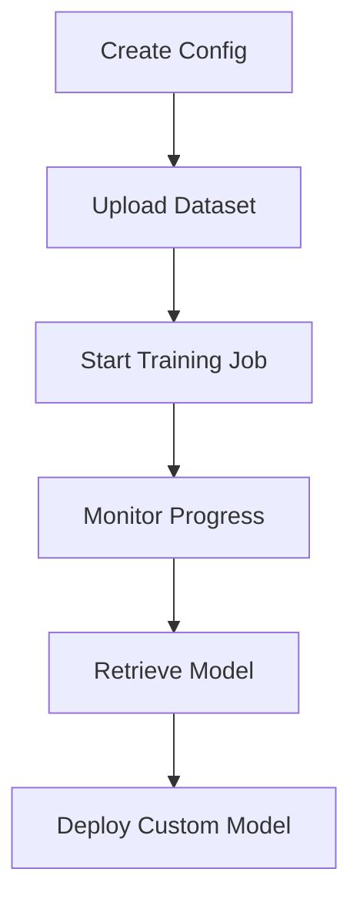

# NeMo Platform Integration Deep Dive

Learn how to leverage advanced NeMo Microservices Platform capabilities for model customization, evaluation, and deployment within the Data Flywheel Blueprint.

## NeMo Services Integration Overview

The Data Flywheel Blueprint integrates with five core NeMo services:

- **NeMo Customizer**: Fine-tuning and model adaptation
- **NeMo Evaluator**: Comprehensive model evaluation  
- **NeMo Deployment Manager (DMS)**: Model deployment and serving
- **NeMo Data Service**: Dataset management and storage
- **NeMo Embedding Service**: Text embedding generation and similarity operations

### Service Configuration

**Note**: The default `config/config.yaml` contains development/test URLs. For production deployment, update with your actual service endpoints.

**Development Configuration** (`config/config.yaml:1-10`):
```yaml
nmp_config:
  nemo_base_url: "http://nemo.test"     # Development endpoint
  nim_base_url: "http://nim.test"       # Development endpoint
  datastore_base_url: "http://data-store.test"  # Development endpoint
  nmp_namespace: "dfwbp"
```

**Production Configuration Example**:
```yaml
nmp_config:
  nemo_base_url: "http://nemo-service.your-cluster"
  nim_base_url: "http://nim-service.your-cluster"  
  datastore_base_url: "http://data-store.your-cluster"
  nmp_namespace: "your-namespace"
```

## NeMo Customizer Integration

**Source**: `src/lib/nemo/customizer.py:1-441`

The Customizer service enables fine-tuning of foundation models using your production data with parameter-efficient techniques like LoRA.

### Customization Workflow



### Configuration Management

**Creating Customizer Configurations**:
```python
def create_customizer_config(
    self,
    base_model: str,
    customizer_config: CustomizerConfig,
    training_config: TrainingConfig,
) -> str:
    """Creates a reusable customization configuration."""
    
    config_name = NIMConfig.generate_config_name(base_model)
    
    config_payload = {
        "name": config_name,
        "namespace": self.namespace,
        "target": target,  # Retrieved from _manage_target() method
        "training_options": [{
            "training_type": training_config.training_type,
            "finetuning_type": training_config.finetuning_type,
            "num_gpus": customizer_config.gpus,
            "num_nodes": customizer_config.num_nodes,
            "tensor_parallel_size": training_config.tensor_parallel_size,
            "data_parallel_size": training_config.data_parallel_size,
            "use_sequence_parallel": training_config.use_sequence_parallel,
            "micro_batch_size": training_config.micro_batch_size,
        }],
        "training_precision": training_config.training_precision,
        "max_seq_length": customizer_config.max_seq_length,
    }
```

### Training Job Management

**Starting Training Jobs**:
```python
def start_training_job(
    self,
    name: str,
    base_model: str,
    output_model_name: str,
    dataset_name: str,
    training_config: TrainingConfig,
    nim_config: NIMConfig,
) -> tuple[str, str]:
    """Initiates a fine-tuning job and returns job_id and config_name."""
    
    # Create or get the config name
    config_name = self.create_customizer_config(base_model, nim_config.customizer_configs, training_config)
    
    training_params = {
        "name": name,
        "output_model": f"{self.namespace}/{output_model_name}",
        "config": f"{self.namespace}/{config_name}",
        "dataset": {"name": dataset_name, "namespace": self.namespace},
        "hyperparameters": {
            "training_type": training_config.training_type,
            "finetuning_type": training_config.finetuning_type,
            "epochs": training_config.epochs,
            "batch_size": training_config.batch_size,
            "learning_rate": training_config.learning_rate,
            "lora": {
                "adapter_dim": training_config.lora.adapter_dim,
                "adapter_dropout": training_config.lora.adapter_dropout,
            },
        },
    }
```

## NeMo Evaluator Integration

**Source**: `src/lib/nemo/evaluator.py:1-500`

The Evaluator service provides comprehensive model assessment capabilities with multiple evaluation types and metrics.

### Evaluation Configuration

**LLM-as-Judge Setup**:
```python
class Evaluator:
    def __init__(
        self,
        judge_model_config: Any | None = None,
        include_tools: bool = False,
        include_tool_choice: bool = False,
        include_nvext: bool = False,
    ):
        """Initialize evaluator with judge model configuration."""
        self.nemo_url = settings.nmp_config.nemo_base_url
        assert self.nemo_url, "nemo_base_url must be set in config"
        self.namespace = settings.nmp_config.nmp_namespace
```

### Evaluation Types Implementation

#### 1. **Accuracy Evaluation (LLM-as-Judge)**

**Judge Prompt System**:
```python
JUDGE_SYSTEM_PROMPT = """You are an expert evaluator.
Read the task, reference answer, and candidate answer.
Score similarity on a scale of 1 to 10 using this rubric:

10 - Nearly identical meaning; wording differences only.
8-9 - Same key info, maybe one minor detail off.
6-7 - Rough overlap but missing or altering several points.
4-5 - Some relation but wrong on most core content.
2-3 - Largely irrelevant or incorrect.
1 - Completely irrelevant or empty.

Return ONLY the integer (1-10). No other text."""
```

#### 2. **Tool Calling Evaluation**

**Function Call Validation**:
```python
TOOL_CALLING_JUDGE_SYSTEM_PROMPT = """
You are an expert evaluator. Your task is to compare two tool call objects: a ground truth and a prediction. Each object contains metadata about a function call, including the function name and its arguments. Your goal is to determine whether the predicted tool call is correct according to the following strict criteria:

Evaluation Rules:

1. If the prediction is null, empty, or structurally invalid, return a rating of 0.
2. The prediction must include a valid `function.name` field that exactly matches the `function.name` in the ground truth.
3. The prediction must include a `function.arguments` field containing a valid JSON object, or a string that can be parsed into one.
4. Each argument key in the ground truth must also appear in the prediction and satisfy one of the following matching criteria:
   - **Strict-match arguments**: These are typically short identifiers (e.g., user_id, product_id). They must match the ground truth exactly.
   - **Semantic-match arguments**: These are typically longer, natural-language strings (e.g., queries, messages, questions). They should be semantically similar to the ground truth but may differ in wording.
5. If any required argument is missing or fails to meet its matching criteria, the rating must be 0.
6. Only return a rating of 1 if:
   - The function name matches exactly, AND
   - All required arguments are present and correctly matched (strict or semantic as appropriate).

Assume you're familiar with typical tool function usage patterns and can infer which argument types require exact matching versus semantic similarity.

Return your result in the following format:

RATING: 0 or 1
EXPLANATION: Explanation of the rating.
"""
```

### Evaluation Execution Patterns

**Required Imports**:
```python
from src.lib.nemo.evaluator import Evaluator
from src.api.models import WorkloadClassification, ToolEvalType
```

**Parallel Evaluation Strategy**:
```python
def run_comprehensive_evaluation(nim_config: dict, datasets: dict, workload_type: WorkloadClassification) -> list:
    """Run multiple evaluation types in parallel."""
    
    # Initialize evaluator with judge model config
    evaluator = Evaluator(judge_model_config=judge_config)
    eval_job_ids = []
    
    # Base accuracy evaluation
    job_id = evaluator.run_evaluation(
        dataset_name=datasets["base"],
        workload_type=workload_type,
        target_model=nim_config["model_name"],
        test_file="eval_data.jsonl"
    )
    eval_job_ids.append(job_id)
    
    # ICL evaluation with examples  
    job_id = evaluator.run_evaluation(
        dataset_name=datasets["icl"],
        workload_type=workload_type,
        target_model=nim_config["model_name"],
        test_file="eval_data.jsonl"
    )
    eval_job_ids.append(job_id)
    
    # Tool calling evaluation (if applicable)
    if workload_type == WorkloadClassification.TOOL_CALLING:
        job_id = evaluator.run_evaluation(
            dataset_name=datasets["base"],
            workload_type=workload_type,
            target_model=nim_config["model_name"],
            test_file="eval_data.jsonl",
            tool_eval_type=ToolEvalType.TOOL_CALLING_METRIC
        )
        eval_job_ids.append(job_id)
    
    return eval_job_ids
```

### LLM-as-Judge Service Integration

**Source**: `src/lib/nemo/llm_as_judge.py:1-99`

The LLM-as-Judge service provides automated evaluation capabilities using large language models as evaluators.

**Judge Service Initialization**:
```python
from src.lib.nemo.llm_as_judge import LLMAsJudge

judge = LLMAsJudge()
# Uses settings.llm_judge_config for configuration
```

## NeMo Deployment Manager (DMS) Integration

**Source**: `src/lib/nemo/dms_client.py:1-179`

The DMS client manages NVIDIA Inference Microservice (NIM) deployments for serving models.

### NIM Deployment Configuration

**Standard Deployment**:
```python
def deploy_model(self) -> dict[str, Any] | None:
    """Deploy a model using the DMS API."""
    
    url = f"{self.nmp_config.nemo_base_url}/v1/deployment/model-deployments"
    
    payload = self.nim.to_dms_config()
    response = requests.post(url, json=payload)
    
    # Bug in DMS API, if the model deployment already exists, it will return a 500
    if "model deployment already exists" in response.text:
        return
    else:
        response.raise_for_status()
        return response.json()
```

### Advanced Deployment Patterns

**Multi-Model Serving**:
```yaml
nims:
  - model_name: "meta/llama-3.2-1b-instruct"
    model_type: "llm"
    context_length: 8192
    gpus: 1
    pvc_size: 25Gi
    tag: "1.8.3"
    customization_enabled: true
    customizer_configs:
      target: "meta/llama-3.2-1b-instruct@2.0"
      gpus: 1
      max_seq_length: 8192
    
  # - model_name: "meta/llama-3.2-3b-instruct"  
  #   model_type: "llm"
  #   context_length: 8192
  #   gpus: 2
  #   customization_enabled: true
```

**Deployment Status Checking**:
```python
def get_deployment_status(self) -> str:
    """Get the status of a model deployment."""
    
    response = self._call_deployment_endpoint()
    response.raise_for_status()
    return response.json()["status_details"]["status"]

def is_deployed(self) -> bool:
    """Check if a model is deployed."""
    try:
        return self.get_deployment_status() == "deployed"  # Note: wait_for_deployment checks for "ready"
    except Exception:
        return False
```

### Deployment Lifecycle Management

**Health Checking**:
```python
def wait_for_deployment(
    self,
    flywheel_run_id: str,
    progress_callback: Callable[[str], None] | None = None,
    timeout: int = 3600,
):
    """Wait for a deployment to complete.

    Args:
        flywheel_run_id: Unique identifier for the flywheel run
        progress_callback: Optional callback function to report progress.
        timeout: Maximum time to wait in seconds (default: 3600)
    """
    
    start_time = time.time()
    while time.time() - start_time < timeout:
        check_cancellation(flywheel_run_id)
        
        status = self.get_deployment_status()
        
        if status == "ready":
            return status
        elif status == "failed":
            raise Exception("Deployment failed")
            
        time.sleep(30)
```

## NeMo Data Service Integration

**Source**: `src/lib/nemo/data_uploader.py:1-346`

The Data Service manages datasets for training and evaluation workflows.

### Dataset Upload Patterns

**Structured Data Upload**:
```python
def upload_file(
    self,
    data_fp: str,
    data_type: str,
) -> str:
    """Upload a single data file to the repository."""
    
    # Validate data type
    valid_types = ["training", "validation", "testing"]
    assert data_type in valid_types, f"data_type must be one of {valid_types}"
    
    # Validate file exists
    assert os.path.exists(data_fp), f"Data file at '{data_fp}' does not exist"
    
    # Create namespaces if not already done
    if not hasattr(self, "repo_id"):
        self._create_namespaces()
        self.repo_id = self._create_repo()
    
    # Determine filename in repo
    filename = os.path.basename(data_fp)
```

### Dataset Validation and Quality Control

**OpenAI Format Validation**:
```python
from src.lib.integration.openai_format_validator import OpenAIFormatValidator

def validate_records(conversation: dict) -> bool:
    """Validate OpenAI chat completion format."""
    validator = OpenAIFormatValidator()
    return validator.validate_chat_completion_format(conversation)
```

## Integration Best Practices

> **Note**: The following sections contain example implementations and patterns for advanced NeMo integration. These are illustrative code samples that demonstrate best practices rather than functions available in the current codebase.

### Error Handling and Resilience

**Retry Logic with Exponential Backoff** *(Example Implementation)*:
```python
def resilient_nemo_request(func, max_retries=3):
    """Execute NeMo API calls with retry logic."""
    
    for attempt in range(max_retries):
        try:
            return func()
        except requests.exceptions.ConnectionError:
            if attempt == max_retries - 1:
                raise
            delay = (2 ** attempt) + random.uniform(0, 1)
            time.sleep(min(delay, 30))
        except requests.exceptions.HTTPError as e:
            if e.response.status_code in [429, 503]:  # Rate limit or service unavailable
                time.sleep(60 * (attempt + 1))
            else:
                raise
```

## Troubleshooting NeMo Issues

### Common Integration Problems

#### 1. **Service Connectivity Issues**

**Symptoms**: Timeouts or connection refused errors
**Solution**:
```bash
# Test service connectivity
curl -v "http://nemo-service/v1/health"

# Check Kubernetes service discovery
kubectl get svc -n nemo-namespace

# Verify network policies
kubectl describe networkpolicy -n nemo-namespace
```

#### 2. **Authentication Failures**

**Symptoms**: 401/403 HTTP errors
**Solution**:
```bash
# Verify NGC API key
echo $NGC_API_KEY | base64 -d

# Check Kubernetes secrets
kubectl get secret ngc-api -o yaml

# Test authentication manually
curl -H "Authorization: Bearer $NGC_API_KEY" "http://nemo-service/v1/models"
```

#### 3. **Resource Allocation Problems**

**Symptoms**: Training jobs fail with OOM or insufficient GPU errors
**Solution**:
```bash
# Check GPU availability
nvidia-smi

# Monitor Kubernetes resource usage
kubectl top nodes
kubectl describe node <node-name>

# Adjust resource requests
kubectl patch deployment <deployment> -p '{"spec":{"template":{"spec":{"containers":[{"name":"<container>","resources":{"requests":{"nvidia.com/gpu":"2"}}}]}}}}'
```

### Performance Optimization Strategies

#### 1. **Training Optimization**

```python
# Optimize training parameters for speed vs. quality
training_config = {
    "micro_batch_size": 8,      # Larger batches for better GPU utilization
    "batch_size": 16,           # Training batch size
    "learning_rate": 3e-4,      # Aggressive learning rate
    "epochs": 3,                # Fewer epochs for faster iteration
    "training_type": "sft",     # Supervised fine-tuning
    "finetuning_type": "lora",  # LoRA fine-tuning
}
```

#### 2. **Evaluation Optimization**

```python
# Batch evaluation requests for efficiency (Example Implementation)
def batch_evaluation_requests(items: list, batch_size: int = 32):
    """Process evaluation requests in batches."""
    
    for i in range(0, len(items), batch_size):
        batch = items[i:i + batch_size]
        yield run_evaluation_batch(batch)
```

## NeMo Embedding Service Integration

**Source**: `src/lib/nemo/embedding.py:1-94`

The Embedding service provides text embedding generation capabilities for semantic similarity ICL example selection.

**Embedding Service Usage**:
```python
from src.lib.nemo.embedding import Embedding

# Initialize embedding service
embedding_service = Embedding(
    endpoint_url="http://nim.test/v1/embeddings",  # Uses nim_base_url from config
    model_name="nvidia/llama-3.2-nv-embedqa-1b-v2",
    api_key=None  # Optional API key for remote endpoint
)

# Get embeddings for single text or batch
embeddings = embedding_service.get_embedding("Your text here", input_type="query")
batch_embeddings = embedding_service.get_embeddings_batch(
    ["text1", "text2", "text3"], 
    input_type="passage",
    batch_size=32
)
```

This comprehensive integration guide enables advanced usage of NeMo services within the Data Flywheel Blueprint. For basic configuration, refer to the [Configuration Guide](./02-configuration.md). 