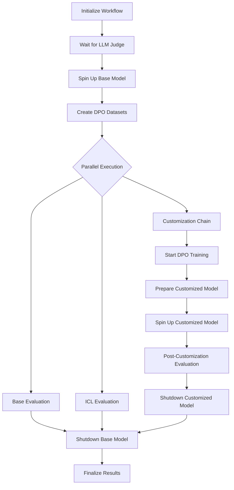

# DPO Training Guide

Learn how to use Direct Preference Optimization (DPO) training with the Data Flywheel Blueprint. DPO is a preference-based fine-tuning technique that trains models using preference pairs to align model behavior with human preferences without requiring a separate reward model.

- [DPO Training Guide](#dpo-training-guide)
  - [What is DPO?](#what-is-dpo)
  - [When to Use DPO](#when-to-use-dpo)
  - [DPO vs Standard Fine-Tuning](#dpo-vs-standard-fine-tuning)
  - [DPO Pipeline Workflow](#dpo-pipeline-workflow)
  - [Prerequisites](#prerequisites)
  - [DPO Data Format](#dpo-data-format)
    - [Required Fields](#required-fields)
    - [Data Format Example](#data-format-example)
    - [Creating DPO Datasets](#creating-dpo-datasets)
  - [Configuration](#configuration)
    - [Training Configuration for DPO](#training-configuration-for-dpo)
    - [DPO Hyperparameters](#dpo-hyperparameters)
  - [Loading DPO Data](#loading-dpo-data)
    - [Getting DPO Data](#getting-dpo-data)
    - [Data Loader Options](#data-loader-options)
  - [Running DPO Jobs](#running-dpo-jobs)
    - [Basic DPO Job](#basic-dpo-job)
    - [Running DPO with Different Configurations](#running-dpo-with-different-configurations)
  - [DPO Evaluation](#dpo-evaluation)
    - [Evaluation Metrics](#evaluation-metrics)
    - [In-Context Learning (ICL) for DPO](#in-context-learning-icl-for-dpo)
  - [Best Practices](#best-practices)
    - [Data Quality](#data-quality)
    - [Hyperparameter Tuning](#hyperparameter-tuning)
  - [Troubleshooting](#troubleshooting)
  - [Examples](#examples)
    - [Example 1: Basic DPO Training with CLI](#example-1-basic-dpo-training-with-cli)
    - [Example 2: DPO with Custom Hyperparameters](#example-2-dpo-with-custom-hyperparameters)
  - [Additional Resources](#additional-resources)

## What is DPO?

Direct Preference Optimization (DPO) is a training method that directly optimizes language models to align with human preferences without requiring a separate reward model. Instead of traditional supervised fine-tuning on single responses, DPO trains models using pairs of responses:
- **Chosen response**: The preferred or better response
- **Rejected response**: The less preferred or worse response

The model learns to increase the likelihood of generating chosen responses while decreasing the likelihood of rejected responses.

## When to Use DPO

Use DPO training when you have:

1. **Preference Data**: Pairs of responses where one is clearly better than the other.
2. **Alignment Goals**: Need to align model behavior with specific quality standards.
3. **Comparative Feedback**: Multiple responses to the same prompt with quality rankings.
4. **Human Feedback**: Annotated data from human evaluators comparing response quality.

**Common Use Cases:**
- Customer service chatbots (professional compared to unprofessional responses)
- Code generation (correct vs buggy implementations)
- Content moderation (safe vs unsafe responses)
- Creative writing (engaging vs bland text)

## DPO vs Standard Fine-Tuning

| Aspect | Standard SFT | DPO |
|--------|-------------|-----|
| **Data Format** | Single response per prompt | Preference pairs (chosen + rejected) |
| **Training Goal** | Maximize likelihood of target response | Maximize preference gap between responses |
| **Use Case** | Task-specific behavior | Alignment with preferences |
| **Evaluation** | Similarity to expected output (1-5) | Preference alignment (1-10) |
| **Data Requirements** | Labeled examples | Comparative judgments |

## DPO Pipeline Workflow

Understanding the complete workflow helps you plan your DPO training process and anticipate resource requirements.



**Pipeline Stages Explained:**

1. **Initialize Workflow**: Set up job parameters and validate configuration
2. **Wait for LLM Judge**: Ensure the judge model is ready for evaluation
3. **Spin Up Base Model**: Deploy the base model for evaluation
4. **Create DPO Datasets**: Format preference pairs for training and evaluation
5. **Parallel Execution**: Run three evaluation paths simultaneously:
   - **Base Evaluation**: Test untrained model performance
   - **ICL Evaluation**: Test with in-context learning examples
   - **Customization Chain**: Execute DPO training and post-training evaluation
6. **Finalize Results**: Aggregate metrics and shut down resources

**Key Differences from Standard Pipeline:**
- **Dataset Creation**: Uses `DPODatasetCreator` to format preference pairs
- **Customized Model Management**: Explicitly spins up and shuts down the fine-tuned model
- **Evaluation**: Uses DPO-specific judge prompt with 1-10 scoring scale for preference alignment

## Prerequisites

Before starting with DPO training:

1. **System Requirements**: Same as standard LLM jobs (see [System Requirements](02-configuration.md#system-requirements))
2. **NMP Deployment**: NeMo Microservices Platform deployed and running
3. **Model Support**: Base model must support customization (see [Model Customization](02-configuration.md#model-customization))
4. **DPO Dataset**: Preference pairs in the correct format

## DPO Data Format

DPO training requires a specific data format with preference pairs.

### Required Fields

Each record must contain:

| Field | Type | Description |
|-------|------|-------------|
| `prompt` | String or Array of messages | User prompt as a string or in conversation format (array of message objects) |
| `chosen_response` | String | The preferred/better response |
| `rejected_response` | String | The less preferred/worse response |
| `workload_id` | String | Identifier for the workload (optional if provided in job config) |
| `client_id` | String | Client identifier (optional if provided in job config) |

### Data Format Example

**Simple String Format (Recommended for Single-Turn):**

```json
{
  "prompt": "What is Python?",
  "chosen_response": "Python is a high-level, interpreted programming language known for its readability, simplicity, and versatility. It supports multiple programming paradigms and has a comprehensive standard library.",
  "rejected_response": "Python is a snake.",
  "workload_id": "coding-assistant",
  "client_id": "company-1"
}
```

**List of Messages Format:**

```json
{
  "prompt": [
    {"role": "user", "content": "What is Python?"}
  ],
  "chosen_response": "Python is a high-level, interpreted programming language known for its readability, simplicity, and versatility. It supports multiple programming paradigms and has a comprehensive standard library.",
  "rejected_response": "Python is a snake.",
  "workload_id": "coding-assistant",
  "client_id": "company-1"
}
```

**Multi-turn Conversation Example:**

```json
{
  "prompt": [
    {"role": "system", "content": "You are a helpful coding assistant."},
    {"role": "user", "content": "How do I sort a list in Python?"}
  ],
  "chosen_response": "You can sort a list in Python using the `sort()` method (in-place) or `sorted()` function (returns new list):\n\n```python\n# In-place sorting\nmy_list = [3, 1, 2]\nmy_list.sort()\nprint(my_list)  # [1, 2, 3]\n\n# Returns new sorted list\nmy_list = [3, 1, 2]\nsorted_list = sorted(my_list)\nprint(sorted_list)  # [1, 2, 3]\n```",
  "rejected_response": "Just use sort().",
  "workload_id": "coding-assistant",
  "client_id": "company-1"
}
```

### Creating DPO Datasets

**Tips for creating quality DPO datasets:**

1. **Clear Preference Gap**: Ensure chosen responses are meaningfully better than rejected ones.
2. **Diverse Examples**: Include various prompt types and response qualities.
3. **Consistent Criteria**: Use consistent quality standards across all preference pairs.
4. **Sufficient Data**: Aim for at least 500-1000 preference pairs for meaningful training.
5. **Balanced Representation**: Cover all important use cases in your domain.

## Configuration

To use DPO training, you need to configure the training parameters in your job configuration.

### Training Configuration for DPO

In `config/config.yaml`, under `llm_job_config`, replace the standard `training_config` with DPO-specific settings:

```yaml
llm_job_config:
  # ... (nims, data_split_config, icl_config remain the same)
  
  # DPO Training configuration
  training_config:
    training_type: "dpo"  # Set to "dpo" for Direct Preference Optimization
    finetuning_type: "all_weights"  # DPO typically uses all weights fine-tuning
    epochs: 3
    batch_size: 64
    learning_rate: 0.00005
    micro_batch_size: 1
    tensor_parallel_size: 1
    pipeline_parallel_size: 1
    data_parallel_size: 1
    training_precision: "bf16-mixed"
    
    # DPO-specific hyperparameters
    dpo:
      ref_policy_kl_penalty: 0.1
      preference_loss_weight: 1.0
      preference_average_log_probs: false
      sft_loss_weight: 0.0
      sft_average_log_probs: false
```

### DPO Hyperparameters

The `dpo` section contains DPO-specific hyperparameters:

| Parameter | Description | Default | Range | Notes |
|-----------|-------------|---------|-------|-------|
| `ref_policy_kl_penalty` | KL divergence penalty between policy and reference model | 0.05 | 0.0-1.0 | Controls how much the model can deviate from the reference policy. Higher values keep model closer to base model. |
| `preference_loss_weight` | Weight for the preference loss component | 1.0 | 0.0-10.0 | Higher values emphasize preference learning over other objectives. |
| `preference_average_log_probs` | Average log probabilities for preference loss | false | true/false | When true, normalizes preference loss by sequence length. |
| `sft_loss_weight` | Weight for supervised fine-tuning loss component | 0.0 | 0.0-10.0 | Set to 0 for pure DPO. Increase to mix SFT with DPO (hybrid training). |
| `sft_average_log_probs` | Average log probabilities for SFT loss | false | true/false | When true, normalizes SFT loss by sequence length. |

**Recommended Starting Values:**
- **Pure DPO**: `ref_policy_kl_penalty: 0.05`, `preference_loss_weight: 1.0`, `sft_loss_weight: 0.0`
- **Hybrid DPO+SFT**: `ref_policy_kl_penalty: 0.1`, `preference_loss_weight: 1.0`, `sft_loss_weight: 0.5`

## Loading DPO Data

### Getting DPO Data

You will need DPO preference pair data in the correct format. You can either:

1. **Use Public Datasets**: Download from HuggingFace (for example, [arcee-ai/general-dpo-datasets](https://huggingface.co/datasets/arcee-ai/general-dpo-datasets))
2. **Create Your Own**: Prepare preference pairs from your application logs

**See the [DPO Example Notebook](../notebooks/dpo-dfw-example.ipynb)** for a complete walkthrough of downloading data from HuggingFace and converting it to the required format.

**Disclaimer**: Each user is responsible for checking the content of datasets and the applicable licenses and determining if suitable for the intended use.

### Data Format Requirements

Each record must have:
- `prompt`: String containing the user query (or list of message objects with `role` and `content` fields for multi-turn conversations)
- `chosen_response`: The preferred response (string)
- `rejected_response`: The less preferred response (string)

Example:
```json
{
  "prompt": "What is Python?",
  "chosen_response": "Python is a high-level, interpreted programming language...",
  "rejected_response": "Python is a snake."
}
```

### Loading Data into Elasticsearch

Once you have your DPO data in JSONL format, use the unified data loader:

```bash
# Place your file in the data/ directory for easy access
uv run python src/scripts/load_data.py --type dpo \
  --workload-id my-dpo-workload \
  --client-id my-client \
  --file my_dpo_dataset.jsonl
```

> **💡 Data File Location:** The `--file` parameter accepts relative paths (resolved from `data/` directory) or absolute paths. For example:
> - Relative: `--file my_dpo_dataset.jsonl` → looks for `data/my_dpo_dataset.jsonl`
> - Absolute: `--file /path/to/my_dpo_dataset.jsonl` → uses the exact path provided

**Script Output:**
```
📊 Loading DPO Preference Data...
   Type: Direct Preference Optimization
   File: my_dpo_dataset.jsonl
   Workload ID: my-dpo-workload
   Client ID: my-client

📊 Loaded 1000 records from file

🔄 Processing 1000 DPO records...
Bulk indexing 950 DPO records...
Successfully indexed 950 records

======================================================================
✅ DPO Data Loading Summary
======================================================================
📁 Original file records:     1000
🔄 Records processed:         1000
⏭️  Skipped (validation):      50
✅ Successfully indexed:      950
📍 Index:                     flywheel_dpo_data
🏷️  Workload ID:               my-dpo-workload
======================================================================
```

### Data Loader Options

| Option | Description | Required | Default | Example |
|--------|-------------|----------|---------|---------|
| `--type dpo` | Specifies DPO data type | ✅ Yes | - | `dpo` |
| `--workload-id` | Workload identifier | ✅ Yes | - | `coding-assistant` |
| `--client-id` | Client identifier | ⭐ Recommended | - | `company-1` |
| `--file` | Path to JSONL file with DPO data | ✅ Yes | - | `data/dpo_data.jsonl` |
| `--limit` | Limit on number of records to load | Optional | Unlimited | `500` |

> **Note:** The `--workload-id` parameter is **required** and enforced at runtime for DPO data. The CLI `--workload-id` takes precedence and will be applied to **all records**, overriding any per-record `workload_id` values in your data file.

> **💡 About --limit:** By default, all records in your file are loaded. Use `--limit` to load only the first N records for testing or when working with large datasets. The loader will report original count, processed count, and truncation details.

**Example with limit:**

```bash
# Load only the first 500 records
uv run python src/scripts/load_data.py --type dpo \
  --workload-id my-dpo-workload \
  --client-id my-client \
  --file my_dpo_dataset.jsonl \
  --limit 500
```

**Getting Help:**

```bash
# See usage examples for all data types
uv run python src/scripts/load_data.py --examples

# View help
uv run python src/scripts/load_data.py --help
```

## Running DPO Jobs

Once your DPO data is loaded and configuration is set, you can run DPO training jobs.

### Basic DPO Job

```bash
curl -X POST http://localhost:8000/api/jobs \
  -H "Content-Type: application/json" \
  -d '{
    "workload_id": "my-dpo-workload",
    "client_id": "my-client",
    "job_type": "llm_job"
  }'
```

> **Note**: The system automatically detects DPO training based on the `training_type: "dpo"` in your configuration.

**Save the job ID for subsequent API requests:**

```bash
# Copy the 'id' from the response above and export it
export job_id="your-job-id-here"
```

### Monitoring Job Status

Check the status of your DPO job:

```bash
curl -X GET http://localhost:8000/api/jobs/${job_id} \
  -H "Content-Type: application/json"
```

### Cancel Running Job

If you need to stop a DPO job that's currently running, you can cancel it:

```bash
curl -X POST http://localhost:8000/api/jobs/${job_id}/cancel
```

> **Note:** Only jobs that have not finished can be cancelled. Cancelled jobs will stop all active tasks and mark the job status as `cancelled`. This is useful when:
> - You notice configuration errors early in the job
> - You need to free up resources for a higher-priority job
> - Training metrics indicate the job is not converging properly

### Delete Job

After a DPO job is complete or cancelled, you can delete it to clean up resources:

```bash
curl -X DELETE http://localhost:8000/api/jobs/${job_id}
```

> **⚠️ Important:** Running jobs must be cancelled first before they can be deleted. The delete operation removes the job and all associated resources, including:
> - **Customized models** from NeMo Microservices Platform
> - **Evaluation jobs** and results from the evaluation service
> - **Training datasets** uploaded to NMP
> - **MLflow experiments** and tracking data (if MLflow is enabled)
> - **MongoDB records** (job metadata, NIMs, evaluations, customizations, LLM judge runs)

**Best Practice:** Delete completed jobs periodically to free up storage and keep your system organized. The deletion process runs in the background and cleans up resources across multiple services.

### Running DPO with Different Configurations

You can create custom DPO configurations using the Configuration API and reference them when running jobs.

**Method 1: Use Default Configuration**

Run DPO job with the default `llm_job_config` (make sure it has `training_type: "dpo"` in `config.yaml`):

```bash
curl -X POST http://localhost:8000/api/jobs \
  -H "Content-Type: application/json" \
  -d '{
    "workload_id": "my-dpo-workload",
    "client_id": "my-client",
    "job_type": "llm_job"
  }'
```

**Method 2: Create Custom Configuration via API**

You can create custom DPO configurations using JSON files or inline JSON.

**Using a JSON File:**

The repository includes an example DPO configuration file at `config/dpo_config_example.json`:

```bash
# Create configuration from JSON file
curl -X POST http://localhost:8000/api/configs \
  -H "Content-Type: application/json" \
  -d @config/dpo_config_example.json
```

**Using Inline JSON:**

**1. Create a new DPO configuration:**

```bash
curl -X POST http://localhost:8000/api/configs \
  -H "Content-Type: application/json" \
  -d '{
    "name": "dpo_aggressive",
    "description": "Aggressive DPO training configuration",
    "config_type": "llm_job",
    "config_data": {
      "nims": [
        {
          "model_name": "meta/llama-3.2-1b-instruct",
          "model_type": "llm",
          "context_length": 8192,
          "gpus": 1,
          "pvc_size": "25Gi",
          "tag": "1.8.3",
          "customization_enabled": true,
          "customizer_configs": {
            "target": "meta/llama-3.2-1b-instruct@2.0",
            "gpus": 1,
            "max_seq_length": 4096
          }
        }
      ],
      "data_split_config": {
        "eval_size": 100,
        "val_ratio": 0.1,
        "min_total_records": 50,
        "limit": 1000
      },
      "icl_config": {
        "max_context_length": 8192,
        "reserved_tokens": 2048,
        "max_examples": 2,
        "min_examples": 1,
        "example_selection": "uniform_distribution"
      },
      "training_config": {
        "training_type": "dpo",
        "finetuning_type": "all_weights",
        "epochs": 5,
        "batch_size": 64,
        "learning_rate": 0.00005,
        "micro_batch_size": 1,
        "tensor_parallel_size": 1,
        "pipeline_parallel_size": 1,
        "data_parallel_size": 1,
        "training_precision": "bf16-mixed",
        "dpo": {
          "ref_policy_kl_penalty": 0.1,
          "preference_loss_weight": 1.5,
          "preference_average_log_probs": false,
          "sft_loss_weight": 0.0,
          "sft_average_log_probs": false
        }
      }
    }
  }'
```

**2. Run job with your custom configuration:**

```bash
curl -X POST http://localhost:8000/api/jobs \
  -H "Content-Type: application/json" \
  -d '{
    "workload_id": "my-dpo-workload",
    "client_id": "my-client",
    "job_type": "llm_job",
    "config_name": "dpo_aggressive"
  }'
```

**3. List all configurations:**

```bash
curl -X GET http://localhost:8000/api/configs
```

**4. Get a specific configuration:**

```bash
curl -X GET http://localhost:8000/api/configs/dpo_aggressive
```

**5. Delete a configuration:**

```bash
curl -X DELETE http://localhost:8000/api/configs/dpo_aggressive
```

> **Note**: Use the Configuration API to create, update, and manage different DPO configurations dynamically. Reference them by name when starting jobs using the `config_name` parameter.

## DPO Evaluation

DPO evaluation uses a specialized judge prompt that compares the model's response to both the chosen and rejected responses.

### Evaluation Metrics

DPO jobs track the following metrics:

| Metric | Description | Scale | Interpretation |
|--------|-------------|-------|----------------|
| `preference_score` | Alignment with preferred responses | 1-10 | Higher is better. 10 = excellent alignment, 1 = poor alignment |
| **Base Evaluation** | Score before DPO training | 1-10 | Baseline preference alignment |
| **ICL Evaluation** | Score with in-context examples | 1-10 | Impact of few-shot learning |
| **Customized Evaluation** | Score after DPO training | 1-10 | Impact of DPO fine-tuning |

**Score Interpretation:**
- **10**: Model response matches or exceeds the quality of the chosen response
- **7-9**: Model response aligns well with the chosen response
- **4-6**: Model response is acceptable, some alignment with chosen response
- **1-3**: Model response is poor, more similar to rejected response

### In-Context Learning (ICL) for DPO

DPO supports ICL evaluation where examples are formatted as preference pairs:

**ICL Example Format:**
```
System: You will be given examples showing preferred vs less preferred responses.

Example 1:
Prompt: What is Python?
✓ PREFERRED Response: Python is a high-level programming language...
✗ LESS PREFERRED Response: Python is a snake.

Example 2:
Prompt: Explain recursion
✓ PREFERRED Response: Recursion is when a function calls itself...
✗ LESS PREFERRED Response: It's when something repeats.

[Actual evaluation prompt]
```

## Best Practices

### Data Quality

1. **Clear Preferences**: Ensure obvious quality differences between chosen and rejected responses
2. **Diverse Examples**: Cover various scenarios and edge cases
3. **Consistent Standards**: Apply the same evaluation criteria across all pairs
4. **Avoid Bias**: Balance different types of improvements (accuracy, helpfulness, safety)

### Hyperparameter Tuning

**Start with these recommended settings:**
```yaml
training_config:
  epochs: 2
  batch_size: 64
  learning_rate: 0.00005
  micro_batch_size: 1
  tensor_parallel_size: 1
  pipeline_parallel_size: 1
  data_parallel_size: 1
  training_precision: "bf16-mixed"
  dpo:
    ref_policy_kl_penalty: 0.1
    preference_loss_weight: 1.0
    preference_average_log_probs: false
    sft_loss_weight: 0.0
    sft_average_log_probs: false
```

**Then iterate based on results:**
- **Model diverging too much**: Increase `ref_policy_kl_penalty` (0.2-0.5)
- **Not learning preferences**: Increase `preference_loss_weight` (1.5-2.0)
- **Need base task retention**: Add `sft_loss_weight` (0.3-0.5)


## Troubleshooting

| Issue | Possible Cause | Solution |
|-------|---------------|----------|
| **Low preference scores** | Model not learning distinctions | Increase `preference_loss_weight`, check data quality |
| **Model outputs degraded** | Too much deviation from base model | Increase `ref_policy_kl_penalty` |
| **Training unstable** | Learning rate too high | Reduce `learning_rate` to 0.00005 or 0.00001 |
| **"DPO config required" error** | Missing `dpo` section | Add `dpo` hyperparameters to `training_config` |
| **Data loading fails** | Wrong data format | Verify each record has `prompt`, `chosen_response`, `rejected_response` |

## Examples

### Complete Workflow Example

For a complete end-to-end example of DPO training, see the **[DPO Example Notebook](../notebooks/dpo-dfw-example.ipynb)** which demonstrates:
1. Downloading DPO data from HuggingFace
2. Converting to Data Flywheel Blueprint format
3. Loading into Elasticsearch
4. Running a DPO training job
5. Monitoring results

### Example 1: Basic DPO Training with CLI

**1. Prepare data** (`data/helpfulness_dpo.jsonl`):
```json
{"prompt": [{"role": "user", "content": "How do I center a div?"}], "chosen_response": "Use Flexbox:\n```css\n.container { display: flex; justify-content: center; align-items: center; }\n```", "rejected_response": "Use CSS."}
{"prompt": [{"role": "user", "content": "What is Git?"}], "chosen_response": "Git is a distributed version control system for tracking changes in source code during software development.", "rejected_response": "Git is for saving files."}
```

**2. Load data:**

```bash
# Place helpfulness_dpo.jsonl in the data/ directory
uv run python src/scripts/load_data.py --type dpo \
  --workload-id web-dev \
  --client-id acme \
  --file helpfulness_dpo.jsonl
```
**3. Run job:**
```bash
curl -X POST http://localhost:8000/api/jobs \
  -H "Content-Type: application/json" \
  -d '{"workload_id": "web-dev", "client_id": "acme", "job_type": "llm_job"}'
```

### Example 2: DPO with Custom Hyperparameters

**1. Create custom configuration with aggressive preference learning:**

```bash
curl -X POST http://localhost:8000/api/configs \
  -H "Content-Type: application/json" \
  -d '{
    "name": "dpo_high_preference",
    "description": "DPO configuration with high preference learning weight",
    "config_type": "llm_job",
    "config_data": {
      "nims": [
        {
          "model_name": "meta/llama-3.2-1b-instruct",
          "model_type": "llm",
          "context_length": 8192,
          "gpus": 1,
          "pvc_size": "25Gi",
          "tag": "1.8.3",
          "customization_enabled": true,
          "customizer_configs": {
            "target": "meta/llama-3.2-1b-instruct@2.0",
            "gpus": 1,
            "max_seq_length": 4096
          }
        }
      ],
      "data_split_config": {
        "eval_size": 100,
        "val_ratio": 0.1,
        "min_total_records": 50,
        "limit": 1000
      },
      "training_config": {
        "training_type": "dpo",
        "finetuning_type": "all_weights",
        "epochs": 5,
        "batch_size": 64,
        "learning_rate": 0.0001,
        "micro_batch_size": 1,
        "tensor_parallel_size": 1,
        "pipeline_parallel_size": 1,
        "data_parallel_size": 1,
        "training_precision": "bf16-mixed",
        "dpo": {
          "ref_policy_kl_penalty": 0.1,
          "preference_loss_weight": 2.0,
          "preference_average_log_probs": false,
          "sft_loss_weight": 0.0,
          "sft_average_log_probs": false
        }
      }
    }
  }'
```

**2. Run job with custom configuration:**

```bash
curl -X POST http://localhost:8000/api/jobs \
  -H "Content-Type: application/json" \
  -d '{
    "workload_id": "web-dev",
    "client_id": "acme",
    "job_type": "llm_job",
    "config_name": "dpo_high_preference"
  }'
```

## Additional Resources

- **Configuration Reference**: [Configuration Guide](02-configuration.md#fine-tuning-options)
- **API Documentation**: [API Reference](06-api-reference.md)
- **Evaluation Details**: [Evaluation Types and Metrics](05-evaluation-types-and-metrics.md)
- **NeMo Customizer Documentation**: [NeMo Microservices Customization (v26.3.0)](https://docs.nvidia.com/nemo/microservices/26.03.0/about/core-concepts/customization.html)
- **DPO Paper**: [Direct Preference Optimization: Your Language Model is Secretly a Reward Model](https://arxiv.org/abs/2305.18290)

