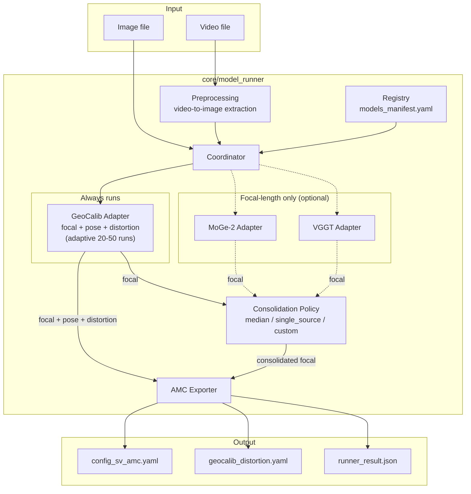

# FL Model Runner

Unified framework for running multiple camera-calibration models (GeoCalib, MoGe-2, VGGT) behind a common adapter interface. Replaces the direct `run_geocalib.py` call in the AMC pipeline, combines focal-length estimates, and exports AMC-compatible artifacts.

**What it solves:**
- **Stable output.** GeoCalib's variance is controlled via adaptive multi-run iteration (20-50 runs with CV-based convergence), producing a representative focal estimate.
- **Easy model integration.** Adding a new model requires one YAML manifest entry and one adapter class. No changes to coordination, CLI, exporter, or pipeline scripts.
- **Side-by-side benchmarking.** All models run on the same input with per-model statistics (mean, median, std, CV) and auto-generated plots.
- **Pipeline isolation.** Models are loaded and unloaded one at a time. A failure in a non-required model does not crash the pipeline. Downstream AMC steps see the same output format regardless of which models ran.

---

## Architecture



Only one model is loaded on GPU at a time. The coordinator unloads the current model before loading the next.

### Key components

**Registry** (`registry.py` + `models_manifest.yaml`) -- Reads the YAML manifest at startup and knows which models are available, where their repos and weights live, and which adapter class to instantiate for each. Adding a new model means adding a manifest entry; the registry picks it up automatically via `importlib`.

**Coordinator** (`coordinator.py`) -- The core engine. Receives a `RunnerRequest`, resolves video-to-image preprocessing, determines which models to run (based on consolidation config or CLI override), then runs each model sequentially: load model onto GPU, infer (with timeout/retry), collect output, unload before loading the next. Manages the one-model-on-GPU-at-a-time policy. After all models run, optionally applies a consolidation policy and builds provenance metadata. 

**Known limitation:** inference timeout uses `signal.SIGALRM` (Unix, main-thread only). This works for CLI and single-process uvicorn but will fail from worker threads. A subprocess-based timeout is needed for threaded server deployments.

**Adapters** (`adapters/`) -- One class per model, all implementing `BaseModelAdapter` with three methods: `validate_environment()`, `load_model()`, `infer()`. Each adapter handles model-specific logic internally (e.g. GeoCalib's adaptive iteration, MoGe's intrinsics extraction, VGGT's principal-point scaling). They return a standardized `AdapterOutput` so the coordinator doesn't care about model internals.

**Consolidation** (`consolidation.py`) -- Pluggable policies that combine focal-length estimates from multiple models into a single value. Also controls which models run (see Configuration section). Called by the coordinator after all adapters finish. When enabled, the selected policy (e.g. `median_of_models`) determines the focal value written to `config_sv_amc.yaml`. Custom policies can be added without touching other code.

**Exporter** (`exporters/amc_exporter.py`) -- Translates the coordinator's `RunnerResult` into the files AMC expects: `config_sv_amc.yaml` (focal range, rotation ranges), distortion YAML, undistorted image, and `runner_result.json`. This is the only component that knows about AMC's file format conventions.

---

## Models

| Model | What it provides | Focal source | Variance |
|-------|-----------------|-------------|----------|
| **GeoCalib** | Focal length, roll/pitch, uncertainty, distortion, undistorted image | Camera calibration with geometric optimization | Shows variance -- stabilized via adaptive multi-run |
| **MoGe-2** | Focal length (from predicted intrinsics matrix) | Monocular geometry estimation | Deterministic |
| **VGGT** | Focal length (from predicted camera matrix) | Visual geometry transformer | Deterministic |

GeoCalib always runs regardless of which other models are enabled, because it is the only model that provides rotation, uncertainty, and distortion needed by AMC downstream.

---

## Setup

A single script reads `models_manifest.yaml` and handles everything: cloning repos, downloading weights, and installing Python dependencies.

```bash
cd auto-magic-calib-dev

# Set up all enabled models
python3 -m core.model_runner.setup.setup_models

# Set up specific models only
python3 -m core.model_runner.setup.setup_models --models geocalib moge

# Skip pip install (e.g. if deps are already installed)
python3 -m core.model_runner.setup.setup_models --skip-deps

# Verbose output
python3 -m core.model_runner.setup.setup_models -v
```

The script is idempotent -- it skips repos that are already cloned and weight files that are already downloaded.

### What the setup script does

For each enabled model in the manifest, in order:

1. `git clone <repo.url> <repo.clone_to>` (skipped if directory exists)
2. For models with `weights.files`: `wget` each URL to `<weights.local_dir>/<name>` (skipped if exists). For models with `pretrained_name` (e.g. MoGe): `huggingface_hub.snapshot_download()` into `<weights.local_dir>/`
3. `pip install -e <repo.clone_to>` or `pip install -r <repo.clone_to>/requirements.txt` (whichever is available)

All paths are relative to the AMC project root (`auto-magic-calib-dev/`).

### Configuration files

| File | Purpose |
|------|---------|
| `models_manifest.yaml` | Declares all models, adapter classes, repo paths, weight paths |
| `runner_config.yaml` | Per-model runtime params (e.g. adaptive GeoCalib iterations) and consolidation policy |

Edit the manifest to mark models as available (`enabled: true/false`) or change paths. The manifest's `enabled` flag determines what is *available*; the consolidation config in `runner_config.yaml` determines what actually *runs* (see below).

Key settings in `runner_config.yaml`:

| Setting | Default | Description |
|---------|---------|-------------|
| `focal_length_search_range` | 30 | +/- range around focal in exported `config_sv_amc.yaml` |
| `consolidation.enabled` | false | Controls both focal consolidation and which models run |
| `consolidation.policy` | `median_of_models` | How to combine focal estimates: `single_source`, `median_of_models`, `weighted_by_confidence`, `trimmed_mean` |

**Model selection** (when no `--models` CLI flag is passed):

| Consolidation setting | Models that run |
|---|---|
| `enabled: false` | GeoCalib only |
| `enabled: true`, `policy: single_source` | GeoCalib + `policy_params.model_id` |
| `enabled: true`, any multi-model policy | All enabled models from manifest |

The `--models` CLI flag overrides this logic entirely (e.g. for benchmarking).

When consolidation is enabled, `focal_length_init` and `focal_length` range in `config_sv_amc.yaml` come from the consolidated value. All other values (rotation, distortion) always come from GeoCalib.

---

## Usage

The CLI takes **one image or one video at a time**. Input is `--image` or `--video` (mutually exclusive). Video is preprocessed into a representative frame automatically.

All commands are run from the project root (`auto-magic-calib-dev/`).

### AMC-compatible run (production use)

Runs models based on consolidation config (or all enabled if overridden via `--models`), exports `config_sv_amc.yaml` + distortion + undistorted image. Already integrated into `launch_AutoMagicCalib.sh` -- no manual steps needed beyond setup.

```bash
# With an image
python3 -m core.model_runner.cli run-amc-compatible \
  --image /path/to/image.jpg \
  --output /path/to/output_dir

# With a video (auto-extracts background frame)
python3 -m core.model_runner.cli run-amc-compatible \
  --video /path/to/video.mp4 \
  --output /path/to/output_dir

# Run only specific models (by model ID from the manifest)
python3 -m core.model_runner.cli run-amc-compatible \
  --image /path/to/image.jpg \
  --output /path/to/output_dir \
  --models geocalib moge

# With a distortion-aware camera model
python3 -m core.model_runner.cli run-amc-compatible \
  --image /path/to/image.jpg \
  --output /path/to/output_dir \
  --camera-model simple_radial

# Pass global AMC config to merge into runner params
python3 -m core.model_runner.cli run-amc-compatible \
  --image /path/to/image.jpg \
  --output /path/to/output_dir \
  --amc-config /path/to/amc_config.yaml

# Save per-model intermediate outputs
python3 -m core.model_runner.cli run-amc-compatible \
  --image /path/to/image.jpg \
  --output /path/to/output_dir \
  --save-per-model
```

Output directory:
```
output_dir/
  config_sv_amc.yaml       # AMC search ranges (focal, rotation, etc.)
  runner_result.json       # per-model focal estimates, consolidation policy/result, pose source
  runner_provenance.json
  runner_input.jpg         # preprocessed frame (when input is video)
  geocalib_distortion.yaml # only with distortion model (simple_radial, etc.)
  geocalib_undistorted.jpg # only with distortion model
```

### Benchmark (repeatability test)

Runs each model N times, writes statistics CSV and report.

```bash
python3 -m core.model_runner.cli benchmark \
  --image /path/to/image.jpg \
  --output /path/to/benchmark_out \
  --n-runs 10 \
  --seed 42

# Benchmark only GeoCalib
python3 -m core.model_runner.cli benchmark \
  --image /path/to/image.jpg \
  --output /path/to/benchmark_out \
  --n-runs 20 \
  --models geocalib
```

Output:
```
benchmark_out/
  geocalib/
  moge/
  vggt/
  benchmark_summary.csv         # per-model, per-run focal + runtime
  benchmark_report.md           # mean/median/std/CV summary
  plot_focal_per_run.png        # focal length over runs (one line per model)
  plot_focal_distribution.png   # box + strip plot per model
  plot_runtime.png              # inference time box plot per model
  plot_focal_summary.png        # bar chart: median focal with std error bars
```

### Python API

```python
from pathlib import Path
from core.model_runner.api import run_amc_compatible, benchmark

# Production run
result = run_amc_compatible(
    image=Path("test.jpg"),
    output_dir=Path("out"),
)

# Benchmark
result = benchmark(
    image=Path("test.jpg"),
    output_dir=Path("bench_out"),
    n_runs=10,
    models=["geocalib", "moge"],
)
```

### CLI reference

**Global args** (apply to both sub-commands):

| Arg | Default | Description |
|-----|---------|-------------|
| `--manifest` | `configs/config_AutoMagicCalib/models_manifest.yaml` | Path to model manifest |
| `--runner-config` | `configs/config_AutoMagicCalib/runner_config.yaml` | Path to runtime config |
| `--project-root` | auto-detected from manifest | AMC project root |
| `--verbose` / `--debug` | off | Debug logging |

**Common args** (per sub-command):

| Arg | Short | Description |
|-----|-------|-------------|
| `--image PATH` | `-i` | Input image (mutually exclusive with --video) |
| `--video PATH` | `-v` | Input video (mutually exclusive with --image) |
| `--output PATH` | `-o` | Output directory (required) |
| `--camera-model` | | `pinhole` (default), `simple_radial`, or `simple_divisional` |
| `--models [IDs...]` | | Subset of model IDs to run; omit to use consolidation-based selection |
| `--save-per-model` | | Save per-model intermediate outputs (off by default) |

**run-amc-compatible** adds: `--amc-config` / `-c` (AMC config YAML), `--rectification_config` (reads camera model from `distortion.model`).

**benchmark** adds: `--n-runs` (default 10), `--seed` (default 42).

---

## Adding a new model

Two steps:

1. **Write an adapter** in `adapters/`:

```python
class NewModelAdapter(BaseModelAdapter):
    def validate_environment(self) -> bool: ...
    def load_model(self, device="cuda") -> None: ...
    def infer(self, inp: AdapterInput) -> AdapterOutput: ...
```

2. **Add a manifest entry** in `models_manifest.yaml`:

```yaml
  new_model:
    enabled: true
    required_for_pose: false
    adapter_class: core.model_runner.adapters.new_model_adapter.NewModelAdapter
    repo:
      url: https://github.com/...
      clone_to: submodules/NewModel
    weights:
      local_dir: models/new_model
      files:
        - name: checkpoint.pt
          url: https://...
    timeout_s: 60
    max_retries: 0
```

No changes to coordination, CLI, or exporter code needed.

---

## Consolidation

The consolidation section in `runner_config.yaml` serves two purposes:

1. **Model selection** -- determines which models run (see table in Configuration section above).
2. **Focal aggregation** -- when multiple models run, combines their focal-length estimates into a single value.

| Policy | Description |
|--------|-------------|
| `single_source` | Use one model's focal directly (specify which via `policy_params.model_id`) |
| `median_of_models` | Median across all models' estimates (default) |
| `trimmed_mean` | Mean after IQR outlier removal |
| `custom` | User-defined logic (implement in `consolidation.py`) |

The consolidated focal is used for `focal_length_init` and `focal_length` search range in the exported `config_sv_amc.yaml`. All other values (rotation, distortion) always come from GeoCalib.

When consolidation is disabled, only GeoCalib runs and its focal is used directly (baseline-compatible behavior).

---

## Package layout

```
core/model_runner/
  run.py                    # entry point for launch scripts
  cli.py                    # CLI: run-amc-compatible, benchmark
  api.py                    # Python API
  schemas.py                # dataclasses (AdapterInput/Output, RunnerRequest/Result)
  coordinator.py            # core engine: model sequencing, timeout/retry
  registry.py               # manifest loader, adapter factory
  preprocessing.py          # video-to-image extraction
  stats.py                  # IQR outlier removal, focal statistics
  consolidation.py          # pluggable focal aggregation policies
  benchmark_viz.py          # plot generation from benchmark CSV
  adapters/
    base.py                 # BaseModelAdapter ABC
    geocalib_adapter.py     # adaptive multi-run, pose + distortion
    moge_adapter.py         # focal from normalized intrinsics
    vggt_adapter.py         # focal from camera matrix with scaling
  exporters/
    amc_exporter.py         # writes AMC-compatible output artifacts
  setup/
    setup_models.py         # manifest-driven repo/weight/dep setup

configs/config_AutoMagicCalib/
  models_manifest.yaml      # model registry (GeoCalib, MoGe-2, VGGT)
  runner_config.yaml        # runtime config + consolidation policy
```
